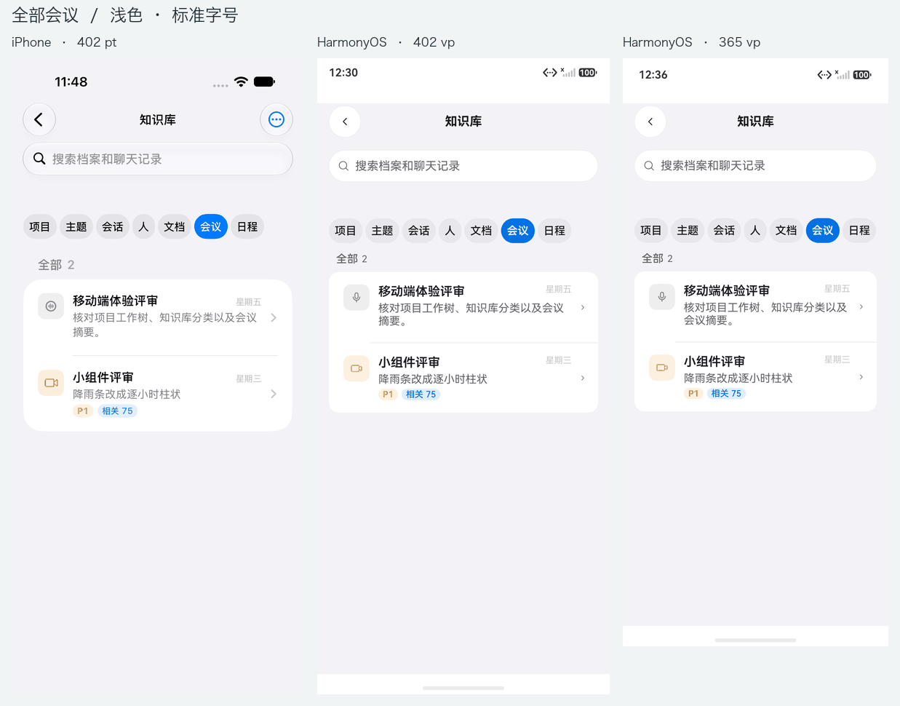
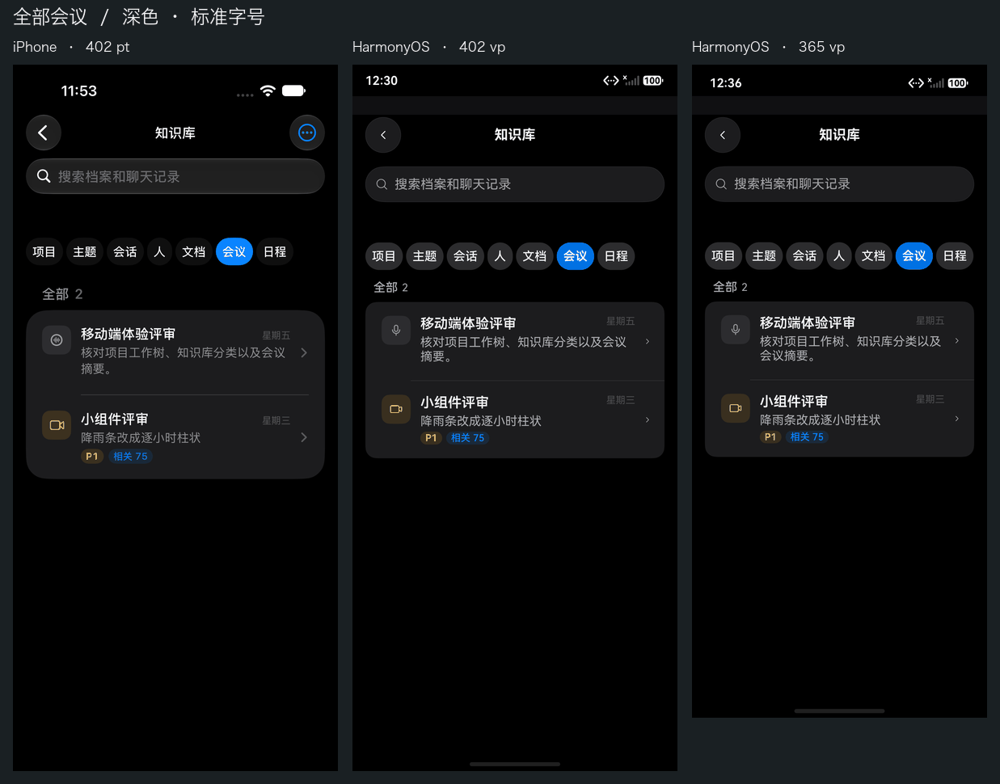
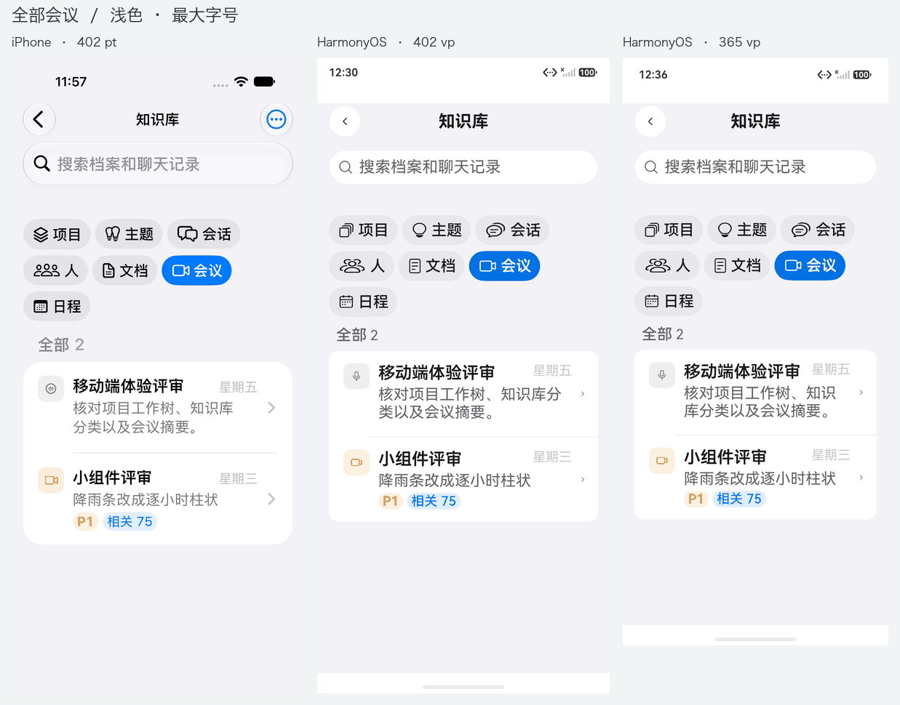

# 全部会议 · All meetings

[返回全部页面 · All pages](../README.md)

打开会议记录列表，找到移动端体验评审。

Three independent native captures, left to right: iPhone 402 pt, HarmonyOS 402 vp, HarmonyOS 365 vp. The complete screen, including system bars, is visible.

[Download all original screenshots and accessibility trees for this page](../originals/meeting-list.zip?raw=1) · [Source and capture method](../SOURCES.md)

Original archive SHA-256: a1b1c78c0c88f7328bc510d6897171febc4fbe469349b9afe232c49a4dc5b5c5

## 浅色 · 标准字号

| Device | Pixels | Captured at | PNG digest | Hierarchy digest |
| --- | --- | --- | --- | --- |
| iPhone 402 pt | 1206 × 2622 | 2026-11-23T03:48:42.938+00:00 | 5f31ec054da05b06 | ed79b9ecb2a41fa3 |
| HarmonyOS 402 vp | 1206 × 2622 | 2026-11-23T12:30:31+08:00 | 2a712698b3c2a9c0 | 6481732e6bdb805e |
| HarmonyOS 365 vp | 1280 × 2832 | 2026-11-23T12:36:27+08:00 | 326800c0f076ca7c | 41a4f5f8b8cea7dc |

## 深色 · 标准字号

| Device | Pixels | Captured at | PNG digest | Hierarchy digest |
| --- | --- | --- | --- | --- |
| iPhone 402 pt | 1206 × 2622 | 2026-11-23T03:53:06.011+00:00 | 7eb36882689a3901 | 63af27a19be6a647 |
| HarmonyOS 402 vp | 1206 × 2622 | 2026-11-23T12:30:35+08:00 | 540019bc8b3df89e | 6481732e6bdb805e |
| HarmonyOS 365 vp | 1280 × 2832 | 2026-11-23T12:36:31+08:00 | c919a2ef81c64b65 | e60c9c19b49e7af5 |

## 浅色 · 最大字号

| Device | Pixels | Captured at | PNG digest | Hierarchy digest |
| --- | --- | --- | --- | --- |
| iPhone 402 pt | 1206 × 2622 | 2026-11-23T03:57:00.970+00:00 | 52b4cae6f63ec416 | c6a6e78a35b83e5a |
| HarmonyOS 402 vp | 1206 × 2622 | 2026-11-23T12:30:39+08:00 | a1c104dcce216bc2 | 5710f3a705996872 |
| HarmonyOS 365 vp | 1280 × 2832 | 2026-11-23T12:36:36+08:00 | e598b284a31ce1f3 | 127ce9c5f1a9b887 |

Full 64-character digests and ZIP entry paths are under this page in the [manifest](../manifest.json).

[← 会议](meetings.md)
[会议详情 →](meeting-detail.md)
