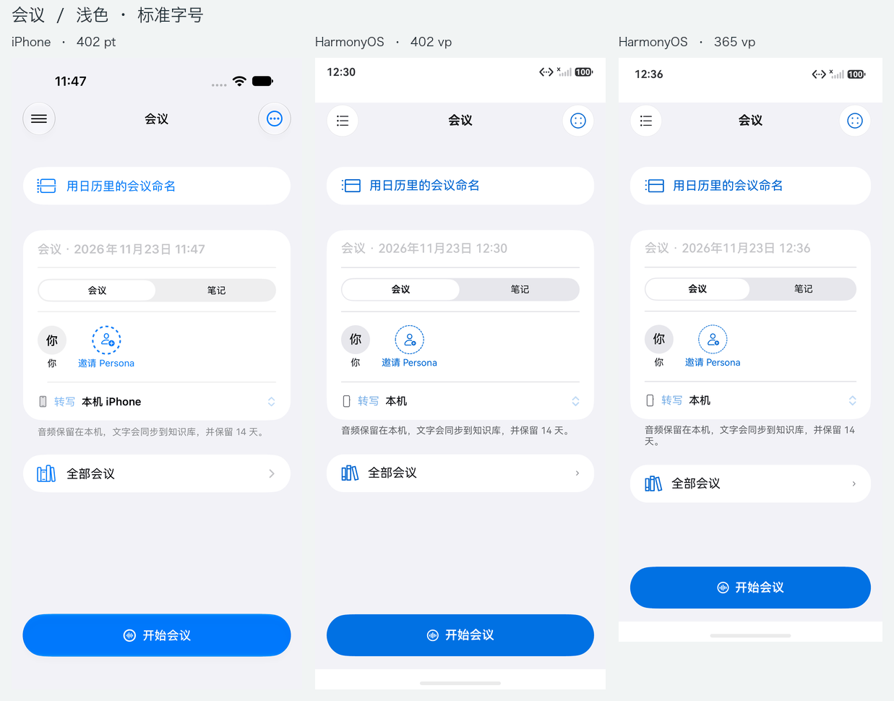
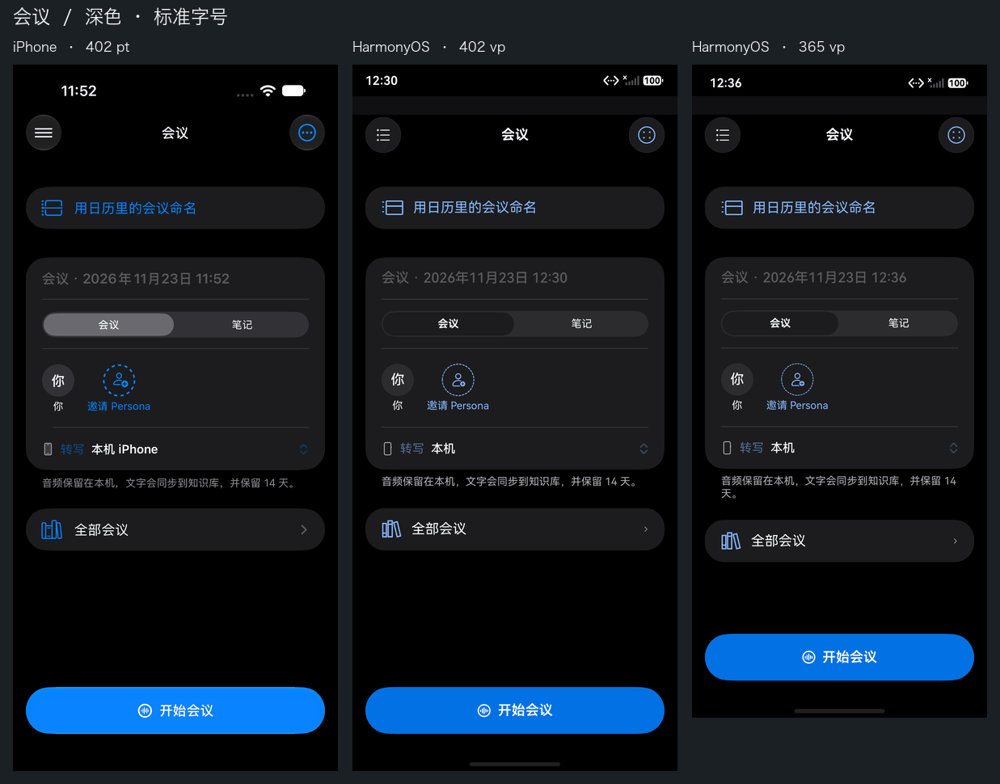
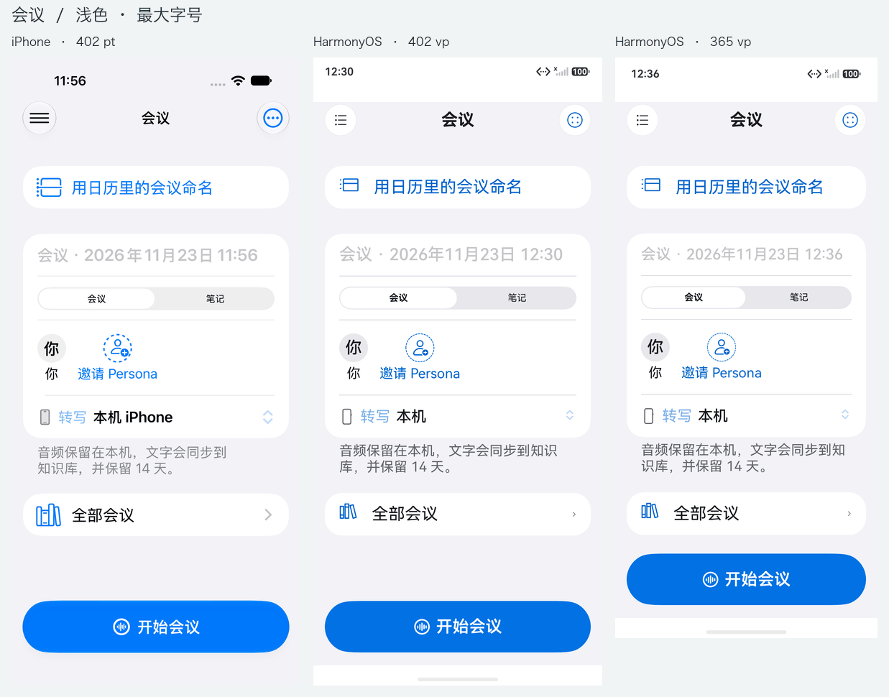

# 会议 · Meetings

[返回全部页面 · All pages](../README.md)

查看会议首页、录制入口及全部会议入口。
Compare the meeting and note setup, calendar naming, assistant invitation and start action.

Three independent native captures, left to right: iPhone 402 pt, HarmonyOS 402 vp, HarmonyOS 365 vp. The complete screen, including system bars, is visible.

[Download all original screenshots and accessibility trees for this page](../originals/meetings.zip?raw=1) · [Source and capture method](../SOURCES.md)

Original archive SHA-256: b81501e9e171a0cf8c78a74511f26c549fef44753414e21d0564bea5c054a880

## 浅色 · 标准字号

| Device | Pixels | Captured at | PNG digest | Hierarchy digest |
| --- | --- | --- | --- | --- |
| iPhone 402 pt | 1206 × 2622 | 2026-11-23T03:47:44.729+00:00 | edf55a50b3ade862 | 0b524bdaa1ef05fb |
| HarmonyOS 402 vp | 1206 × 2622 | 2026-11-23T12:30:18+08:00 | 5d18c5bf6ca8fef5 | 5dd47456d154195d |
| HarmonyOS 365 vp | 1280 × 2832 | 2026-11-23T12:36:13+08:00 | 044bfdef2541a5e4 | 9538bfc760dc00c2 |

## 深色 · 标准字号

| Device | Pixels | Captured at | PNG digest | Hierarchy digest |
| --- | --- | --- | --- | --- |
| iPhone 402 pt | 1206 × 2622 | 2026-11-23T03:52:10.781+00:00 | b8f617b9b2a75217 | af0e1647605184c1 |
| HarmonyOS 402 vp | 1206 × 2622 | 2026-11-23T12:30:22+08:00 | 0a6e94da24343fef | 5dd47456d154195d |
| HarmonyOS 365 vp | 1280 × 2832 | 2026-11-23T12:36:17+08:00 | 9772cef43cce40cd | 7a435de22a48abc6 |

## 浅色 · 最大字号

| Device | Pixels | Captured at | PNG digest | Hierarchy digest |
| --- | --- | --- | --- | --- |
| iPhone 402 pt | 1206 × 2622 | 2026-11-23T03:56:10.049+00:00 | 5e01c5cd2fd629af | ff708b27af6a201e |
| HarmonyOS 402 vp | 1206 × 2622 | 2026-11-23T12:30:26+08:00 | 5135e84a9123d765 | 4e7ad363698daf72 |
| HarmonyOS 365 vp | 1280 × 2832 | 2026-11-23T12:36:21+08:00 | 8c6abefada01043e | 18259c60d5ebf9a2 |

Full 64-character digests and ZIP entry paths are under this page in the [manifest](../manifest.json).

[← 知识库](knowledge.md)
[全部会议 →](meeting-list.md)
