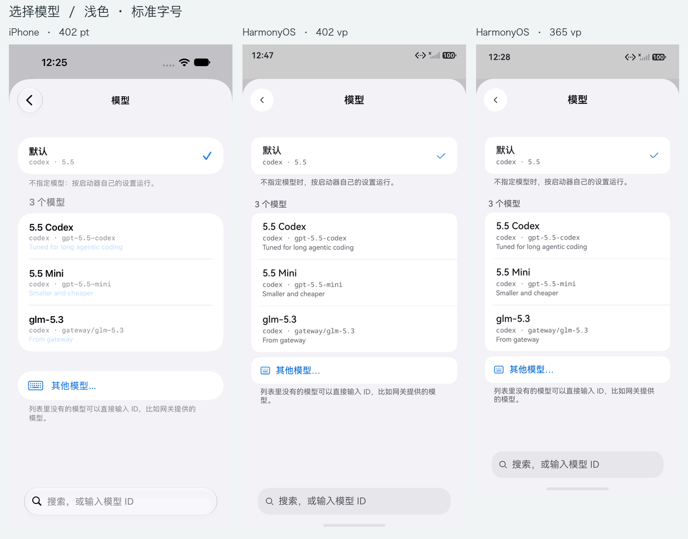
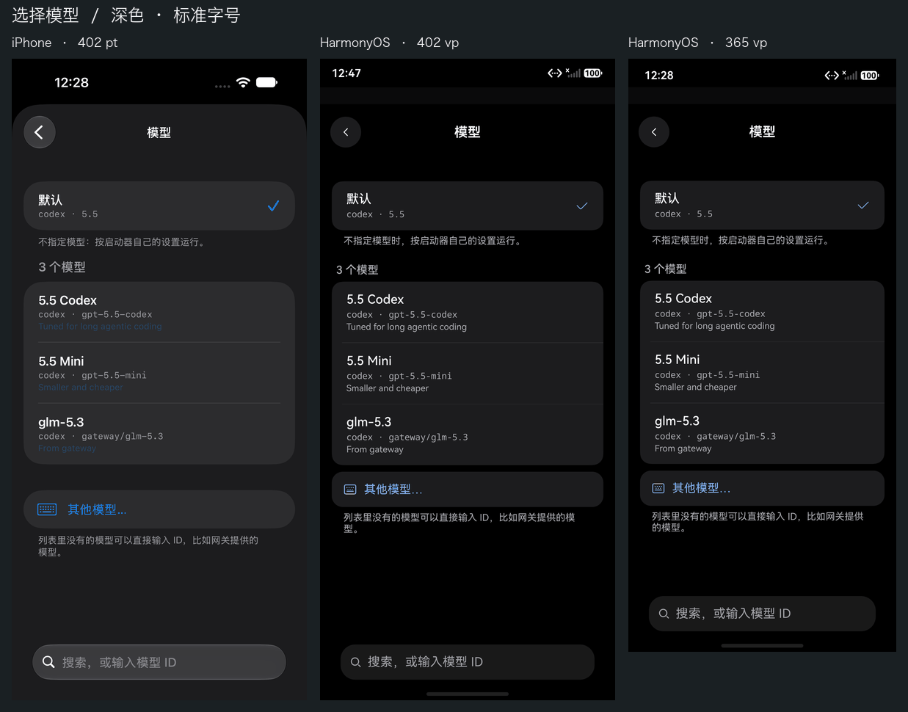
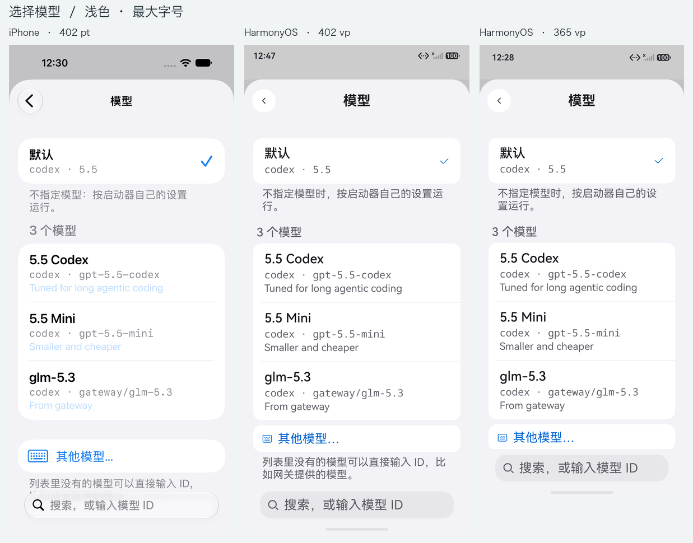

# 选择模型 · Choose a model

[返回全部页面 · All pages](../README.md)

打开所选启动器提供的模型列表。

Three independent native captures, left to right: iPhone 402 pt, HarmonyOS 402 vp, HarmonyOS 365 vp. The complete screen, including system bars, is visible.

[Download all original screenshots and accessibility trees for this page](../originals/models.zip?raw=1) · [Source and capture method](../SOURCES.md)

Original archive SHA-256: 0cde56518ef73b89db44550cd1af61ebb88d06b4937f0719329155957c790fda

## 浅色 · 标准字号

| Device | Pixels | Captured at | PNG digest | Hierarchy digest |
| --- | --- | --- | --- | --- |
| iPhone 402 pt | 1206 × 2622 | 2026-11-23T04:25:34.535+00:00 | 99227d5ac11eec17 | 5fd31307e22251ec |
| HarmonyOS 402 vp | 1206 × 2622 | 2026-11-23T12:47:42+08:00 | 245577eee77fe7be | b00cd9e73f45953d |
| HarmonyOS 365 vp | 1280 × 2832 | 2026-11-23T12:28:11+08:00 | a522a83605f72248 | 1f54103c8c998208 |

## 深色 · 标准字号

| Device | Pixels | Captured at | PNG digest | Hierarchy digest |
| --- | --- | --- | --- | --- |
| iPhone 402 pt | 1206 × 2622 | 2026-11-23T04:28:03.946+00:00 | 035096e790c295e1 | c89dbb6bd871bb8b |
| HarmonyOS 402 vp | 1206 × 2622 | 2026-11-23T12:47:45+08:00 | daede2bd2eb9859f | b00cd9e73f45953d |
| HarmonyOS 365 vp | 1280 × 2832 | 2026-11-23T12:28:14+08:00 | 086c6926bedb3482 | ca4e7a9996b33fd5 |

## 浅色 · 最大字号

| Device | Pixels | Captured at | PNG digest | Hierarchy digest |
| --- | --- | --- | --- | --- |
| iPhone 402 pt | 1206 × 2622 | 2026-11-23T04:30:38.268+00:00 | f97284b38e930d5a | e789fd58bf206850 |
| HarmonyOS 402 vp | 1206 × 2622 | 2026-11-23T12:47:49+08:00 | 414b77a1b40f87cf | 34417d54e8a96749 |
| HarmonyOS 365 vp | 1280 × 2832 | 2026-11-23T12:28:19+08:00 | f8fcc4c4eb32fd51 | bd74e179497b31c5 |

Full 64-character digests and ZIP entry paths are under this page in the [manifest](../manifest.json).

[← 选择目录](folder-browser.md)
[提交 Agent 配置 →](start-ready.md)
