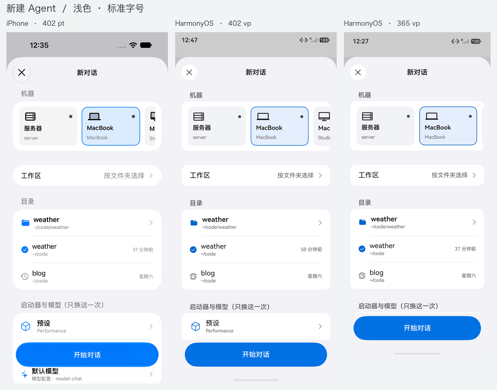
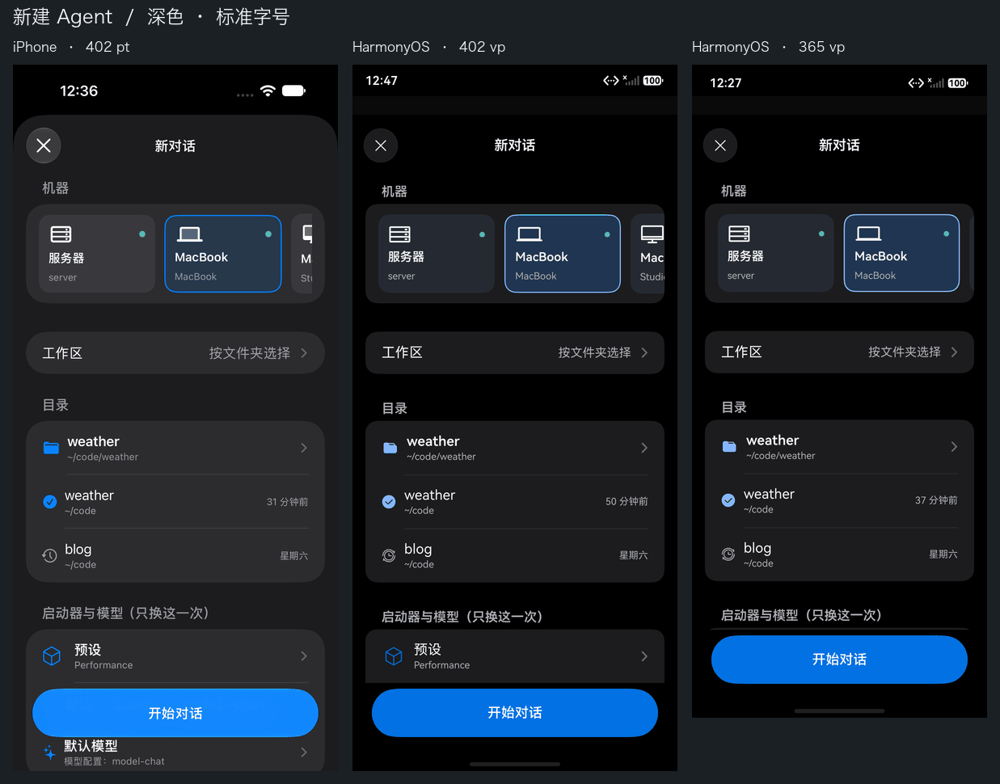
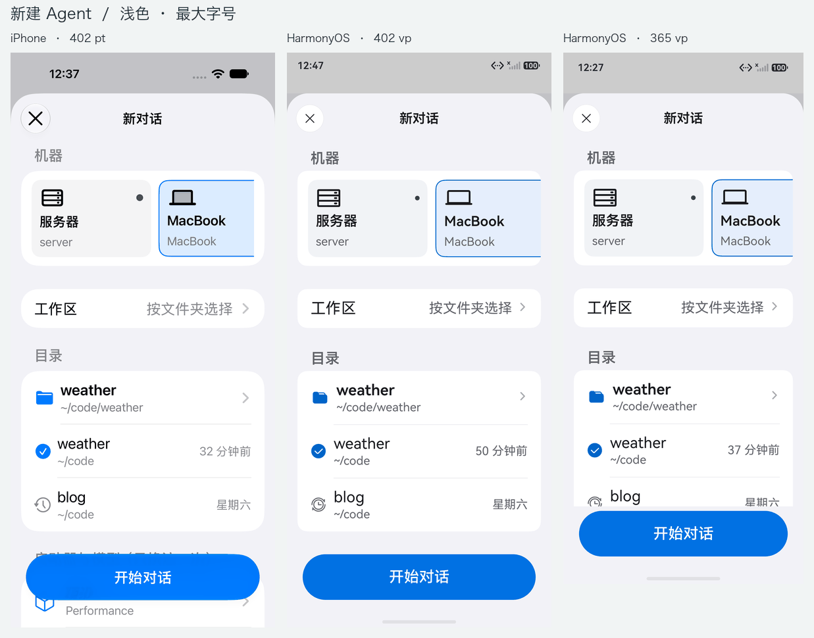

# 新建 Agent · New agent

[返回全部页面 · All pages](../README.md)

在启动表单选择机器、工作目录和启动器。
Compare the machine, directory, launcher and default model in the start form.

Three independent native captures, left to right: iPhone 402 pt, HarmonyOS 402 vp, HarmonyOS 365 vp. The complete screen, including system bars, is visible.

[Download all original screenshots and accessibility trees for this page](../originals/new-agent.zip?raw=1) · [Source and capture method](../SOURCES.md)

Original archive SHA-256: a7b3ed32e7a5bf4ff9138450bca3bbd483bd270d2694b1682aa4b59428a9891b

## 浅色 · 标准字号

| Device | Pixels | Captured at | PNG digest | Hierarchy digest |
| --- | --- | --- | --- | --- |
| iPhone 402 pt | 1206 × 2622 | 2026-11-23T04:35:54.704+00:00 | 4385288e6abca5c3 | 259dbcd20a45a082 |
| HarmonyOS 402 vp | 1206 × 2622 | 2026-11-23T12:47:01+08:00 | 6dbe36c8520dc6a5 | f2493f14a8fb4ca4 |
| HarmonyOS 365 vp | 1280 × 2832 | 2026-11-23T12:27:29+08:00 | 2adebb3c0088a1d9 | c7ab7e2a2652e1c1 |

## 深色 · 标准字号

| Device | Pixels | Captured at | PNG digest | Hierarchy digest |
| --- | --- | --- | --- | --- |
| iPhone 402 pt | 1206 × 2622 | 2026-11-23T04:36:44.729+00:00 | 1777779bf887b88c | fc654f1d1351c4e2 |
| HarmonyOS 402 vp | 1206 × 2622 | 2026-11-23T12:47:04+08:00 | ff61db4fc60d6430 | f2493f14a8fb4ca4 |
| HarmonyOS 365 vp | 1280 × 2832 | 2026-11-23T12:27:33+08:00 | c355567970129a79 | d66e10862e9b7870 |

## 浅色 · 最大字号

| Device | Pixels | Captured at | PNG digest | Hierarchy digest |
| --- | --- | --- | --- | --- |
| iPhone 402 pt | 1206 × 2622 | 2026-11-23T04:37:35.720+00:00 | 22223fe0cc49abde | 322baf6d8cbe2a77 |
| HarmonyOS 402 vp | 1206 × 2622 | 2026-11-23T12:47:08+08:00 | cfa329ce8ded13de | d1706d1d5b90b360 |
| HarmonyOS 365 vp | 1280 × 2832 | 2026-11-23T12:27:37+08:00 | 5aa084a51eae6c24 | 67cd93d41e5260b0 |

Full 64-character digests and ZIP entry paths are under this page in the [manifest](../manifest.json).

[← 工作树详情](worktree.md)
[选择目录 →](folder-browser.md)
