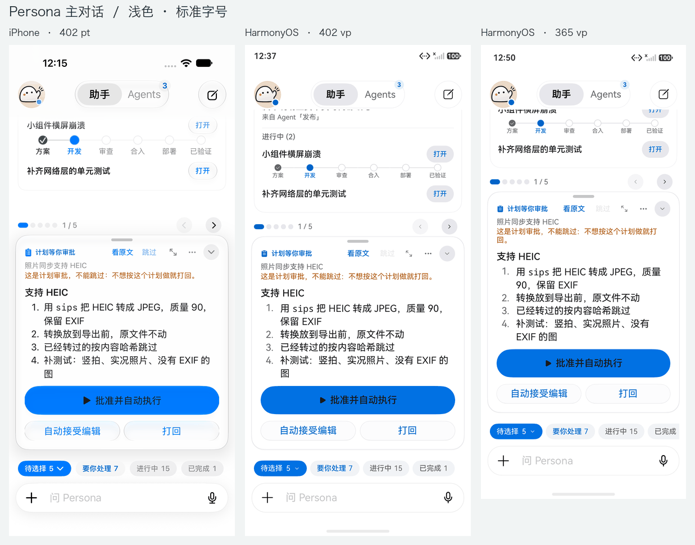
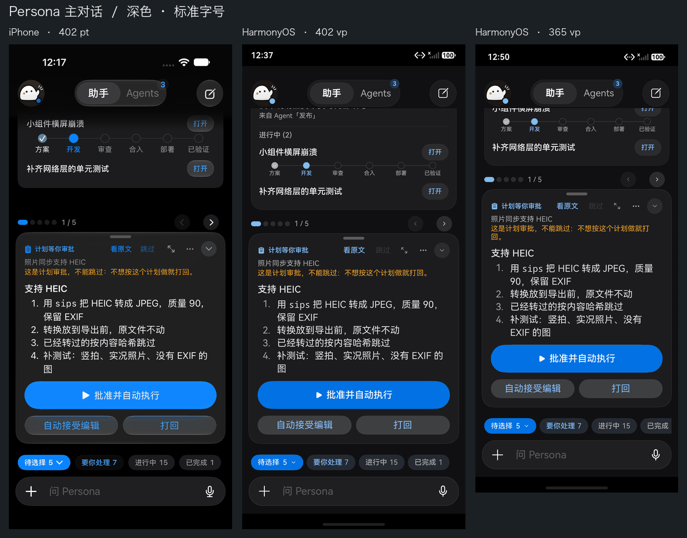
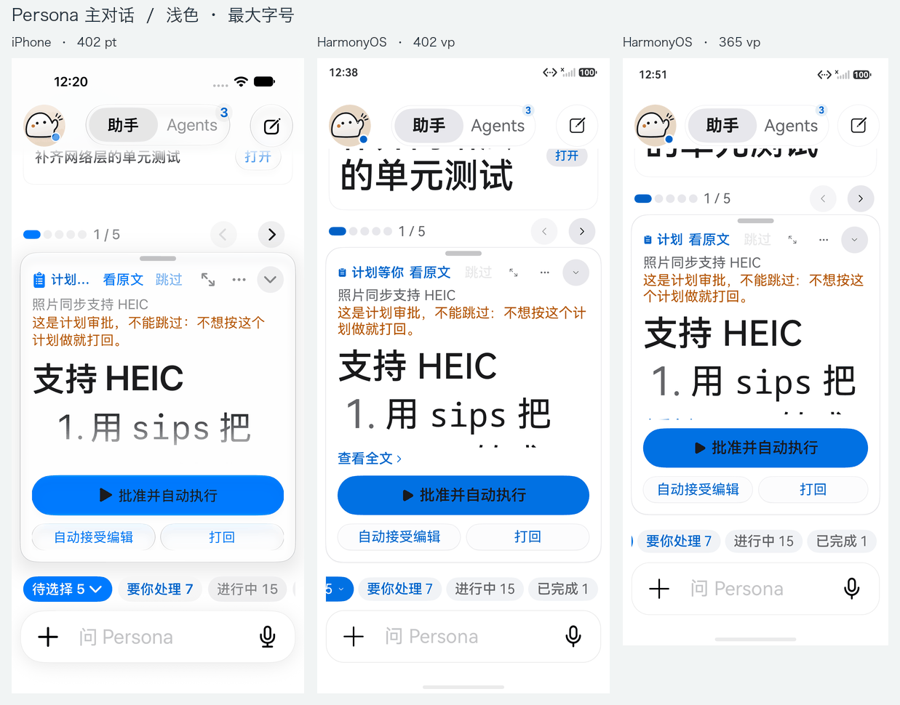

# Persona 主对话 · Main assistant conversation

[返回全部页面 · All pages](../README.md)

查看主助手的消息、任务卡和输入区。
Compare the assistant briefing, its progress links, the pending Agent plan and the composer.

Three independent native captures, left to right: iPhone 402 pt, HarmonyOS 402 vp, HarmonyOS 365 vp. The complete screen, including system bars, is visible.

[Download all original screenshots and accessibility trees for this page](../originals/persona.zip?raw=1) · [Source and capture method](../SOURCES.md)

Original archive SHA-256: 265c8ea3dcb84105e5cbe8049a19fb4d3db9d6401873425554b8c1792ef7d231

## 浅色 · 标准字号

| Device | Pixels | Captured at | PNG digest | Hierarchy digest |
| --- | --- | --- | --- | --- |
| iPhone 402 pt | 1206 × 2622 | 2026-11-23T04:15:28.731+00:00 | 31aca5948db426cb | 2ecf5e9c2d2c8272 |
| HarmonyOS 402 vp | 1206 × 2622 | 2026-11-23T12:37:29+08:00 | 45f43dd19c46c223 | 16980d8f9455a593 |
| HarmonyOS 365 vp | 1280 × 2832 | 2026-11-23T12:50:06+08:00 | 6ca4041f064dd80b | 2f99310fc8a387e2 |

## 深色 · 标准字号

| Device | Pixels | Captured at | PNG digest | Hierarchy digest |
| --- | --- | --- | --- | --- |
| iPhone 402 pt | 1206 × 2622 | 2026-11-23T04:17:49.186+00:00 | f2b0e9b67bbffd05 | 615792d294cd700a |
| HarmonyOS 402 vp | 1206 × 2622 | 2026-11-23T12:37:33+08:00 | 24a7f465b9ae3841 | 16980d8f9455a593 |
| HarmonyOS 365 vp | 1280 × 2832 | 2026-11-23T12:50:10+08:00 | 61601d62f5b3ad31 | 98c38391398d05c3 |

## 浅色 · 最大字号

| Device | Pixels | Captured at | PNG digest | Hierarchy digest |
| --- | --- | --- | --- | --- |
| iPhone 402 pt | 1206 × 2622 | 2026-11-23T04:20:26.036+00:00 | dc8872d7be255734 | c360c3ab8e91c588 |
| HarmonyOS 402 vp | 1206 × 2622 | 2026-11-23T12:38:01+08:00 | b9dfeb07f6825227 | 1ddb5a35bbcf4828 |
| HarmonyOS 365 vp | 1280 × 2832 | 2026-11-23T12:51:00+08:00 | 0422cded6bd7f5bb | 339357b2e7512e0a |

Full 64-character digests and ZIP entry paths are under this page in the [manifest](../manifest.json).

[← 会话小结详情](recap-detail.md)
[展开会话输入框 →](composer.md)
