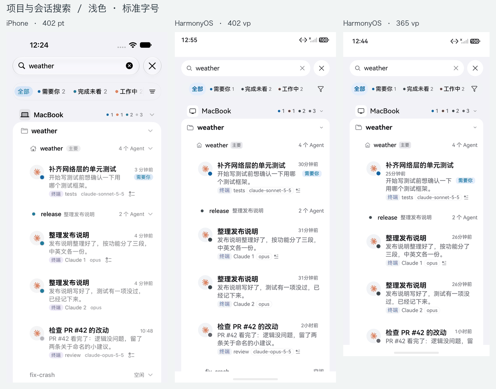
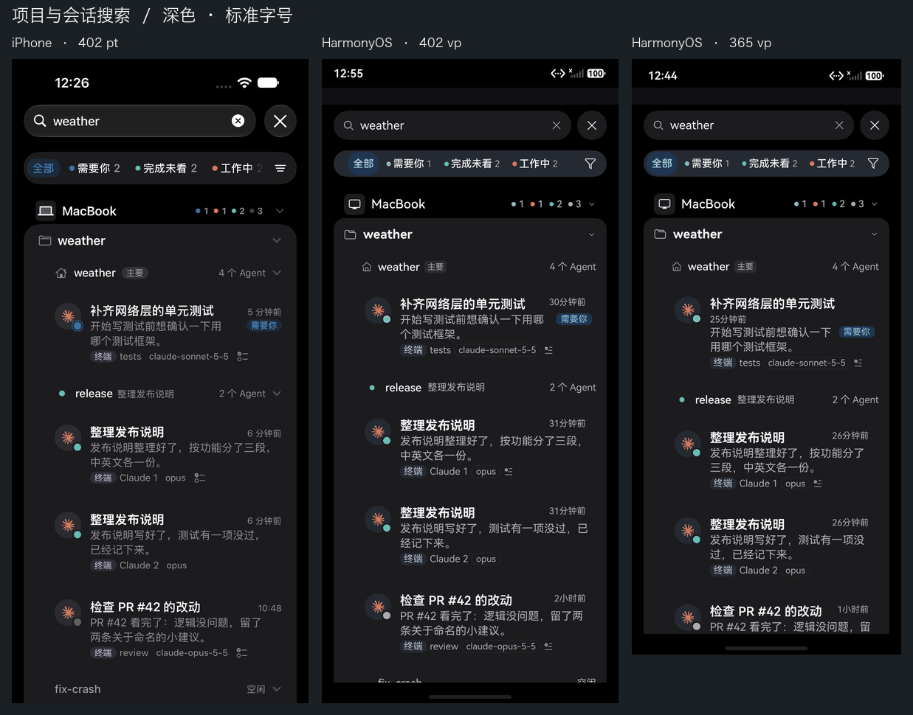
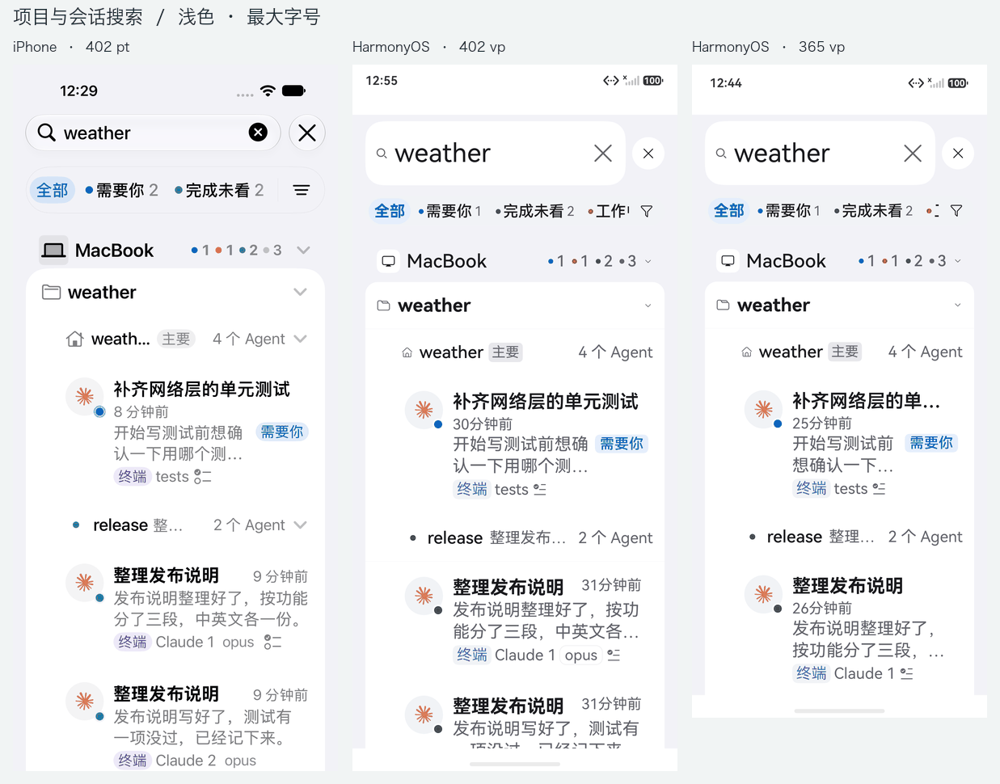

# 项目与会话搜索 · Search projects and sessions

[返回全部页面 · All pages](../README.md)

按仓库或会话关键词筛选项目，再读取匹配项。
Search for weather in the repository outline and compare its activity filters and matching rows.

Three independent native captures, left to right: iPhone 402 pt, HarmonyOS 402 vp, HarmonyOS 365 vp. The complete screen, including system bars, is visible.

[Download all original screenshots and accessibility trees for this page](../originals/project-search.zip?raw=1) · [Source and capture method](../SOURCES.md)

Original archive SHA-256: 574b44a6531075b34fc837f5c511cc9607e2be3f7d27a0724350a619904a33d7

## 浅色 · 标准字号

| Device | Pixels | Captured at | PNG digest | Hierarchy digest |
| --- | --- | --- | --- | --- |
| iPhone 402 pt | 1206 × 2622 | 2026-11-23T04:24:17.965+00:00 | 548246fd8afa0ef8 | 49bc9aca80a7eb61 |
| HarmonyOS 402 vp | 1206 × 2622 | 2026-11-23T12:55:33+08:00 | 18770d0a231b565d | d675b4770c29ebb1 |
| HarmonyOS 365 vp | 1280 × 2832 | 2026-11-23T12:44:00+08:00 | 5e6274ccfb59fd76 | 7f8e7eaa689639c5 |

## 深色 · 标准字号

| Device | Pixels | Captured at | PNG digest | Hierarchy digest |
| --- | --- | --- | --- | --- |
| iPhone 402 pt | 1206 × 2622 | 2026-11-23T04:26:49.250+00:00 | a9175cbea18509b0 | 540925f8d8e3a58b |
| HarmonyOS 402 vp | 1206 × 2622 | 2026-11-23T12:55:42+08:00 | 8846b7ac9b08c3dd | d675b4770c29ebb1 |
| HarmonyOS 365 vp | 1280 × 2832 | 2026-11-23T12:44:05+08:00 | 3a27534ed492a4fb | 7906d60b7e922d05 |

## 浅色 · 最大字号

| Device | Pixels | Captured at | PNG digest | Hierarchy digest |
| --- | --- | --- | --- | --- |
| iPhone 402 pt | 1206 × 2622 | 2026-11-23T04:29:19.205+00:00 | a9db613c39ea356a | 67e1abe20cb185a9 |
| HarmonyOS 402 vp | 1206 × 2622 | 2026-11-23T12:55:58+08:00 | 28919c2d7cfa2cb8 | 3f64a3a414610c3b |
| HarmonyOS 365 vp | 1280 × 2832 | 2026-11-23T12:44:11+08:00 | 3091430df46df717 | f96c900b3929d36c |

Full 64-character digests and ZIP entry paths are under this page in the [manifest](../manifest.json).

[← 折叠 release 标签](release-collapsed.md)
[仓库详情 →](project.md)
