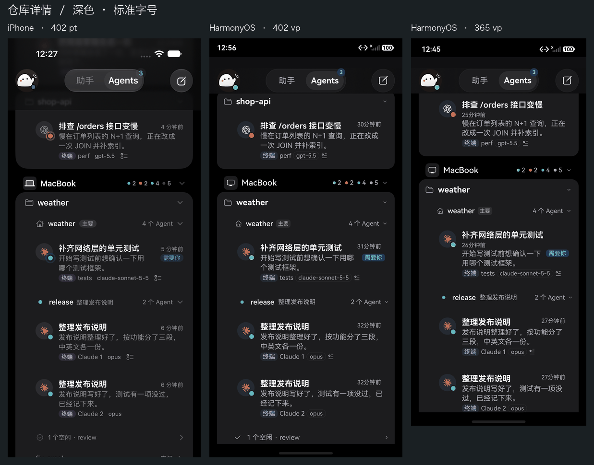

# 仓库详情 · Repository details

[返回全部页面 · All pages](../README.md)

查看 weather 仓库包含的工作树和会话。
Expand weather in place and inspect the worktrees and sessions inside this repository.

Three independent native captures, left to right: iPhone 402 pt, HarmonyOS 402 vp, HarmonyOS 365 vp. The complete screen, including system bars, is visible.

[Download all original screenshots and accessibility trees for this page](../originals/project.zip?raw=1) · [Source and capture method](../SOURCES.md)

Original archive SHA-256: b54af63dceb272ad5f9147f6c81fa869e749792934e33536c10d48653f88ac31

## 浅色 · 标准字号

| Device | Pixels | Captured at | PNG digest | Hierarchy digest |
| --- | --- | --- | --- | --- |
| iPhone 402 pt | 1206 × 2622 | 2026-11-23T04:24:33.830+00:00 | 12ec58ebf9a15395 | f4728ef7cd50add4 |
| HarmonyOS 402 vp | 1206 × 2622 | 2026-11-23T12:56:27+08:00 | 9af64c8a0e23815f | 90c3a0bdad4abba1 |
| HarmonyOS 365 vp | 1280 × 2832 | 2026-11-23T12:44:36+08:00 | 9ac7d8c23c565778 | ed99ee79dc2b5ef5 |

## 深色 · 标准字号

| Device | Pixels | Captured at | PNG digest | Hierarchy digest |
| --- | --- | --- | --- | --- |
| iPhone 402 pt | 1206 × 2622 | 2026-11-23T04:27:04.560+00:00 | f664c4cf86120bcb | 82782f6b520f8fc5 |
| HarmonyOS 402 vp | 1206 × 2622 | 2026-11-23T12:56:33+08:00 | 42371f52939a9ce3 | 90c3a0bdad4abba1 |
| HarmonyOS 365 vp | 1280 × 2832 | 2026-11-23T12:45:06+08:00 | 8f47dd574bd06c74 | b1727e5a9c4f8699 |

## 浅色 · 最大字号

| Device | Pixels | Captured at | PNG digest | Hierarchy digest |
| --- | --- | --- | --- | --- |
| iPhone 402 pt | 1206 × 2622 | 2026-11-23T04:29:38.393+00:00 | 372f653bf252e9a9 | 55944b535da6a98c |
| HarmonyOS 402 vp | 1206 × 2622 | 2026-11-23T12:56:43+08:00 | a767109ca9a7ad8d | 215f6b6031cf670e |
| HarmonyOS 365 vp | 1280 × 2832 | 2026-11-23T12:45:26+08:00 | ec63c90f7624f764 | 6b55efd39dd61609 |

Full 64-character digests and ZIP entry paths are under this page in the [manifest](../manifest.json).

[← 项目与会话搜索](project-search.md)
[工作树详情 →](worktree.md)
