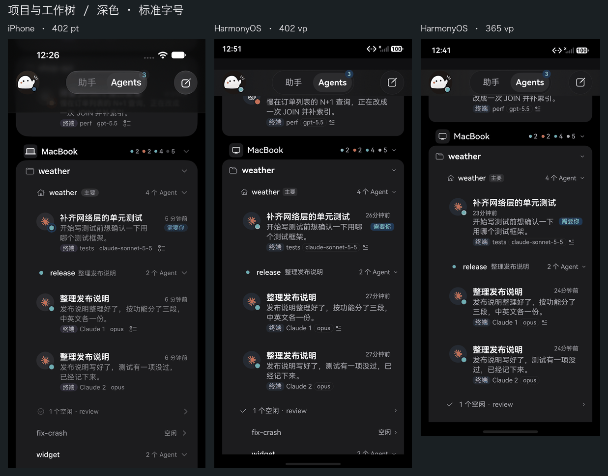

# 项目与工作树 · Project tree

[返回全部页面 · All pages](../README.md)

查看 weather 仓库、工作树和各自的 Agent。
Open the repository grouping in Agents and expand the same machine.

Three independent native captures, left to right: iPhone 402 pt, HarmonyOS 402 vp, HarmonyOS 365 vp. The complete screen, including system bars, is visible.

[Download all original screenshots and accessibility trees for this page](../originals/projects.zip?raw=1) · [Source and capture method](../SOURCES.md)

Original archive SHA-256: 49ed99da723bbf53b7594e60dd81af5ad04615d912a6642b60cce265535aafe5

## 浅色 · 标准字号

| Device | Pixels | Captured at | PNG digest | Hierarchy digest |
| --- | --- | --- | --- | --- |
| iPhone 402 pt | 1206 × 2622 | 2026-11-23T04:24:00.868+00:00 | b91dd22515beb866 | 35eff61ecea8a60c |
| HarmonyOS 402 vp | 1206 × 2622 | 2026-11-23T12:51:41+08:00 | efef725b2748828c | c79ae45f48534c4b |
| HarmonyOS 365 vp | 1280 × 2832 | 2026-11-23T12:41:21+08:00 | 20d69c9ced8fbe5d | e0d6119f491dd79d |

## 深色 · 标准字号

| Device | Pixels | Captured at | PNG digest | Hierarchy digest |
| --- | --- | --- | --- | --- |
| iPhone 402 pt | 1206 × 2622 | 2026-11-23T04:26:31.393+00:00 | 673f134222c48eb8 | 4e70df7924a5150a |
| HarmonyOS 402 vp | 1206 × 2622 | 2026-11-23T12:51:45+08:00 | 0683fc79e4024a76 | c79ae45f48534c4b |
| HarmonyOS 365 vp | 1280 × 2832 | 2026-11-23T12:41:27+08:00 | b1901ed653533451 | b8c54c7faacd2db2 |

## 浅色 · 最大字号

| Device | Pixels | Captured at | PNG digest | Hierarchy digest |
| --- | --- | --- | --- | --- |
| iPhone 402 pt | 1206 × 2622 | 2026-11-23T04:29:03.041+00:00 | 93f1444372e37e3c | dfdbf584bc7cc37f |
| HarmonyOS 402 vp | 1206 × 2622 | 2026-11-23T12:51:55+08:00 | c3ca021aaa4421d7 | f796cb9dd58c9789 |
| HarmonyOS 365 vp | 1280 × 2832 | 2026-11-23T12:41:36+08:00 | d694b5d1e8aea843 | 372434dd35be7707 |

Full 64-character digests and ZIP entry paths are under this page in the [manifest](../manifest.json).

[折叠 release 标签 →](release-collapsed.md)
