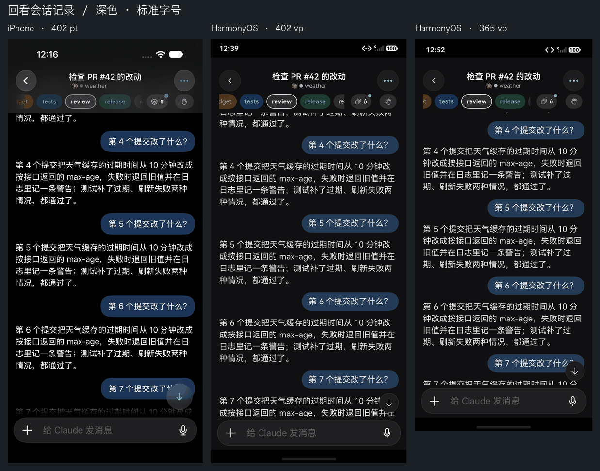

# 回看会话记录 · Read earlier messages

[返回全部页面 · All pages](../README.md)

回到较早的消息，再通过向下箭头跳至最新内容。

Three independent native captures, left to right: iPhone 402 pt, HarmonyOS 402 vp, HarmonyOS 365 vp. The complete screen, including system bars, is visible.

[Download all original screenshots and accessibility trees for this page](../originals/reading-history.zip?raw=1) · [Source and capture method](../SOURCES.md)

Original archive SHA-256: 6c6ad00ebfa753883a0643967f0124737a0d4f1eeae377fa3b3318b8b733c105

## 浅色 · 标准字号

| Device | Pixels | Captured at | PNG digest | Hierarchy digest |
| --- | --- | --- | --- | --- |
| iPhone 402 pt | 1206 × 2622 | 2026-11-23T04:14:03.061+00:00 | 16c2ee59b57698d9 | dce06e9a1f344920 |
| HarmonyOS 402 vp | 1206 × 2622 | 2026-11-23T12:39:49+08:00 | c1d0ecdba892dcd0 | b4e815d3b99162dd |
| HarmonyOS 365 vp | 1280 × 2832 | 2026-11-23T12:52:38+08:00 | 955ae23ba84e4df3 | 6d20ad7f7f39e921 |

## 深色 · 标准字号

| Device | Pixels | Captured at | PNG digest | Hierarchy digest |
| --- | --- | --- | --- | --- |
| iPhone 402 pt | 1206 × 2622 | 2026-11-23T04:16:23.610+00:00 | ac14fa659b4a8654 | 9d9c0f5d370eb876 |
| HarmonyOS 402 vp | 1206 × 2622 | 2026-11-23T12:39:57+08:00 | a6e1e78958f905d5 | da621c3944a710b3 |
| HarmonyOS 365 vp | 1280 × 2832 | 2026-11-23T12:52:45+08:00 | 8f77f36cecebd638 | d494822a6a665646 |

## 浅色 · 最大字号

| Device | Pixels | Captured at | PNG digest | Hierarchy digest |
| --- | --- | --- | --- | --- |
| iPhone 402 pt | 1206 × 2622 | 2026-11-23T04:19:00.451+00:00 | bce1a6c7e2c597f8 | 594b0bd8e1b0d50c |
| HarmonyOS 402 vp | 1206 × 2622 | 2026-11-23T12:41:44+08:00 | 77b444649beda8c1 | ef610c4749ac5836 |
| HarmonyOS 365 vp | 1280 × 2832 | 2026-11-23T12:54:54+08:00 | 8bec4da856c811e1 | 2459a4ebbbfeafd4 |

Full 64-character digests and ZIP entry paths are under this page in the [manifest](../manifest.json).

[← 展开会话输入框](composer.md)
[文件 →](files.md)
