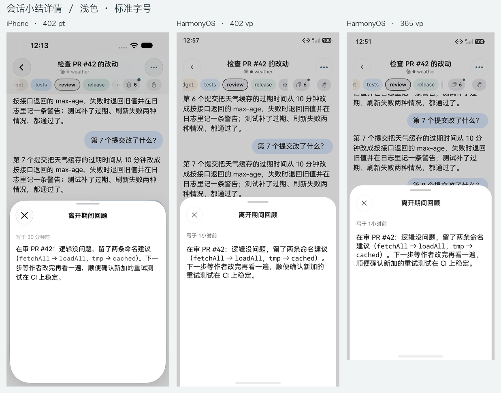
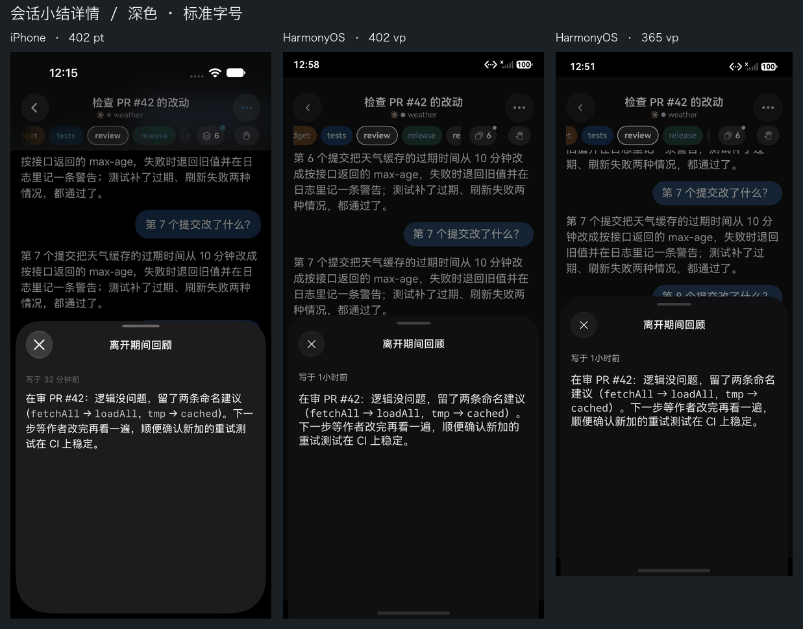
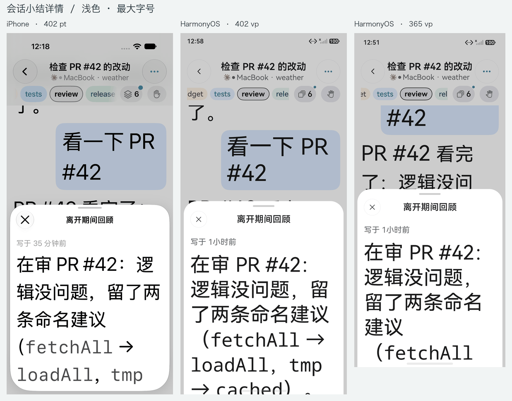

# 会话小结详情 · Conversation recap

[返回全部页面 · All pages](../README.md)

从「离开期间回顾」标记打开完整回顾。

Three independent native captures, left to right: iPhone 402 pt, HarmonyOS 402 vp, HarmonyOS 365 vp. The complete screen, including system bars, is visible.

[Download all original screenshots and accessibility trees for this page](../originals/recap-detail.zip?raw=1) · [Source and capture method](../SOURCES.md)

Original archive SHA-256: 8c2bce0516878b1c88e883adb374f281106f841b8fe417591bf28067f188f4f7

## 浅色 · 标准字号

| Device | Pixels | Captured at | PNG digest | Hierarchy digest |
| --- | --- | --- | --- | --- |
| iPhone 402 pt | 1206 × 2622 | 2026-11-23T04:13:29.278+00:00 | 0818a8bf35a489b6 | 1dedb3e561c9487e |
| HarmonyOS 402 vp | 1206 × 2622 | 2026-11-23T12:57:59+08:00 | 2cdab0927f12a227 | 6e1ba53d81f97127 |
| HarmonyOS 365 vp | 1280 × 2832 | 2026-11-23T12:51:27+08:00 | f280bccf394ba421 | a182bd4b3f634c87 |

## 深色 · 标准字号

| Device | Pixels | Captured at | PNG digest | Hierarchy digest |
| --- | --- | --- | --- | --- |
| iPhone 402 pt | 1206 × 2622 | 2026-11-23T04:15:49.815+00:00 | e57250d20f5422a8 | ba73e4a33e06e7cc |
| HarmonyOS 402 vp | 1206 × 2622 | 2026-11-23T12:58:02+08:00 | 8d8d31521a1663e4 | 6e1ba53d81f97127 |
| HarmonyOS 365 vp | 1280 × 2832 | 2026-11-23T12:51:31+08:00 | 88f58b1c21094832 | beb314ce8c4bf0e5 |

## 浅色 · 最大字号

| Device | Pixels | Captured at | PNG digest | Hierarchy digest |
| --- | --- | --- | --- | --- |
| iPhone 402 pt | 1206 × 2622 | 2026-11-23T04:18:09.720+00:00 | 4581a0b4e243b55c | 44613a75935242fd |
| HarmonyOS 402 vp | 1206 × 2622 | 2026-11-23T12:58:06+08:00 | 006158414e4dd42e | 468cc1170b5c470a |
| HarmonyOS 365 vp | 1280 × 2832 | 2026-11-23T12:51:35+08:00 | 473d91e7d2246e3a | c978bae5fb10b033 |

Full 64-character digests and ZIP entry paths are under this page in the [manifest](../manifest.json).

[← Agent 会话](agent-chat.md)
[Persona 主对话 →](persona.md)
