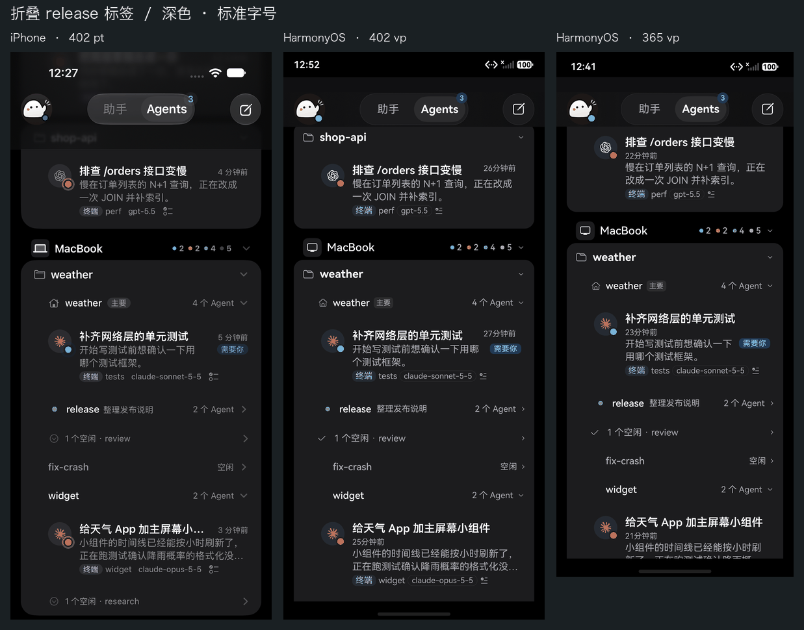

# 折叠 release 标签 · Collapse a terminal tab

[返回全部页面 · All pages](../README.md)

折叠 weather 下的 release 标签，查看分组和折叠状态。
Collapse the release terminal group in the weather project tree.

Three independent native captures, left to right: iPhone 402 pt, HarmonyOS 402 vp, HarmonyOS 365 vp. The complete screen, including system bars, is visible.

[Download all original screenshots and accessibility trees for this page](../originals/release-collapsed.zip?raw=1) · [Source and capture method](../SOURCES.md)

Original archive SHA-256: 843e3b1e3d0b629a9ee70cedc850c0567a72bf8774cccfe511a9e7d06a254788

## 浅色 · 标准字号

| Device | Pixels | Captured at | PNG digest | Hierarchy digest |
| --- | --- | --- | --- | --- |
| iPhone 402 pt | 1206 × 2622 | 2026-11-23T04:24:38.267+00:00 | e5a61720e6da34db | db469b7c1bb2dcfa |
| HarmonyOS 402 vp | 1206 × 2622 | 2026-11-23T12:52:07+08:00 | 002700853cf71be1 | a44ca9c8a5a62e03 |
| HarmonyOS 365 vp | 1280 × 2832 | 2026-11-23T12:41:49+08:00 | b6b4f1c6dc43c6ed | 7fda5316ac5617d3 |

## 深色 · 标准字号

| Device | Pixels | Captured at | PNG digest | Hierarchy digest |
| --- | --- | --- | --- | --- |
| iPhone 402 pt | 1206 × 2622 | 2026-11-23T04:27:08.775+00:00 | 5b5bf8534c69ba04 | 55a3da3d8d0b8c18 |
| HarmonyOS 402 vp | 1206 × 2622 | 2026-11-23T12:52:12+08:00 | b6e1fe374540fde5 | a44ca9c8a5a62e03 |
| HarmonyOS 365 vp | 1280 × 2832 | 2026-11-23T12:41:55+08:00 | b7916a5bc774ecfa | 8966903f55b451b3 |

## 浅色 · 最大字号

| Device | Pixels | Captured at | PNG digest | Hierarchy digest |
| --- | --- | --- | --- | --- |
| iPhone 402 pt | 1206 × 2622 | 2026-11-23T04:29:42.336+00:00 | 32cabbbcccaa373b | 83231e69e0b77d64 |
| HarmonyOS 402 vp | 1206 × 2622 | 2026-11-23T12:52:20+08:00 | 72525ffc204773d9 | dd9b76880c5f4e43 |
| HarmonyOS 365 vp | 1280 × 2832 | 2026-11-23T12:42:05+08:00 | 985822a8ea18d8b6 | 02cd8f093e3b9ace |

Full 64-character digests and ZIP entry paths are under this page in the [manifest](../manifest.json).

[← 项目与工作树](projects.md)
[项目与会话搜索 →](project-search.md)
