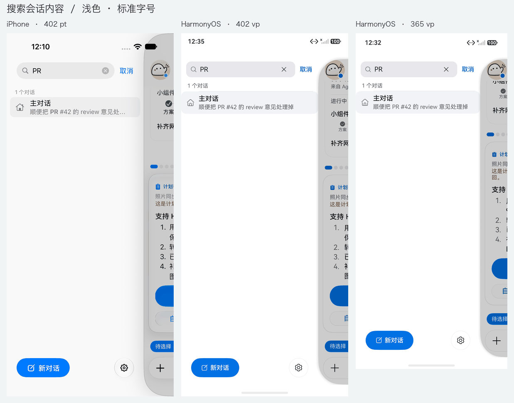
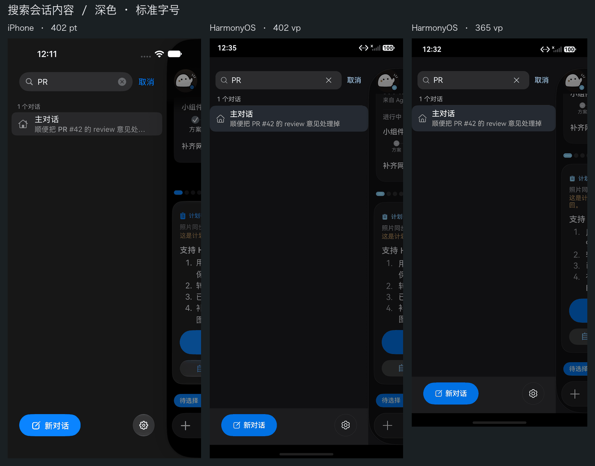
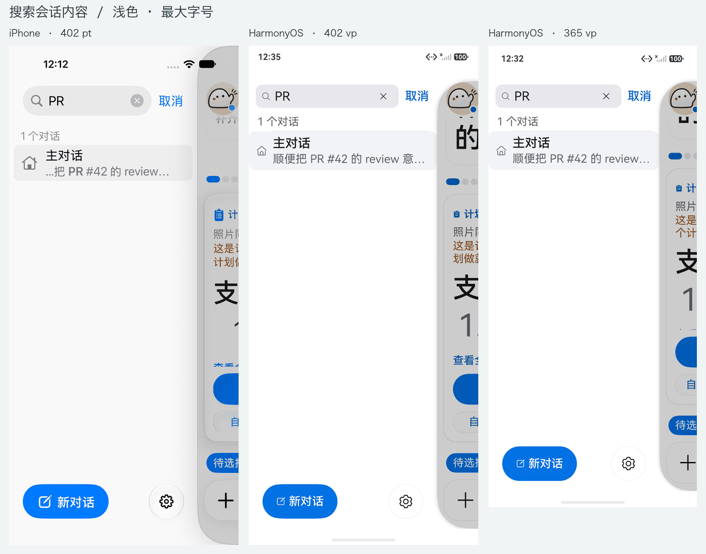

# 搜索会话内容 · Search conversations

[返回全部页面 · All pages](../README.md)

用 PR 搜索会话内容并查看匹配结果。

Three independent native captures, left to right: iPhone 402 pt, HarmonyOS 402 vp, HarmonyOS 365 vp. The complete screen, including system bars, is visible.

[Download all original screenshots and accessibility trees for this page](../originals/search.zip?raw=1) · [Source and capture method](../SOURCES.md)

Original archive SHA-256: 5bf5aa07ae827e5bf8612a97d7140fcd0f3f660c808cd1092f8db44d26514040

## 浅色 · 标准字号

| Device | Pixels | Captured at | PNG digest | Hierarchy digest |
| --- | --- | --- | --- | --- |
| iPhone 402 pt | 1206 × 2622 | 2026-11-23T04:10:35.326+00:00 | bf84af4def600bf5 | 967b70dc96d5ab91 |
| HarmonyOS 402 vp | 1206 × 2622 | 2026-11-23T12:35:42+08:00 | fba412765b94ca8c | 93f061eaaee08566 |
| HarmonyOS 365 vp | 1280 × 2832 | 2026-11-23T12:32:25+08:00 | 5f22d7e3be146939 | 425bac64a0626826 |

## 深色 · 标准字号

| Device | Pixels | Captured at | PNG digest | Hierarchy digest |
| --- | --- | --- | --- | --- |
| iPhone 402 pt | 1206 × 2622 | 2026-11-23T04:11:23.705+00:00 | bcaaa26e78173f08 | b3367303d544dfad |
| HarmonyOS 402 vp | 1206 × 2622 | 2026-11-23T12:35:46+08:00 | 24bb2a3baade225c | 93f061eaaee08566 |
| HarmonyOS 365 vp | 1280 × 2832 | 2026-11-23T12:32:29+08:00 | b24dd8581c5c27ed | 63d579cacbdfe71a |

## 浅色 · 最大字号

| Device | Pixels | Captured at | PNG digest | Hierarchy digest |
| --- | --- | --- | --- | --- |
| iPhone 402 pt | 1206 × 2622 | 2026-11-23T04:12:26.362+00:00 | 8d75db65eba4b1f5 | 29adf9cabcbb2219 |
| HarmonyOS 402 vp | 1206 × 2622 | 2026-11-23T12:35:51+08:00 | 38ceb29526c3f551 | 8bfafa6ca277bcdd |
| HarmonyOS 365 vp | 1280 × 2832 | 2026-11-23T12:32:33+08:00 | 4257b41c4176c679 | 1b9aea6af4f8b6eb |

Full 64-character digests and ZIP entry paths are under this page in the [manifest](../manifest.json).

[← Agent 偏好](agent-preferences.md)
[收件箱 →](inbox.md)
