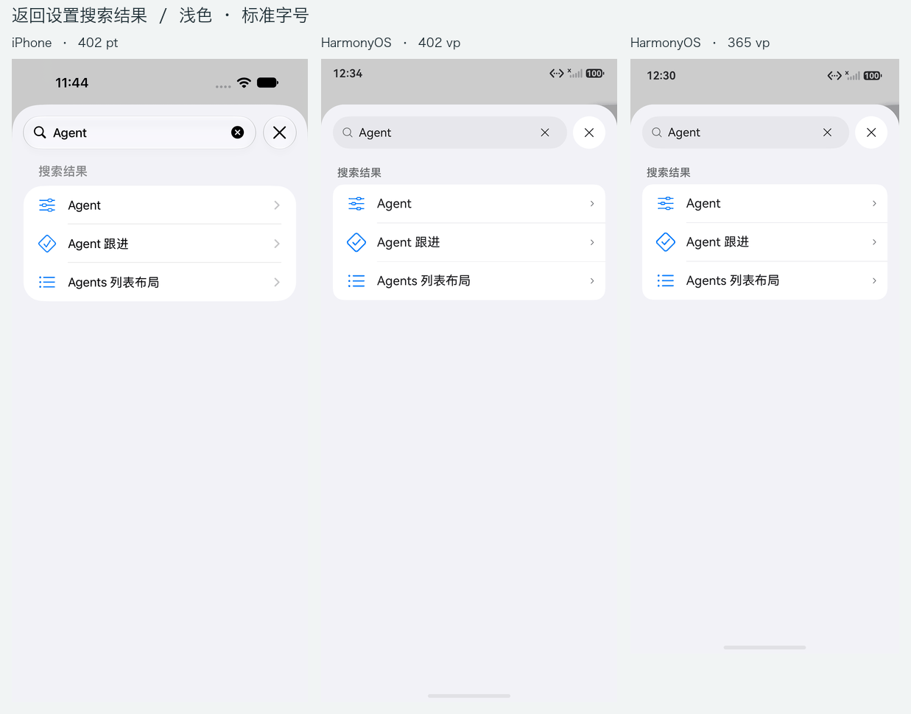
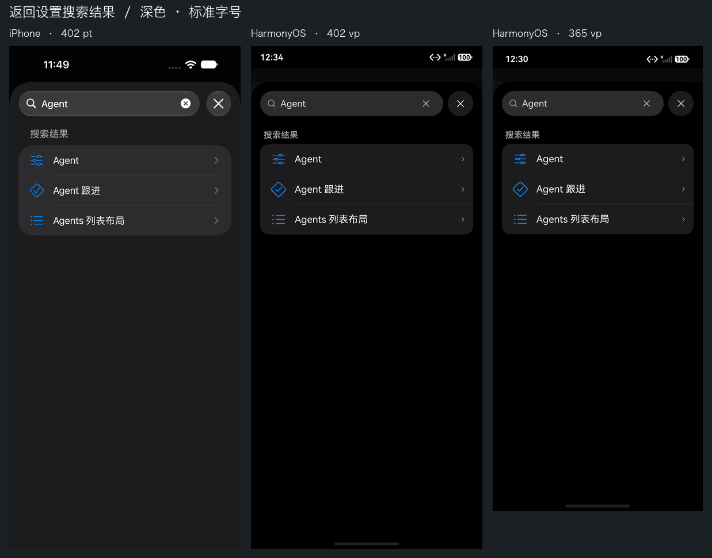
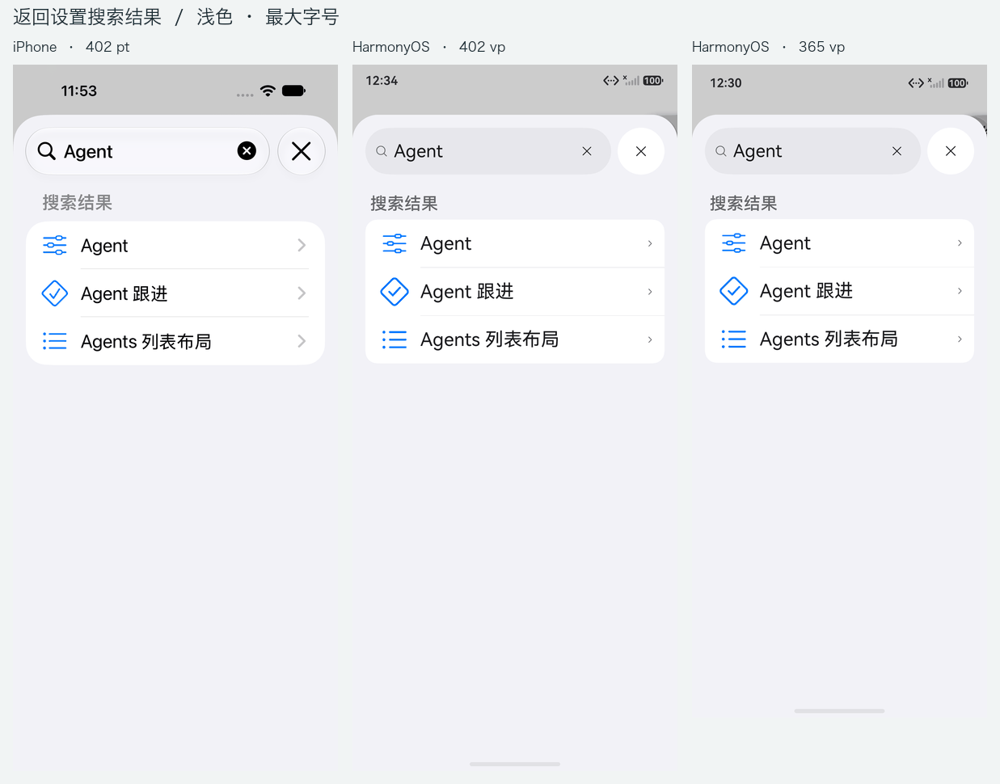

# 返回设置搜索结果 · Restore settings search

[返回全部页面 · All pages](../README.md)

搜索 Agent，打开偏好项，再返回已保留的搜索结果。

Three independent native captures, left to right: iPhone 402 pt, HarmonyOS 402 vp, HarmonyOS 365 vp. The complete screen, including system bars, is visible.

[Download all original screenshots and accessibility trees for this page](../originals/settings-search-restored.zip?raw=1) · [Source and capture method](../SOURCES.md)

Original archive SHA-256: 250547edec9a90c62f730a80d8a21744d6719c8584ccc74b53bb64a8b3ad4363

## 浅色 · 标准字号

| Device | Pixels | Captured at | PNG digest | Hierarchy digest |
| --- | --- | --- | --- | --- |
| iPhone 402 pt | 1206 × 2622 | 2026-11-23T03:44:53.728+00:00 | d853e80eb78937ca | 3be965d8934b6ddb |
| HarmonyOS 402 vp | 1206 × 2622 | 2026-11-23T12:34:13+08:00 | 5fa3f6b72cf56cb5 | 9e95112d7bac9590 |
| HarmonyOS 365 vp | 1280 × 2832 | 2026-11-23T12:30:29+08:00 | 8a7fe1c9382da89f | 49dbd6516bb925e2 |

## 深色 · 标准字号

| Device | Pixels | Captured at | PNG digest | Hierarchy digest |
| --- | --- | --- | --- | --- |
| iPhone 402 pt | 1206 × 2622 | 2026-11-23T03:49:33.573+00:00 | e4cd8533d731e787 | b5480d5899d8f3fc |
| HarmonyOS 402 vp | 1206 × 2622 | 2026-11-23T12:34:17+08:00 | c8dcf918b20f8f29 | 94b40a146501a97e |
| HarmonyOS 365 vp | 1280 × 2832 | 2026-11-23T12:30:33+08:00 | 13bf8dce75396606 | 8330b1a3f390a75d |

## 浅色 · 最大字号

| Device | Pixels | Captured at | PNG digest | Hierarchy digest |
| --- | --- | --- | --- | --- |
| iPhone 402 pt | 1206 × 2622 | 2026-11-23T03:53:51.705+00:00 | c5dad4e6267b3bc7 | 3a905c33127ac86a |
| HarmonyOS 402 vp | 1206 × 2622 | 2026-11-23T12:34:21+08:00 | 56140eb2c99c896a | 348c52c08b1c29fb |
| HarmonyOS 365 vp | 1280 × 2832 | 2026-11-23T12:30:37+08:00 | fbc15f8f9288ea40 | a8223da0935604d2 |

Full 64-character digests and ZIP entry paths are under this page in the [manifest](../manifest.json).

[← 设置](settings.md)
[语言 →](language.md)
