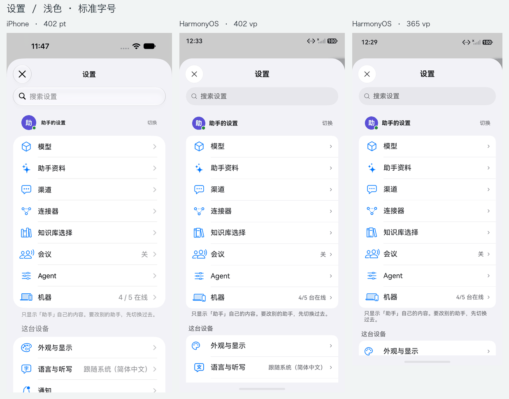
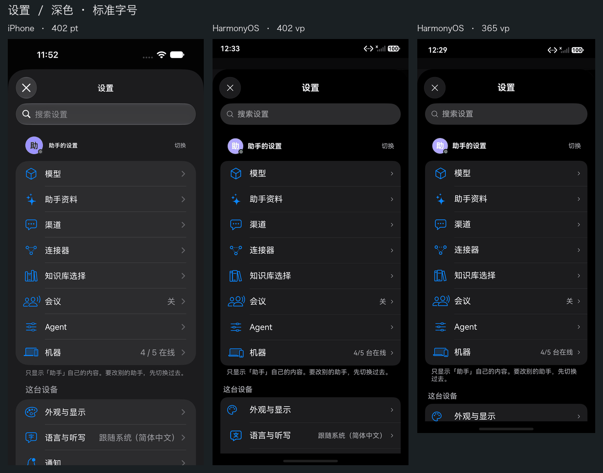
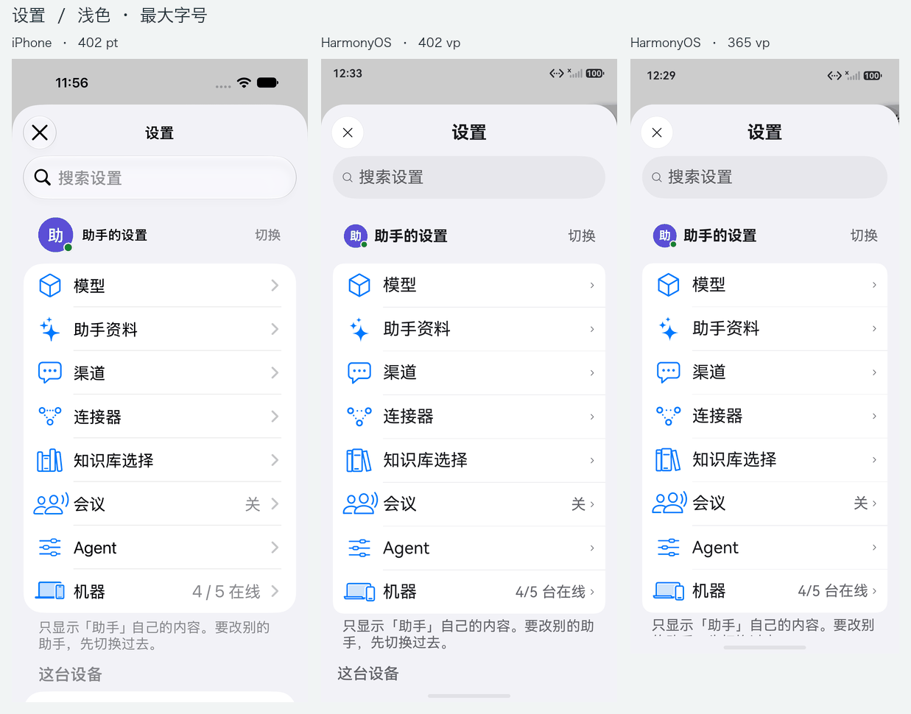

# 设置 · Settings

[返回全部页面 · All pages](../README.md)

查看设置分组和搜索入口。

Three independent native captures, left to right: iPhone 402 pt, HarmonyOS 402 vp, HarmonyOS 365 vp. The complete screen, including system bars, is visible.

[Download all original screenshots and accessibility trees for this page](../originals/settings.zip?raw=1) · [Source and capture method](../SOURCES.md)

Original archive SHA-256: 928909338bd7c2d69e265515db5bca70482c7a3b5ddd978418a98e93d2c994a8

## 浅色 · 标准字号

| Device | Pixels | Captured at | PNG digest | Hierarchy digest |
| --- | --- | --- | --- | --- |
| iPhone 402 pt | 1206 × 2622 | 2026-11-23T03:47:57.604+00:00 | a79919c776499bc2 | 32d281f5e21742c1 |
| HarmonyOS 402 vp | 1206 × 2622 | 2026-11-23T12:33:02+08:00 | 7506cd943e9a7adf | 5a77149b172fba94 |
| HarmonyOS 365 vp | 1280 × 2832 | 2026-11-23T12:29:32+08:00 | 66acd85f1fdfbabd | d55f9e8801810b8a |

## 深色 · 标准字号

| Device | Pixels | Captured at | PNG digest | Hierarchy digest |
| --- | --- | --- | --- | --- |
| iPhone 402 pt | 1206 × 2622 | 2026-11-23T03:52:22.371+00:00 | 340c8f68165e561f | 126794ad58d3660f |
| HarmonyOS 402 vp | 1206 × 2622 | 2026-11-23T12:33:06+08:00 | 0a96a7c528cd83c4 | 5a77149b172fba94 |
| HarmonyOS 365 vp | 1280 × 2832 | 2026-11-23T12:29:35+08:00 | ae468b0069bb3a02 | 27b34b8d0ff6d493 |

## 浅色 · 最大字号

| Device | Pixels | Captured at | PNG digest | Hierarchy digest |
| --- | --- | --- | --- | --- |
| iPhone 402 pt | 1206 × 2622 | 2026-11-23T03:56:20.853+00:00 | 44c74c48000f397c | c57f449f18925583 |
| HarmonyOS 402 vp | 1206 × 2622 | 2026-11-23T12:33:10+08:00 | c78b07d31f44c9f9 | d5d300b48c058355 |
| HarmonyOS 365 vp | 1280 × 2832 | 2026-11-23T12:29:40+08:00 | 79c93ca267b45cb0 | 97795fc706feb82e |

Full 64-character digests and ZIP entry paths are under this page in the [manifest](../manifest.json).

[← 切换助手](assistant-menu.md)
[返回设置搜索结果 →](settings-search-restored.md)
