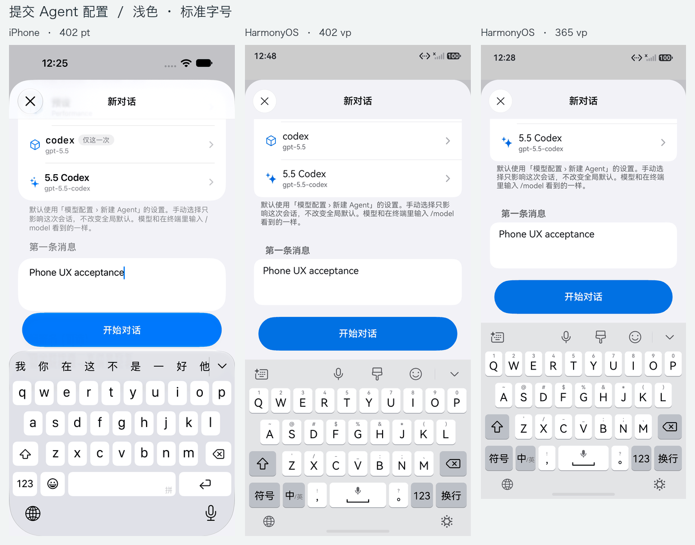
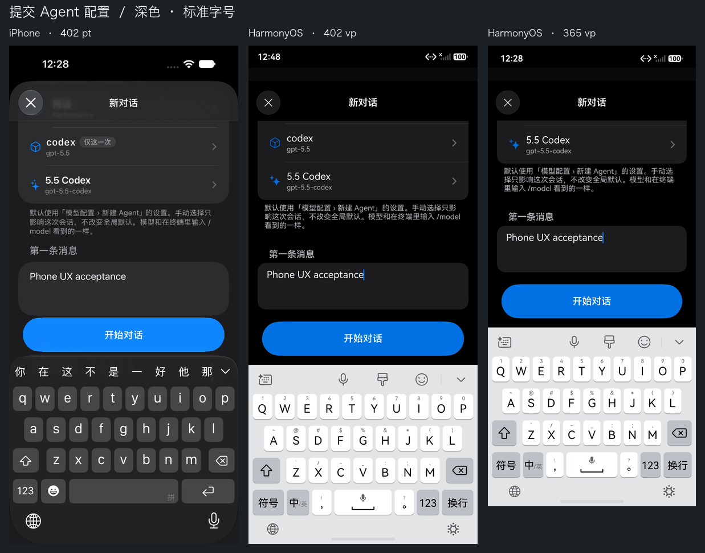
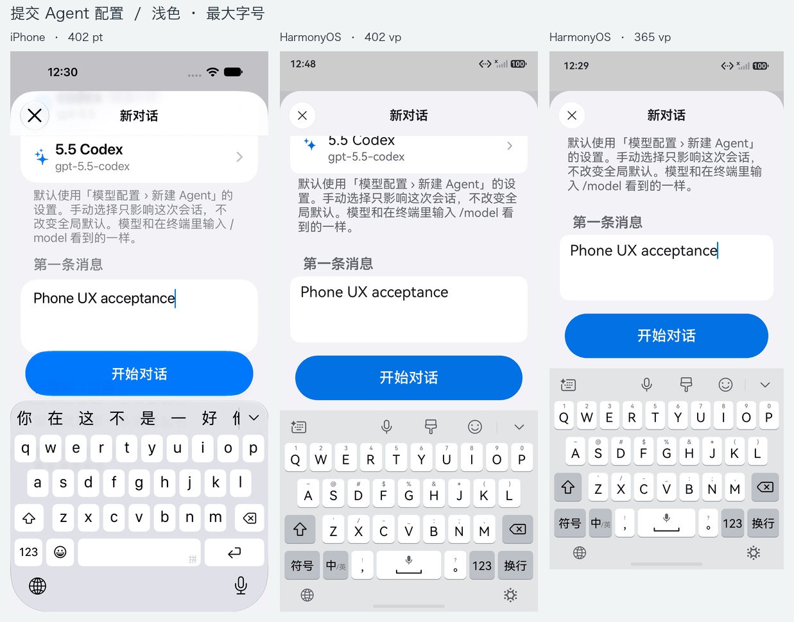

# 提交 Agent 配置 · Agent ready to start

[返回全部页面 · All pages](../README.md)

核对工作目录、启动器、模型和首条提示。
Enter the first message and inspect the start action above the keyboard.

Three independent native captures, left to right: iPhone 402 pt, HarmonyOS 402 vp, HarmonyOS 365 vp. The complete screen, including system bars, is visible.

[Download all original screenshots and accessibility trees for this page](../originals/start-ready.zip?raw=1) · [Source and capture method](../SOURCES.md)

Original archive SHA-256: 69168b17700a89ac1691e135c7e115cb5c552639524fefbcb7932bb67cdaaeda

## 浅色 · 标准字号

| Device | Pixels | Captured at | PNG digest | Hierarchy digest |
| --- | --- | --- | --- | --- |
| iPhone 402 pt | 1206 × 2622 | 2026-11-23T04:25:43.929+00:00 | 9be87f920140e8b2 | 3ee0478c9f3f2108 |
| HarmonyOS 402 vp | 1206 × 2622 | 2026-11-23T12:48:14+08:00 | 87a2833badfea222 | 3251778a5d38532f |
| HarmonyOS 365 vp | 1280 × 2832 | 2026-11-23T12:28:43+08:00 | 090a29e387a0acb7 | 1759a826ead6d52c |

## 深色 · 标准字号

| Device | Pixels | Captured at | PNG digest | Hierarchy digest |
| --- | --- | --- | --- | --- |
| iPhone 402 pt | 1206 × 2622 | 2026-11-23T04:28:13.527+00:00 | b228105aed296f26 | 358daa9ee1893251 |
| HarmonyOS 402 vp | 1206 × 2622 | 2026-11-23T12:48:29+08:00 | 51613d84d35bcacd | 3251778a5d38532f |
| HarmonyOS 365 vp | 1280 × 2832 | 2026-11-23T12:28:58+08:00 | 015c9ba0a2a6b2b1 | 0cf0ca45a42bcb31 |

## 浅色 · 最大字号

| Device | Pixels | Captured at | PNG digest | Hierarchy digest |
| --- | --- | --- | --- | --- |
| iPhone 402 pt | 1206 × 2622 | 2026-11-23T04:30:49.063+00:00 | 164f8412556f2ed6 | 78bd7075e1ac9fbc |
| HarmonyOS 402 vp | 1206 × 2622 | 2026-11-23T12:48:44+08:00 | b9eaa1153862e291 | 39a98831ec83d029 |
| HarmonyOS 365 vp | 1280 × 2832 | 2026-11-23T12:29:13+08:00 | b4d69492a9886c81 | 24f25431a31f20ea |

Full 64-character digests and ZIP entry paths are under this page in the [manifest](../manifest.json).

[← 选择模型](models.md)
[Agents 列表 →](agents.md)
