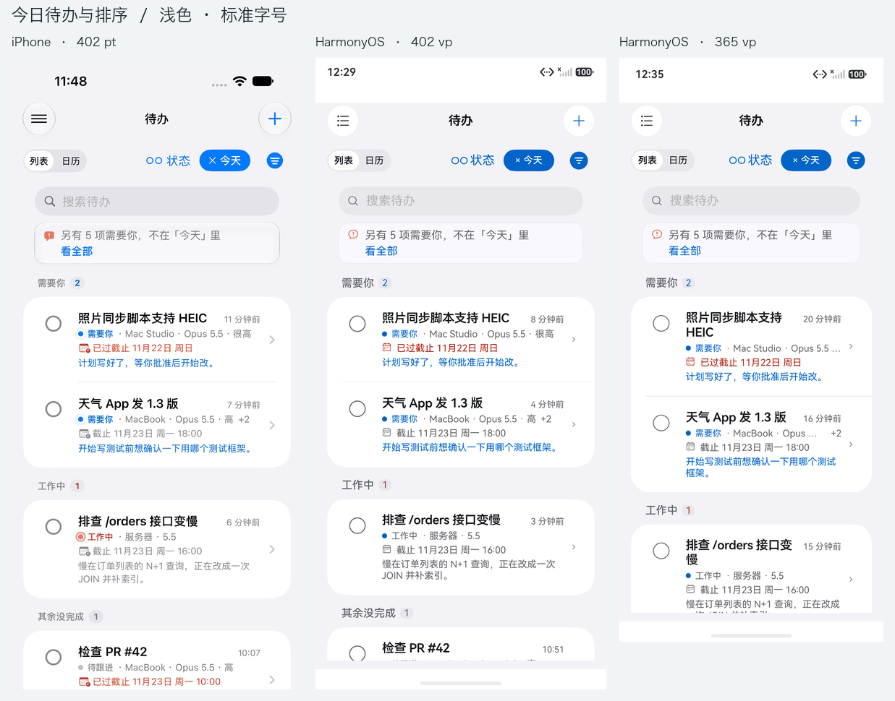
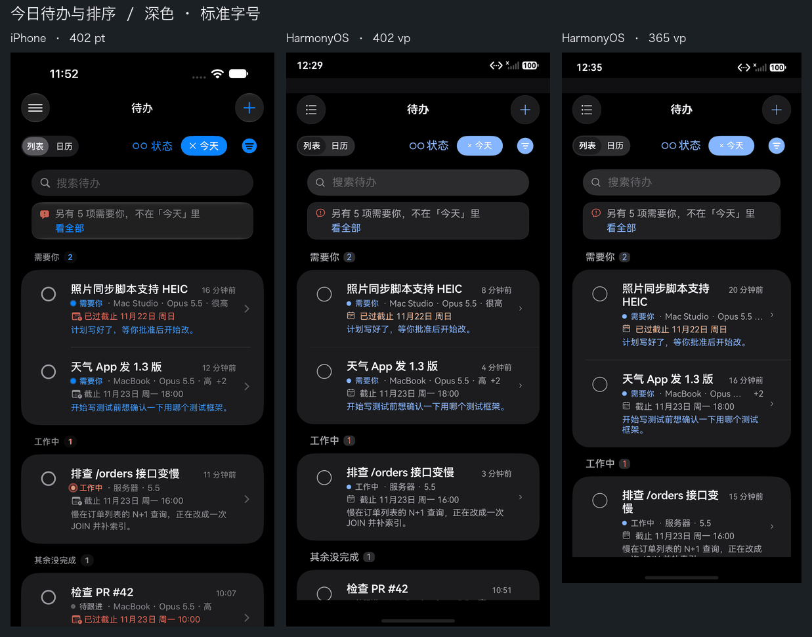
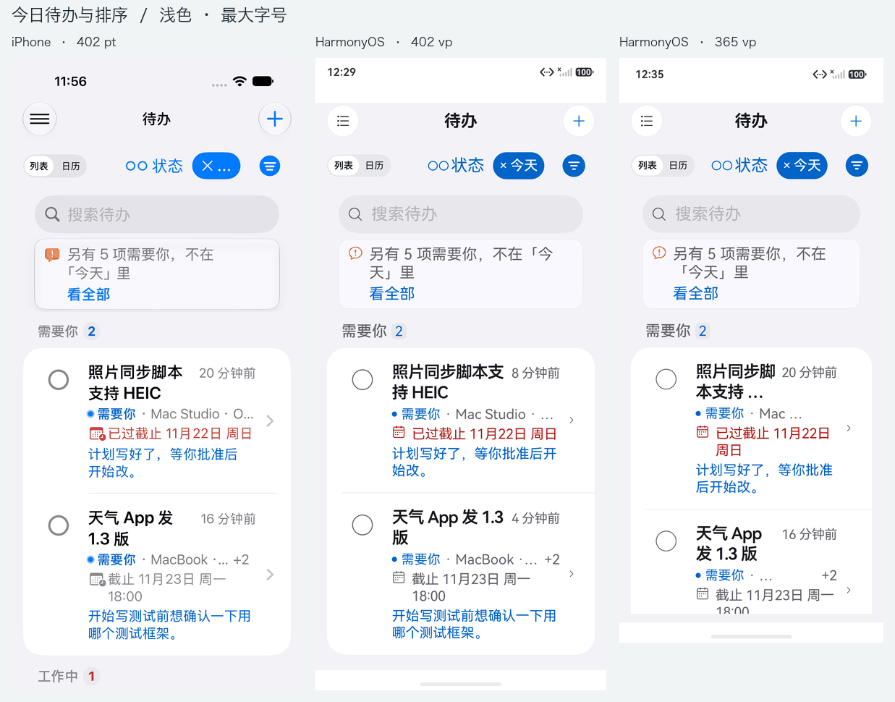

# 今日待办与排序 · Due today and priority

[返回全部页面 · All pages](../README.md)

筛选今天的待办，并查看优先级排序。

Three independent native captures, left to right: iPhone 402 pt, HarmonyOS 402 vp, HarmonyOS 365 vp. The complete screen, including system bars, is visible.

[Download all original screenshots and accessibility trees for this page](../originals/todo-due.zip?raw=1) · [Source and capture method](../SOURCES.md)

Original archive SHA-256: 514183ab532f3349277b37f45ec4cb5c858b8d25830e73ea26882a8190e67755

## 浅色 · 标准字号

| Device | Pixels | Captured at | PNG digest | Hierarchy digest |
| --- | --- | --- | --- | --- |
| iPhone 402 pt | 1206 × 2622 | 2026-11-23T03:48:30.700+00:00 | e69b918c362bf4a1 | 2504de11a87447dc |
| HarmonyOS 402 vp | 1206 × 2622 | 2026-11-23T12:29:25+08:00 | 91170d9d03691f9d | 72fd4fc3a35baec1 |
| HarmonyOS 365 vp | 1280 × 2832 | 2026-11-23T12:35:14+08:00 | 2e80cd16af739730 | 4dc2964dc4fcb900 |

## 深色 · 标准字号

| Device | Pixels | Captured at | PNG digest | Hierarchy digest |
| --- | --- | --- | --- | --- |
| iPhone 402 pt | 1206 × 2622 | 2026-11-23T03:52:55.127+00:00 | 20cdc518accff096 | 0c403aa7036c0d00 |
| HarmonyOS 402 vp | 1206 × 2622 | 2026-11-23T12:29:29+08:00 | 95c39963a4f1cb79 | 72fd4fc3a35baec1 |
| HarmonyOS 365 vp | 1280 × 2832 | 2026-11-23T12:35:18+08:00 | 51e04e6061824e3b | 2e918491f3af2588 |

## 浅色 · 最大字号

| Device | Pixels | Captured at | PNG digest | Hierarchy digest |
| --- | --- | --- | --- | --- |
| iPhone 402 pt | 1206 × 2622 | 2026-11-23T03:56:51.192+00:00 | f846715fc69ed3ba | 8e5365798700d2e1 |
| HarmonyOS 402 vp | 1206 × 2622 | 2026-11-23T12:29:33+08:00 | b7df584dd922a517 | 621681cfbd1a3d5c |
| HarmonyOS 365 vp | 1280 × 2832 | 2026-11-23T12:35:22+08:00 | 02292c34559a8975 | ffc209b89dc1a6ec |

Full 64-character digests and ZIP entry paths are under this page in the [manifest](../manifest.json).

[← 待办](todo.md)
[知识库 →](knowledge.md)
