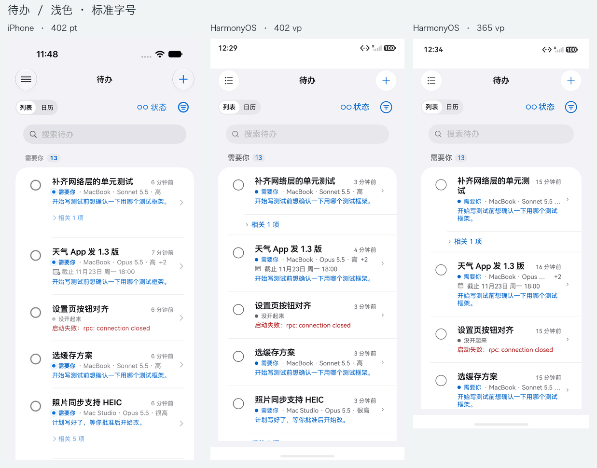
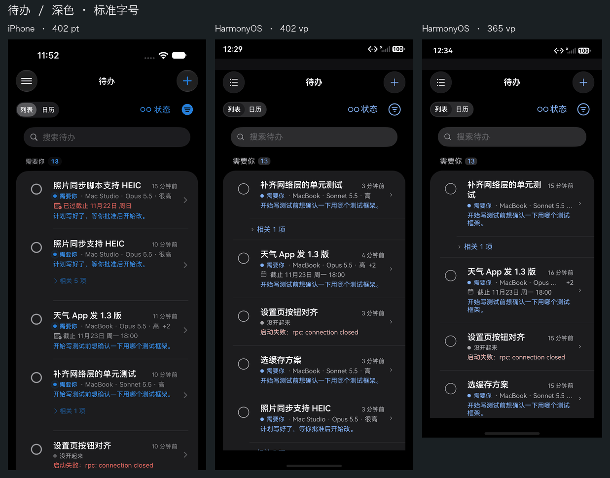
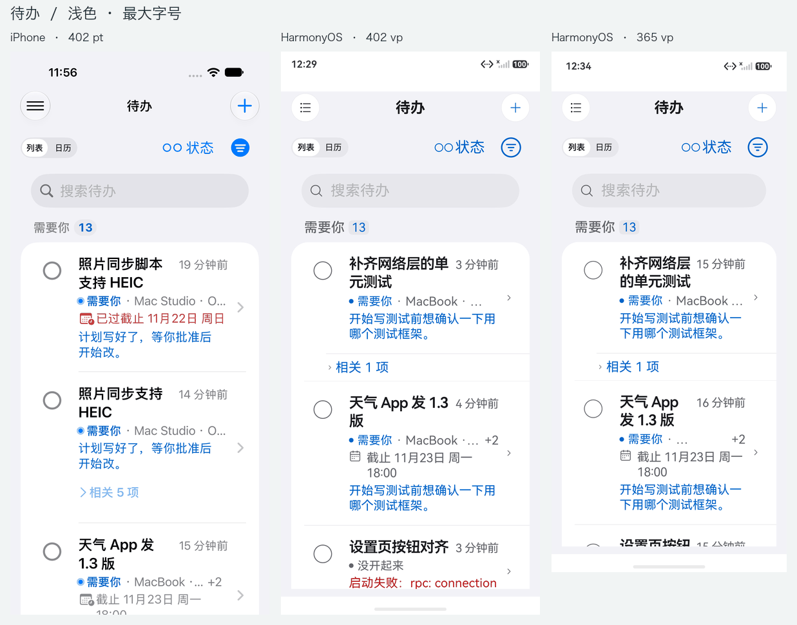

# 待办 · To-dos

[返回全部页面 · All pages](../README.md)

浏览待办清单及其状态。

Three independent native captures, left to right: iPhone 402 pt, HarmonyOS 402 vp, HarmonyOS 365 vp. The complete screen, including system bars, is visible.

[Download all original screenshots and accessibility trees for this page](../originals/todo.zip?raw=1) · [Source and capture method](../SOURCES.md)

Original archive SHA-256: 11f6f7709f76a014185c8f1a977d71251065c8938e393428e87bf944f50fe1df

## 浅色 · 标准字号

| Device | Pixels | Captured at | PNG digest | Hierarchy digest |
| --- | --- | --- | --- | --- |
| iPhone 402 pt | 1206 × 2622 | 2026-11-23T03:48:09.679+00:00 | a91075fa4744fb6f | 1a1cb449dc8caed7 |
| HarmonyOS 402 vp | 1206 × 2622 | 2026-11-23T12:29:06+08:00 | 872e7f9e33a17ed2 | 866b1ca1bdd381d8 |
| HarmonyOS 365 vp | 1280 × 2832 | 2026-11-23T12:34:31+08:00 | c72a7cbc9773370a | b8490f891f467efd |

## 深色 · 标准字号

| Device | Pixels | Captured at | PNG digest | Hierarchy digest |
| --- | --- | --- | --- | --- |
| iPhone 402 pt | 1206 × 2622 | 2026-11-23T03:52:34.656+00:00 | ff2e471ab74bfe0c | ddbf78a503eb3412 |
| HarmonyOS 402 vp | 1206 × 2622 | 2026-11-23T12:29:10+08:00 | ba1dfb96a83f13c3 | 866b1ca1bdd381d8 |
| HarmonyOS 365 vp | 1280 × 2832 | 2026-11-23T12:34:42+08:00 | 6134c645488c5e8e | 1568454be07ba570 |

## 浅色 · 最大字号

| Device | Pixels | Captured at | PNG digest | Hierarchy digest |
| --- | --- | --- | --- | --- |
| iPhone 402 pt | 1206 × 2622 | 2026-11-23T03:56:32.261+00:00 | 135f563a75d26d06 | cefab0542d1192e4 |
| HarmonyOS 402 vp | 1206 × 2622 | 2026-11-23T12:29:14+08:00 | 867164d8275df674 | 16b6616ee37379e6 |
| HarmonyOS 365 vp | 1280 × 2832 | 2026-11-23T12:34:59+08:00 | 08693de9e1e2ef06 | 1b4316cefed1ccd0 |

Full 64-character digests and ZIP entry paths are under this page in the [manifest](../manifest.json).

[← 收件箱](inbox.md)
[今日待办与排序 →](todo-due.md)
