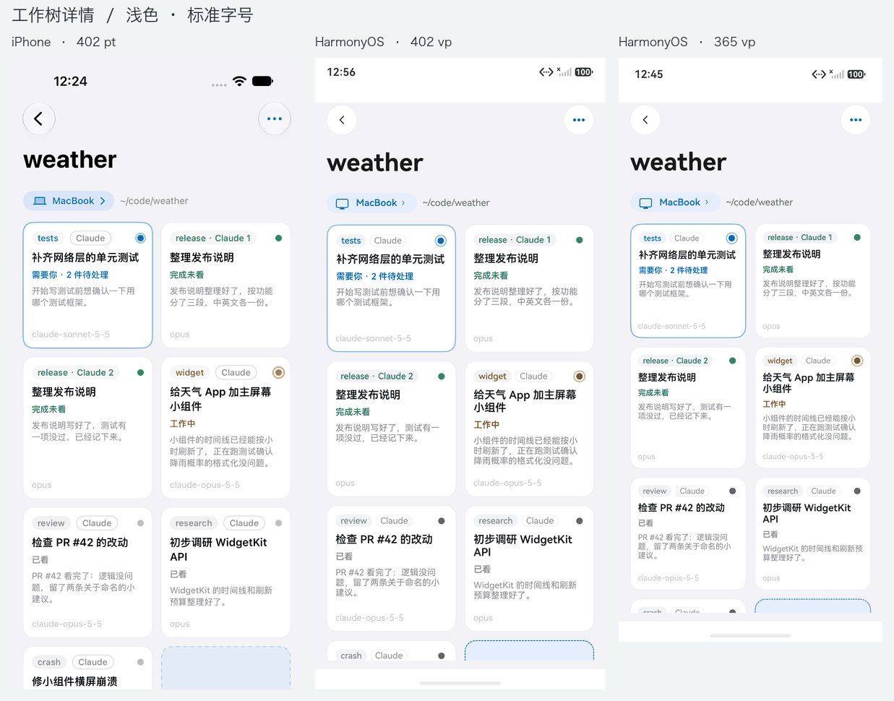
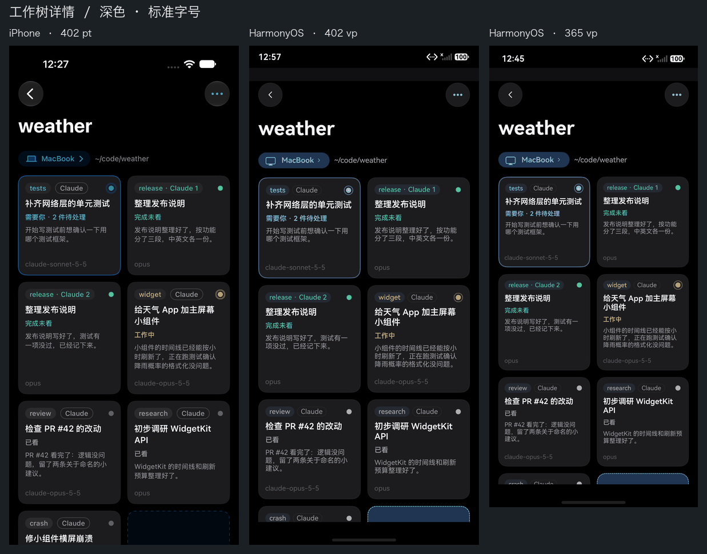
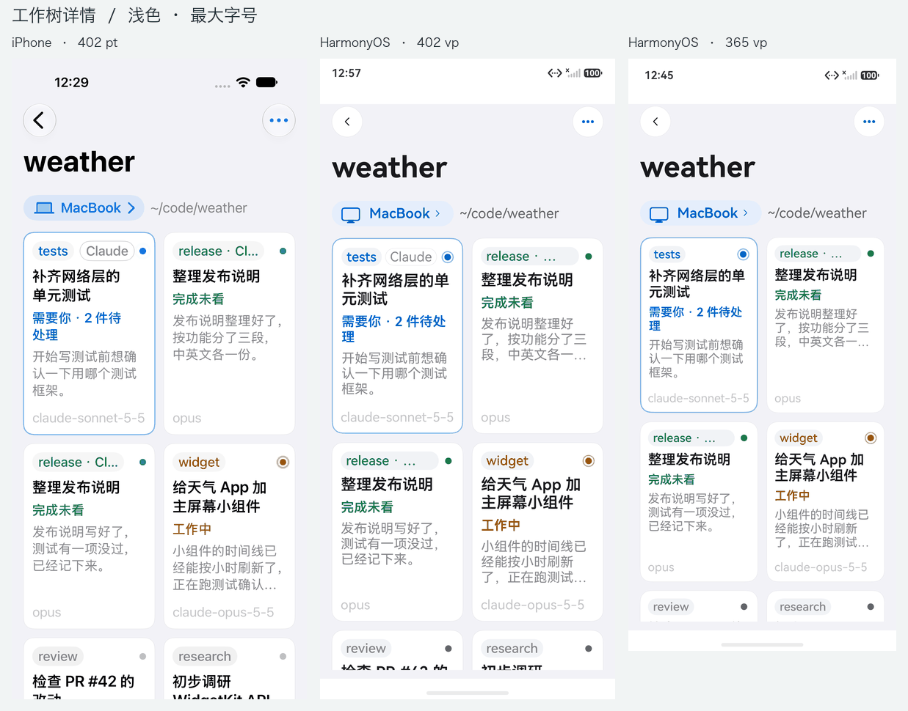

# 工作树详情 · Worktree details

[返回全部页面 · All pages](../README.md)

在选中的开发目录下查看会话和所属机器。
Open the weather terminal space and browse its agents across Git checkouts.

Three independent native captures, left to right: iPhone 402 pt, HarmonyOS 402 vp, HarmonyOS 365 vp. The complete screen, including system bars, is visible.

[Download all original screenshots and accessibility trees for this page](../originals/worktree.zip?raw=1) · [Source and capture method](../SOURCES.md)

Original archive SHA-256: 70fb00da41f8e568824722cf04978f0cd80f960aa52c7bc541ed084a5435da15

## 浅色 · 标准字号

| Device | Pixels | Captured at | PNG digest | Hierarchy digest |
| --- | --- | --- | --- | --- |
| iPhone 402 pt | 1206 × 2622 | 2026-11-23T04:24:53.269+00:00 | e0b93c023b1bc6bb | 76c8727f315ea3a2 |
| HarmonyOS 402 vp | 1206 × 2622 | 2026-11-23T12:56:58+08:00 | de675360c7533ae8 | aa4d54340298c2b7 |
| HarmonyOS 365 vp | 1280 × 2832 | 2026-11-23T12:45:44+08:00 | bcdf2786264794d9 | b98c4752a43f89bd |

## 深色 · 标准字号

| Device | Pixels | Captured at | PNG digest | Hierarchy digest |
| --- | --- | --- | --- | --- |
| iPhone 402 pt | 1206 × 2622 | 2026-11-23T04:27:23.515+00:00 | a09e75e7afc4ba63 | a1bf277ccdeeee0f |
| HarmonyOS 402 vp | 1206 × 2622 | 2026-11-23T12:57:02+08:00 | 57201326fa9b441b | aa4d54340298c2b7 |
| HarmonyOS 365 vp | 1280 × 2832 | 2026-11-23T12:45:48+08:00 | 81213856d717b8da | e145e468caea6612 |

## 浅色 · 最大字号

| Device | Pixels | Captured at | PNG digest | Hierarchy digest |
| --- | --- | --- | --- | --- |
| iPhone 402 pt | 1206 × 2622 | 2026-11-23T04:29:56.882+00:00 | a6aaa7c831462e37 | 2640722dffa2bac1 |
| HarmonyOS 402 vp | 1206 × 2622 | 2026-11-23T12:57:06+08:00 | 9cf9bd754a4b1937 | b6046982ffa01ee1 |
| HarmonyOS 365 vp | 1280 × 2832 | 2026-11-23T12:45:52+08:00 | 3caffd3081b972a2 | 014a1b8b6b4b178a |

Full 64-character digests and ZIP entry paths are under this page in the [manifest](../manifest.json).

[← 仓库详情](project.md)
[新建 Agent →](new-agent.md)
