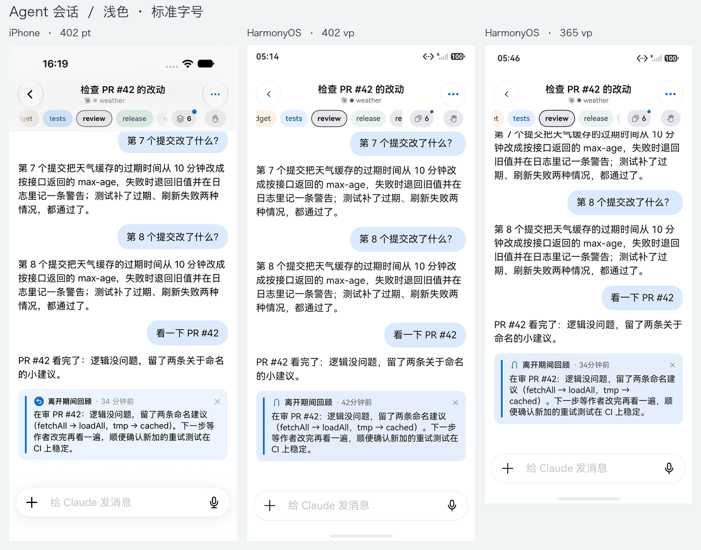
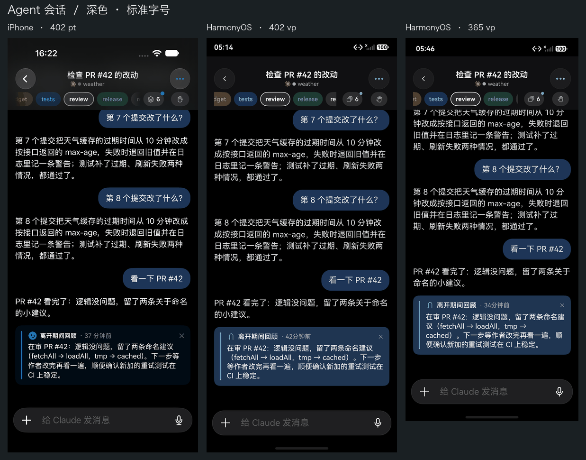
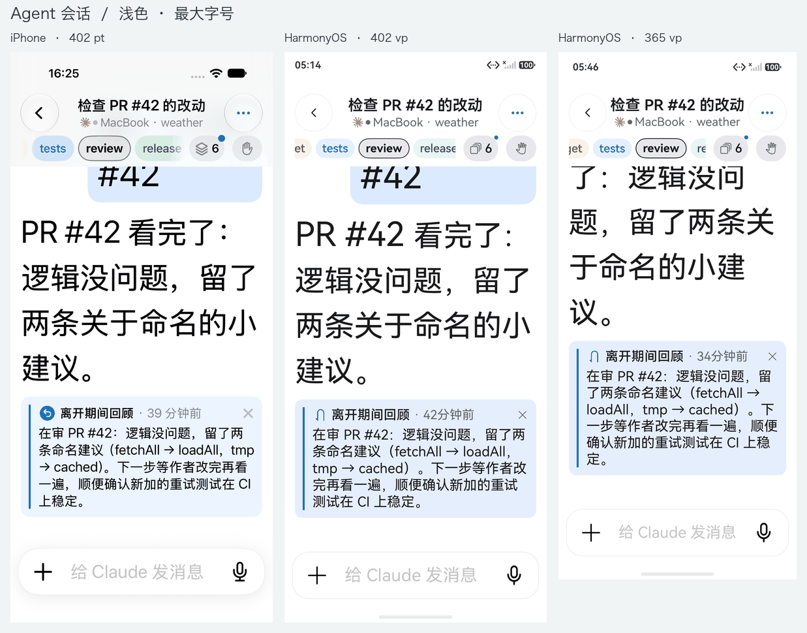

# Agent 会话 · Agent conversation

[返回全部页面 · All pages](../README.md)

打开 weather 的 PR #42 会话，核对用户消息、回复与回顾。
Open the PR #42 conversation with the seeded review history.

Three independent native captures, left to right: iPhone 402 pt, HarmonyOS 402 vp, HarmonyOS 365 vp. The complete screen, including system bars, is visible.

[Download all original screenshots and accessibility trees for this page](../originals/agent-chat.zip?raw=1) · [Source and capture method](../SOURCES.md)

Original archive SHA-256: 090cd918fe2ce4c55dcf5f6851c3b7bcbc4c353031547c9139c6b15e52293c2b

## 浅色 · 标准字号

| Device | Pixels | Captured at | PNG digest | Hierarchy digest |
| --- | --- | --- | --- | --- |
| iPhone 402 pt | 1206 × 2622 | 2026-11-23T08:19:50.959+00:00 | 71d54ba86e27f2fb | 6175d8282e3f2e7a |
| HarmonyOS 402 vp | 1206 × 2622 | 2026-11-23T17:14:07+08:00 | 43149efb978f7c12 | 1d3f949188e830f5 |
| HarmonyOS 365 vp | 1280 × 2832 | 2026-11-23T17:46:15+08:00 | 0845e9f38f45fb1b | 9c7bda85241c367f |

## 深色 · 标准字号

| Device | Pixels | Captured at | PNG digest | Hierarchy digest |
| --- | --- | --- | --- | --- |
| iPhone 402 pt | 1206 × 2622 | 2026-11-23T08:22:51.658+00:00 | 070ef1ed21935246 | 3ea85586052b3c12 |
| HarmonyOS 402 vp | 1206 × 2622 | 2026-11-23T17:14:12+08:00 | abbb6348b5953945 | f492d31aa68b6ef5 |
| HarmonyOS 365 vp | 1280 × 2832 | 2026-11-23T17:46:19+08:00 | 620561532432d146 | 57db40a1187bba25 |

## 浅色 · 最大字号

| Device | Pixels | Captured at | PNG digest | Hierarchy digest |
| --- | --- | --- | --- | --- |
| iPhone 402 pt | 1206 × 2622 | 2026-11-23T08:25:35.181+00:00 | 72e15a1c3bce5706 | 3cad827db3be38e4 |
| HarmonyOS 402 vp | 1206 × 2622 | 2026-11-23T17:14:18+08:00 | 1c958740c7f3562c | f94c2d9c3c0c02b4 |
| HarmonyOS 365 vp | 1280 × 2832 | 2026-11-23T17:46:23+08:00 | 0ac71947a3c7a69b | 56f739345b6f5488 |

Full 64-character digests and ZIP entry paths are under this page in the [manifest](../manifest.json).

[← Agents 列表](agents.md)
[会话小结详情 →](recap-detail.md)
