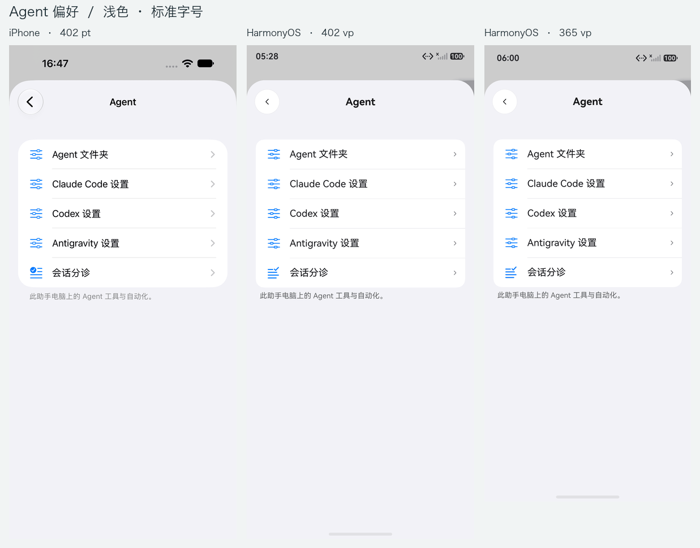
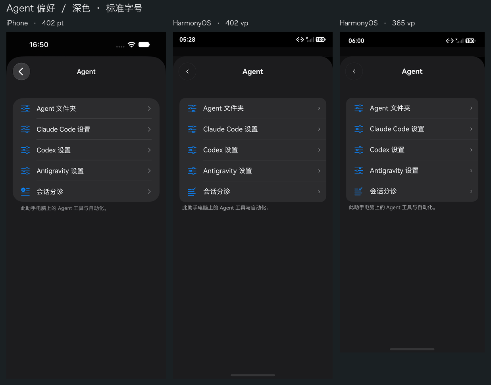
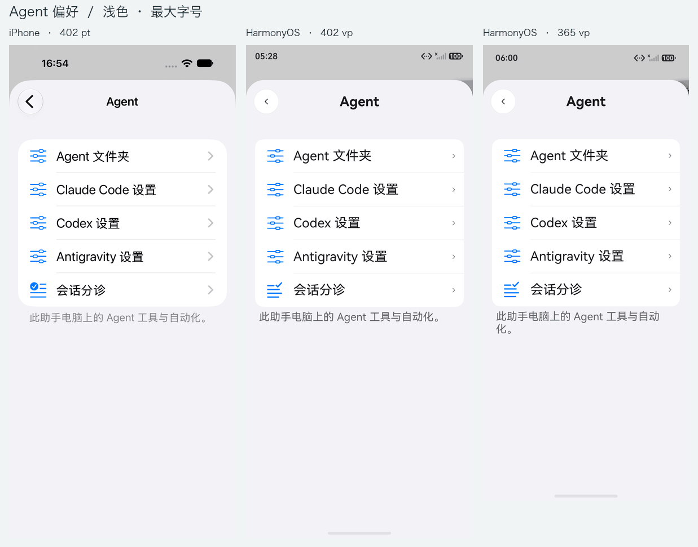

# Agent 偏好 · Agent preferences

[返回全部页面 · All pages](../README.md)

从设置进入 Agent 选项。
Open Agent preferences from Settings search and return to the same query.

Three independent native captures, left to right: iPhone 402 pt, HarmonyOS 402 vp, HarmonyOS 365 vp. The complete screen, including system bars, is visible.

[Download all original screenshots and accessibility trees for this page](../originals/agent-preferences.zip?raw=1) · [Source and capture method](../SOURCES.md)

Original archive SHA-256: 4ec11721a4e9c87fa14a114fe147bd85e08b88c29d0eb640f022ef9b8049300a

## 浅色 · 标准字号

| Device | Pixels | Captured at | PNG digest | Hierarchy digest |
| --- | --- | --- | --- | --- |
| iPhone 402 pt | 1206 × 2622 | 2026-11-23T08:47:09.419+00:00 | 25872e78165a99fc | 1f3e0ab644901093 |
| HarmonyOS 402 vp | 1206 × 2622 | 2026-11-23T17:28:42+08:00 | 4464f4155f1e9dc3 | 5a3f028099a0f7d0 |
| HarmonyOS 365 vp | 1280 × 2832 | 2026-11-23T18:00:31+08:00 | 933b066d85e4e9f3 | bf0a95100c1f3948 |

## 深色 · 标准字号

| Device | Pixels | Captured at | PNG digest | Hierarchy digest |
| --- | --- | --- | --- | --- |
| iPhone 402 pt | 1206 × 2622 | 2026-11-23T08:50:56.643+00:00 | 4742b683886c6eaf | 96da7d3266364a3e |
| HarmonyOS 402 vp | 1206 × 2622 | 2026-11-23T17:28:46+08:00 | 65b3f9525768c5af | 4f128d9428f6004a |
| HarmonyOS 365 vp | 1280 × 2832 | 2026-11-23T18:00:35+08:00 | 4ab3a5648870f2c4 | 0749fd74e8c1ee83 |

## 浅色 · 最大字号

| Device | Pixels | Captured at | PNG digest | Hierarchy digest |
| --- | --- | --- | --- | --- |
| iPhone 402 pt | 1206 × 2622 | 2026-11-23T08:54:40.360+00:00 | 2300ebede694c64b | 166f0d38c035647d |
| HarmonyOS 402 vp | 1206 × 2622 | 2026-11-23T17:28:50+08:00 | 8773047ada428aeb | c91a7d54bd1767c1 |
| HarmonyOS 365 vp | 1280 × 2832 | 2026-11-23T18:00:39+08:00 | f6acbad2cdebd05e | db4e035ec995f218 |

Full 64-character digests and ZIP entry paths are under this page in the [manifest](../manifest.json).

[← 语言](language.md)
[搜索会话内容 →](search.md)
