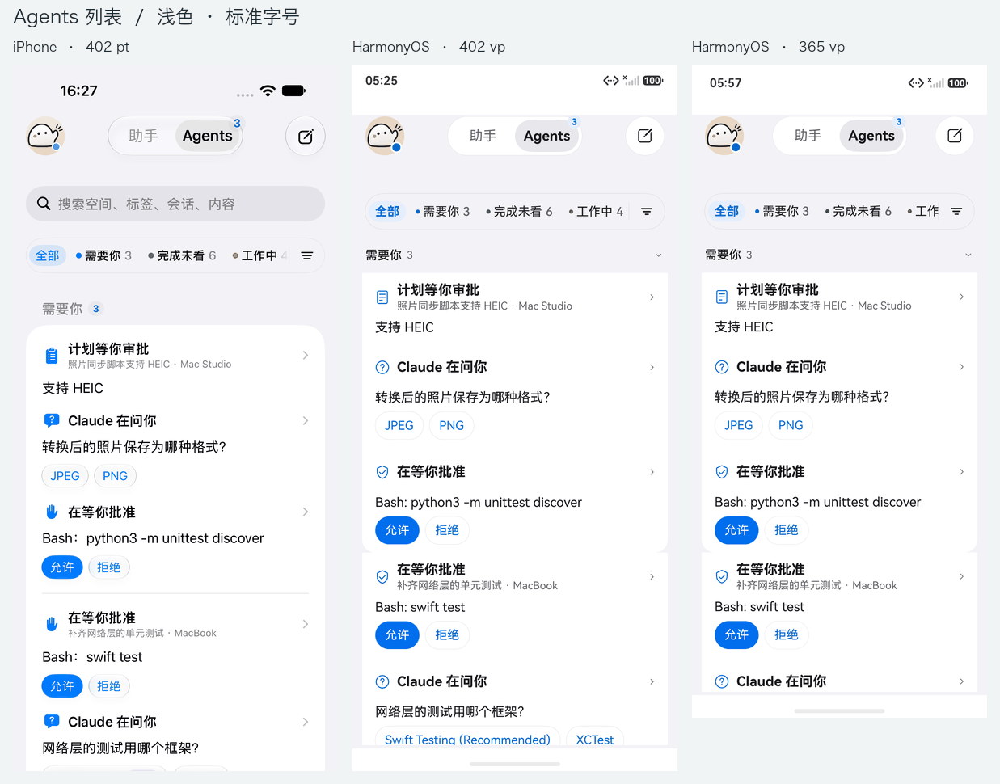
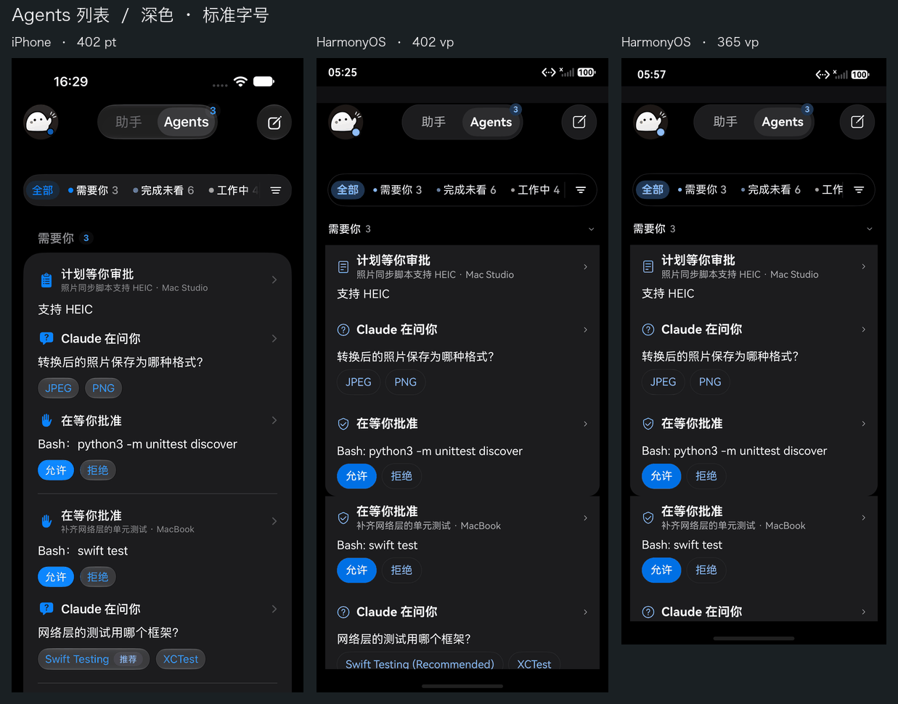
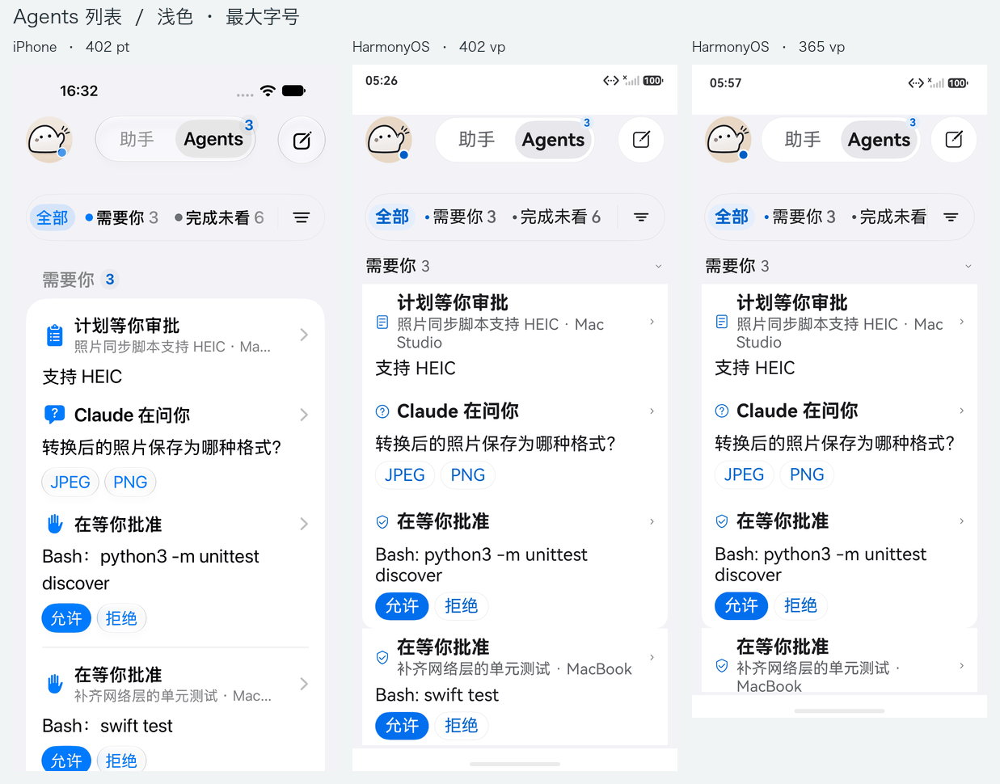

# Agents 列表 · Agent list

[返回全部页面 · All pages](../README.md)

按状态浏览 Agents，区分需要处理和正在工作的会话。

Three independent native captures, left to right: iPhone 402 pt, HarmonyOS 402 vp, HarmonyOS 365 vp. The complete screen, including system bars, is visible.

[Download all original screenshots and accessibility trees for this page](../originals/agents.zip?raw=1) · [Source and capture method](../SOURCES.md)

Original archive SHA-256: a56648a938ae88350e3c7def2202256226f0700d9b7477ef4a3ba1be32ca9e36

## 浅色 · 标准字号

| Device | Pixels | Captured at | PNG digest | Hierarchy digest |
| --- | --- | --- | --- | --- |
| iPhone 402 pt | 1206 × 2622 | 2026-11-23T08:27:15.162+00:00 | 06432675dd110273 | fa63bc41e4a44f3d |
| HarmonyOS 402 vp | 1206 × 2622 | 2026-11-23T17:25:55+08:00 | e614a4b25565b72f | 443d5956e16afc04 |
| HarmonyOS 365 vp | 1280 × 2832 | 2026-11-23T17:57:36+08:00 | f391af27fefd7590 | 33f75c3c3a601140 |

## 深色 · 标准字号

| Device | Pixels | Captured at | PNG digest | Hierarchy digest |
| --- | --- | --- | --- | --- |
| iPhone 402 pt | 1206 × 2622 | 2026-11-23T08:29:43.652+00:00 | e9095c7f80639913 | f44f7475a4d27535 |
| HarmonyOS 402 vp | 1206 × 2622 | 2026-11-23T17:25:59+08:00 | b689dab8749351b2 | 2b402ce4f6db7445 |
| HarmonyOS 365 vp | 1280 × 2832 | 2026-11-23T17:57:40+08:00 | e4567335fe8aec88 | cbb5221981745c54 |

## 浅色 · 最大字号

| Device | Pixels | Captured at | PNG digest | Hierarchy digest |
| --- | --- | --- | --- | --- |
| iPhone 402 pt | 1206 × 2622 | 2026-11-23T08:32:13.645+00:00 | 44f0caffbfb93728 | de57f2e684db8b6c |
| HarmonyOS 402 vp | 1206 × 2622 | 2026-11-23T17:26:04+08:00 | fcd0fdb858c78416 | 6f3eb6da266d9a7f |
| HarmonyOS 365 vp | 1280 × 2832 | 2026-11-23T17:57:45+08:00 | 82875884a5d34bb3 | 8704c4d63744e523 |

Full 64-character digests and ZIP entry paths are under this page in the [manifest](../manifest.json).

[← 提交 Agent 配置](start-ready.md)
[Agent 会话 →](agent-chat.md)
