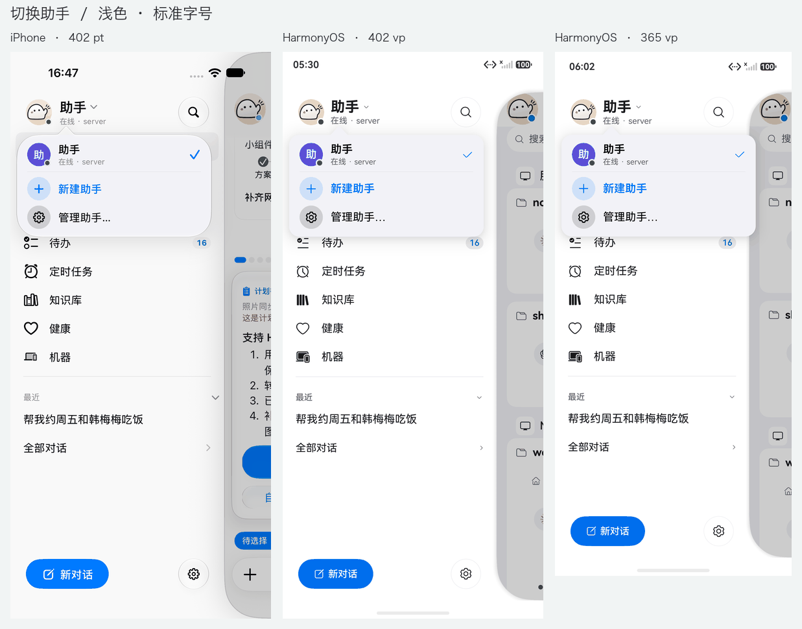
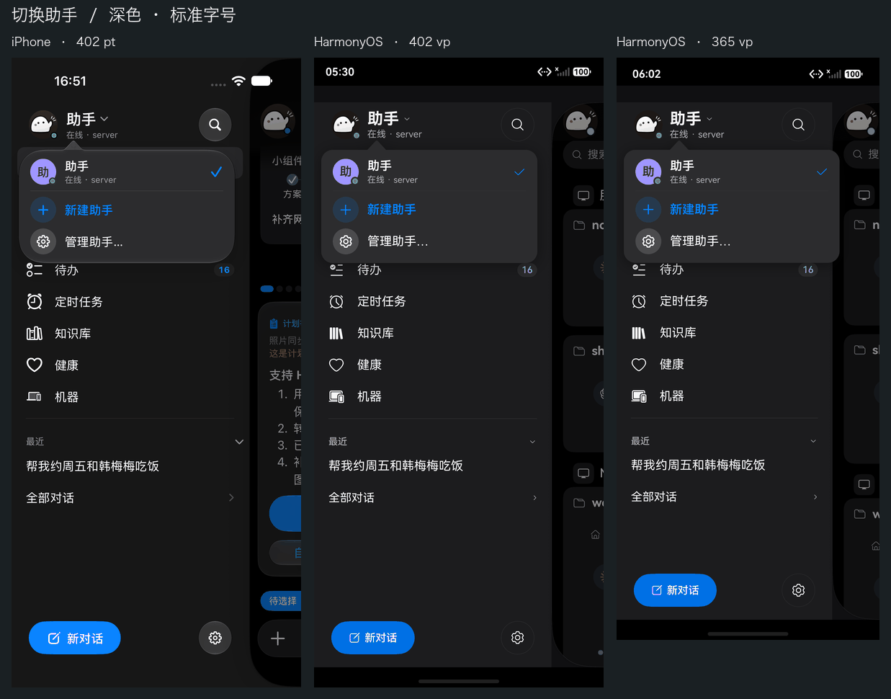
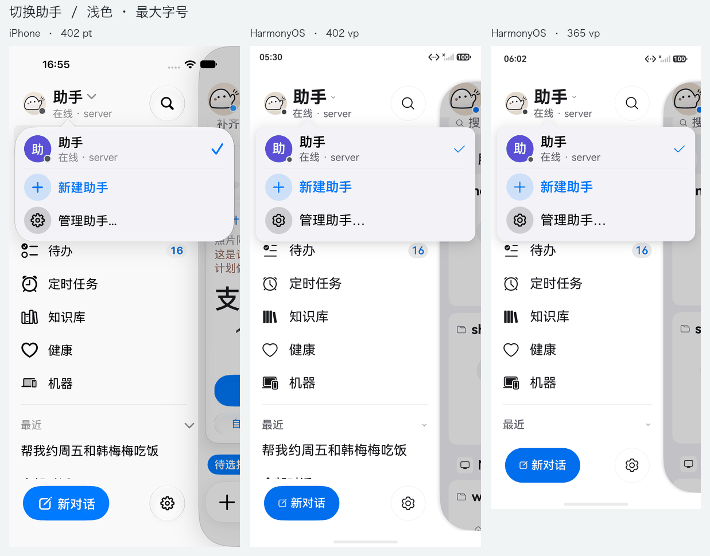

# 切换助手 · Switch assistants

[返回全部页面 · All pages](../README.md)

从当前助手打开助手切换菜单。

Three independent native captures, left to right: iPhone 402 pt, HarmonyOS 402 vp, HarmonyOS 365 vp. The complete screen, including system bars, is visible.

[Download all original screenshots and accessibility trees for this page](../originals/assistant-menu.zip?raw=1) · [Source and capture method](../SOURCES.md)

Original archive SHA-256: 717aeb3d991c76a16444288a70c2ee82ab0344b1f873f86663dd3141fb40f61b

## 浅色 · 标准字号

| Device | Pixels | Captured at | PNG digest | Hierarchy digest |
| --- | --- | --- | --- | --- |
| iPhone 402 pt | 1206 × 2622 | 2026-11-23T08:47:41.258+00:00 | 30d62f8f500e0586 | aeb9de7fcf903993 |
| HarmonyOS 402 vp | 1206 × 2622 | 2026-11-23T17:30:41+08:00 | 686ffc747468135e | 93b59fdfc1a6fc37 |
| HarmonyOS 365 vp | 1280 × 2832 | 2026-11-23T18:02:36+08:00 | 1b098f45d85ca8b1 | 6392c212e00a8dac |

## 深色 · 标准字号

| Device | Pixels | Captured at | PNG digest | Hierarchy digest |
| --- | --- | --- | --- | --- |
| iPhone 402 pt | 1206 × 2622 | 2026-11-23T08:51:28.308+00:00 | 00f36903a0a14a15 | 6d7e98eb95e16eeb |
| HarmonyOS 402 vp | 1206 × 2622 | 2026-11-23T17:30:45+08:00 | 99dd3836ba7c4a91 | dd3767647f5f95be |
| HarmonyOS 365 vp | 1280 × 2832 | 2026-11-23T18:02:41+08:00 | 9050d000489c96ac | af9df0468edab13a |

## 浅色 · 最大字号

| Device | Pixels | Captured at | PNG digest | Hierarchy digest |
| --- | --- | --- | --- | --- |
| iPhone 402 pt | 1206 × 2622 | 2026-11-23T08:55:13.958+00:00 | 947418e651701e70 | 181114d1153edec2 |
| HarmonyOS 402 vp | 1206 × 2622 | 2026-11-23T17:30:51+08:00 | fd2408a17f95aef6 | abb82ad8b3c9991c |
| HarmonyOS 365 vp | 1280 × 2832 | 2026-11-23T18:02:46+08:00 | 4930c632d7a109b0 | 52b75b1ac7dba73d |

Full 64-character digests and ZIP entry paths are under this page in the [manifest](../manifest.json).

[← 侧栏](drawer.md)
[设置 →](settings.md)
