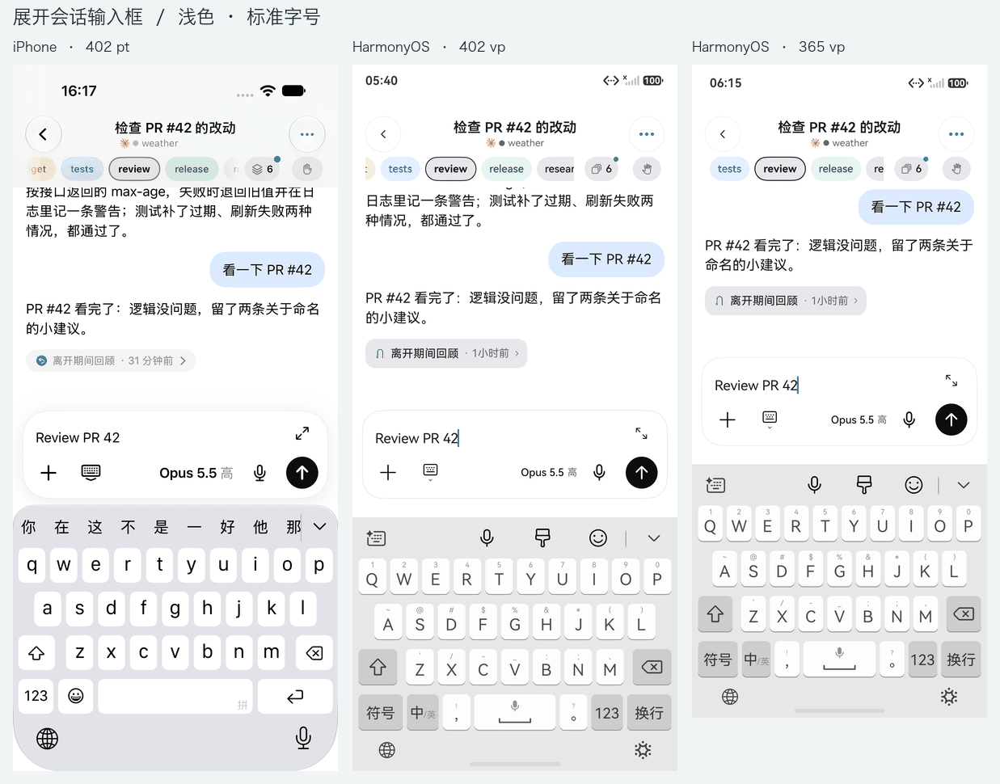
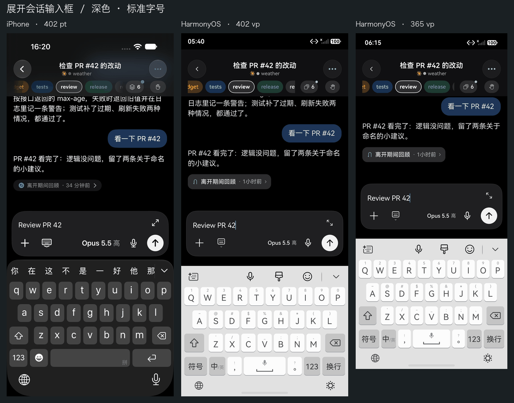
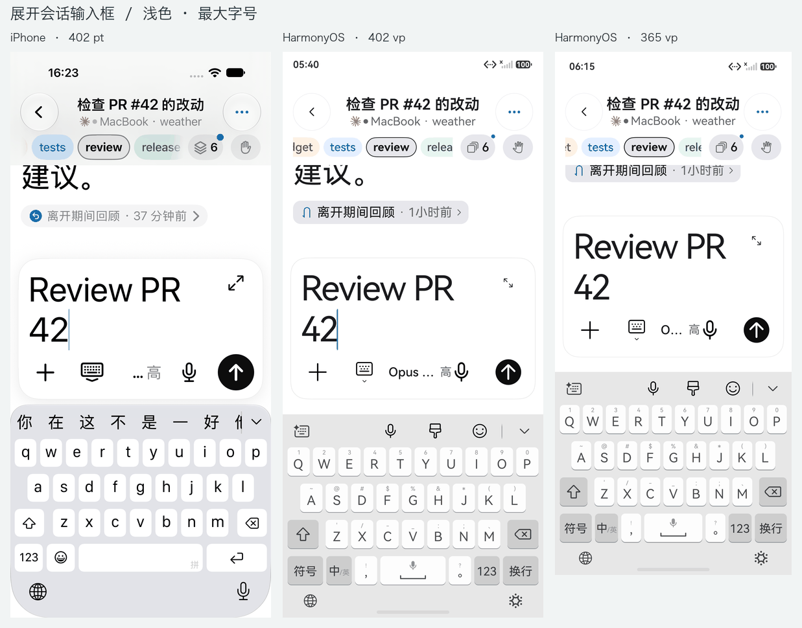

# 展开会话输入框 · Focused composer

[返回全部页面 · All pages](../README.md)

聚焦 PR #42 的输入框，核对草稿、键盘和发送控件的位置。
Focus the PR #42 composer and return from its full-screen editor to the same draft.

Three independent native captures, left to right: iPhone 402 pt, HarmonyOS 402 vp, HarmonyOS 365 vp. The complete screen, including system bars, is visible.

[Download all original screenshots and accessibility trees for this page](../originals/composer.zip?raw=1) · [Source and capture method](../SOURCES.md)

Original archive SHA-256: d8a1f8ea58cc0df69cada472e7d8c6a754b6d4b2fd1fcd60ed1bcdb869b2a41b

## 浅色 · 标准字号

| Device | Pixels | Captured at | PNG digest | Hierarchy digest |
| --- | --- | --- | --- | --- |
| iPhone 402 pt | 1206 × 2622 | 2026-11-23T08:17:00.811+00:00 | 33b522f1b70289b9 | 45f397d01e09f545 |
| HarmonyOS 402 vp | 1206 × 2622 | 2026-11-23T17:40:04+08:00 | b86f6c640e2df1d6 | 5d7dc4ba74b2a5e3 |
| HarmonyOS 365 vp | 1280 × 2832 | 2026-11-23T18:15:36+08:00 | e82268e2309811cf | db3ca236155730b6 |

## 深色 · 标准字号

| Device | Pixels | Captured at | PNG digest | Hierarchy digest |
| --- | --- | --- | --- | --- |
| iPhone 402 pt | 1206 × 2622 | 2026-11-23T08:20:42.396+00:00 | c5317909460c477c | 2a64006f7cb838db |
| HarmonyOS 402 vp | 1206 × 2622 | 2026-11-23T17:40:08+08:00 | f57fb992045a96aa | 3b2a5e72d1147006 |
| HarmonyOS 365 vp | 1280 × 2832 | 2026-11-23T18:15:39+08:00 | dd2e694c175fc5f3 | d823b43dab30e535 |

## 浅色 · 最大字号

| Device | Pixels | Captured at | PNG digest | Hierarchy digest |
| --- | --- | --- | --- | --- |
| iPhone 402 pt | 1206 × 2622 | 2026-11-23T08:23:41.445+00:00 | 3263efb86cf15fb5 | 865838c7712e08b9 |
| HarmonyOS 402 vp | 1206 × 2622 | 2026-11-23T17:40:12+08:00 | 6b477fe605943c5b | dc91fe9b23f3a805 |
| HarmonyOS 365 vp | 1280 × 2832 | 2026-11-23T18:15:44+08:00 | 39704f9301f41d52 | 979ea78afa542c92 |

Full 64-character digests and ZIP entry paths are under this page in the [manifest](../manifest.json).

[← Persona 主对话](persona.md)
[回看会话记录 →](reading-history.md)
