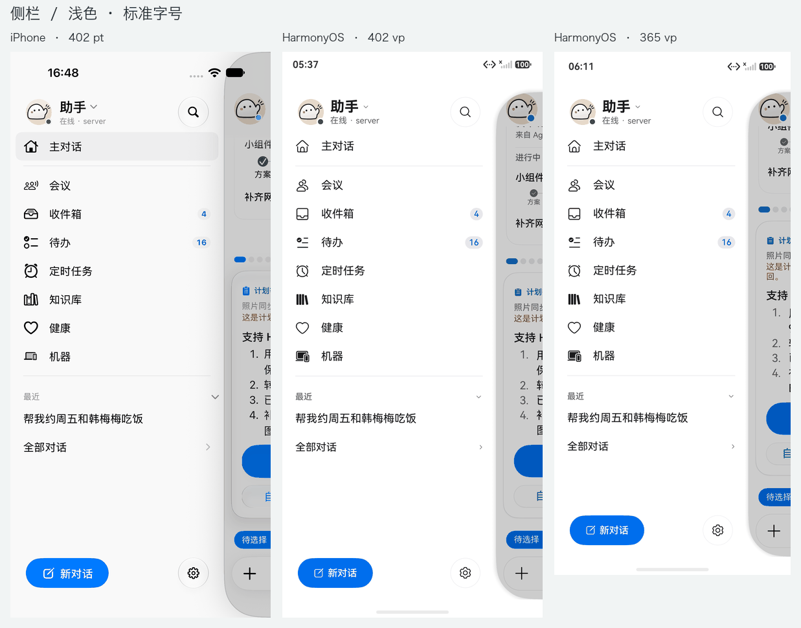
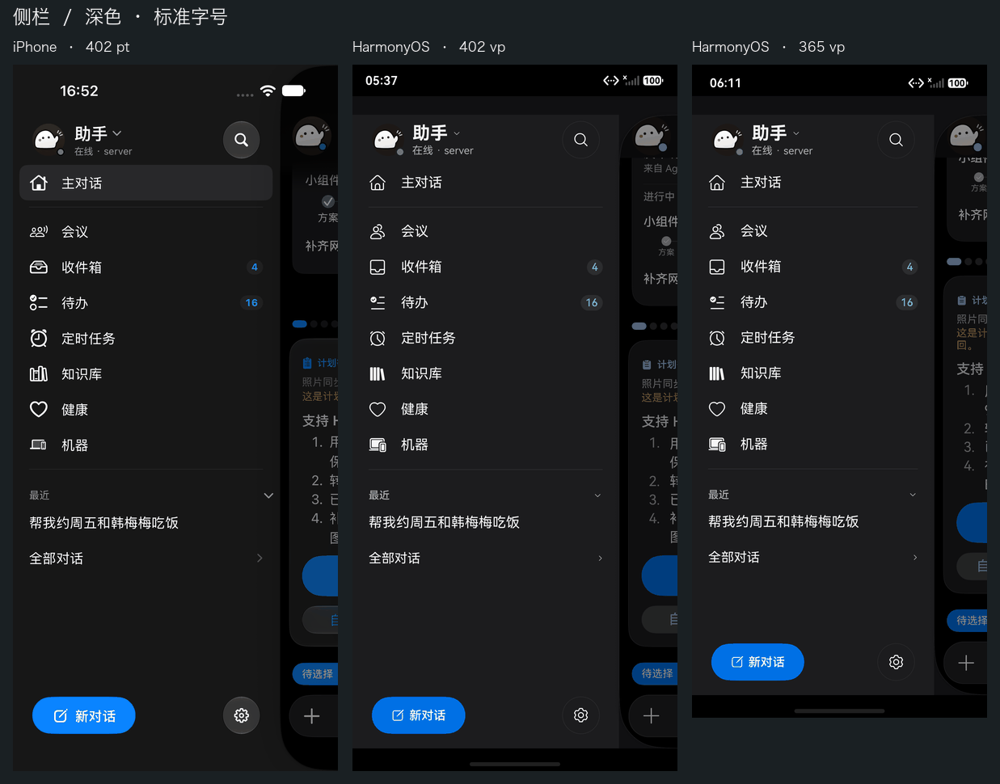
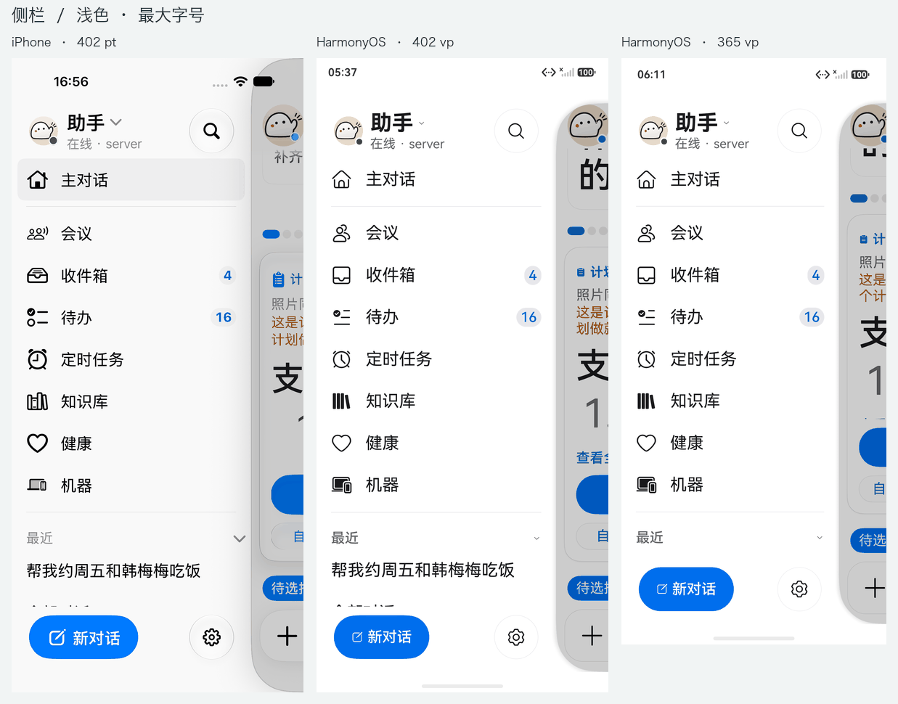

# 侧栏 · Navigation drawer

[返回全部页面 · All pages](../README.md)

在侧栏查找主对话、工作空间和设置入口。

Three independent native captures, left to right: iPhone 402 pt, HarmonyOS 402 vp, HarmonyOS 365 vp. The complete screen, including system bars, is visible.

[Download all original screenshots and accessibility trees for this page](../originals/drawer.zip?raw=1) · [Source and capture method](../SOURCES.md)

Original archive SHA-256: e84b696b501a21b6cc49265857da88034ea457f9c68633faa5abacbc5c35a814

## 浅色 · 标准字号

| Device | Pixels | Captured at | PNG digest | Hierarchy digest |
| --- | --- | --- | --- | --- |
| iPhone 402 pt | 1206 × 2622 | 2026-11-23T08:48:31.209+00:00 | b384e10c61f2df8e | 5892466921b1a172 |
| HarmonyOS 402 vp | 1206 × 2622 | 2026-11-23T17:37:43+08:00 | c832df3e2c9eee1f | 502c3074cc857725 |
| HarmonyOS 365 vp | 1280 × 2832 | 2026-11-23T18:11:27+08:00 | 0692774e1cd42c9b | 516d3cd9a1b5b7f0 |

## 深色 · 标准字号

| Device | Pixels | Captured at | PNG digest | Hierarchy digest |
| --- | --- | --- | --- | --- |
| iPhone 402 pt | 1206 × 2622 | 2026-11-23T08:52:19.483+00:00 | 2945e3a00b326cdd | f935a0fce704e134 |
| HarmonyOS 402 vp | 1206 × 2622 | 2026-11-23T17:37:48+08:00 | 801b99ef9ae68322 | 7e8c32bf14049718 |
| HarmonyOS 365 vp | 1280 × 2832 | 2026-11-23T18:11:32+08:00 | dc5edff47ef6781a | f8058e0857a0e70f |

## 浅色 · 最大字号

| Device | Pixels | Captured at | PNG digest | Hierarchy digest |
| --- | --- | --- | --- | --- |
| iPhone 402 pt | 1206 × 2622 | 2026-11-23T08:56:06.187+00:00 | 522eb339f20f8b61 | 36198f34f9921af1 |
| HarmonyOS 402 vp | 1206 × 2622 | 2026-11-23T17:37:53+08:00 | b95cb7b28e9ecf4e | 6857fd679acf083e |
| HarmonyOS 365 vp | 1280 × 2832 | 2026-11-23T18:11:37+08:00 | 71aebd777ab3bf7e | b4eb4de58d33bdb4 |

Full 64-character digests and ZIP entry paths are under this page in the [manifest](../manifest.json).

[← 机器监控读数](machine-monitor.md)
[切换助手 →](assistant-menu.md)
