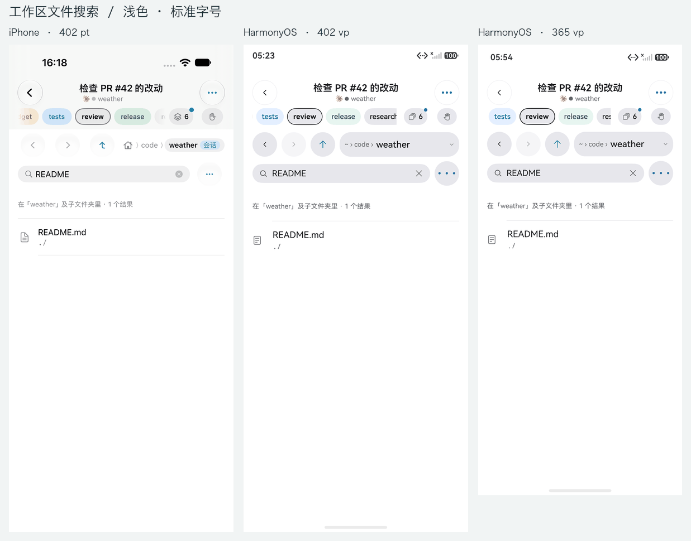
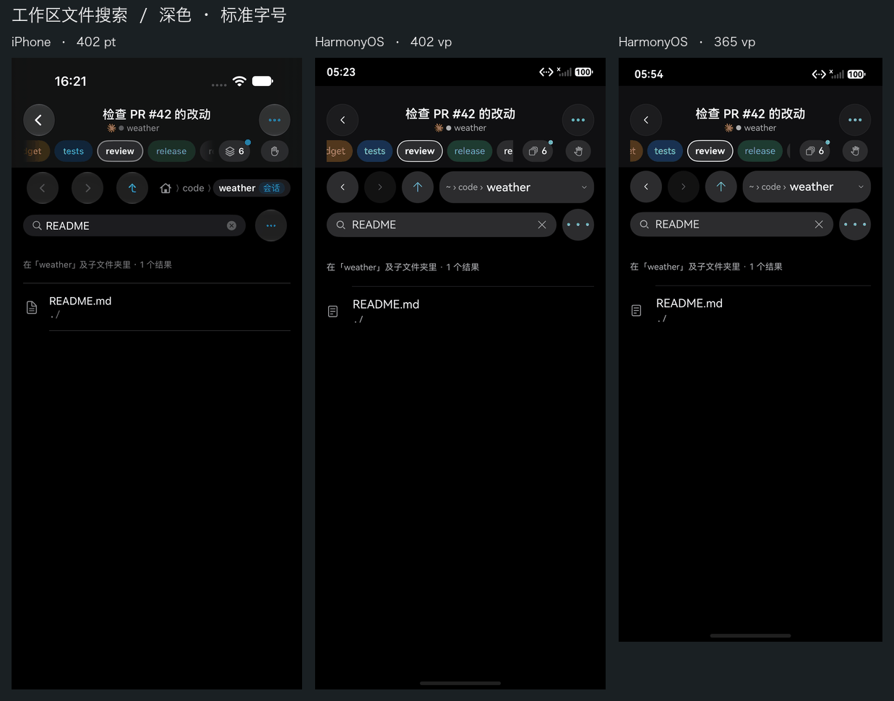
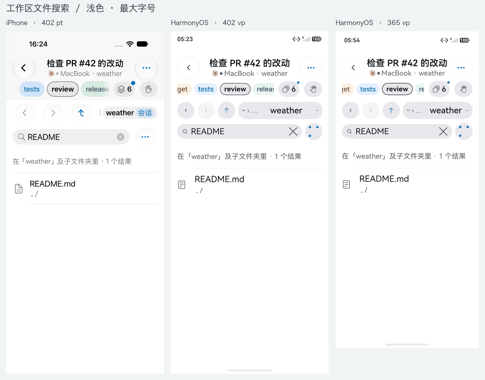

# 工作区文件搜索 · Find a file

[返回全部页面 · All pages](../README.md)

在当前工作目录及子目录搜索 README。

Three independent native captures, left to right: iPhone 402 pt, HarmonyOS 402 vp, HarmonyOS 365 vp. The complete screen, including system bars, is visible.

[Download all original screenshots and accessibility trees for this page](../originals/file-search.zip?raw=1) · [Source and capture method](../SOURCES.md)

Original archive SHA-256: b5da5b4f6864b67b7dfd8324f4dc60461ac592e1134a86a337f7ed01719a7f69

## 浅色 · 标准字号

| Device | Pixels | Captured at | PNG digest | Hierarchy digest |
| --- | --- | --- | --- | --- |
| iPhone 402 pt | 1206 × 2622 | 2026-11-23T08:18:53.162+00:00 | 856d0d1722f0f167 | f6b2f6d80eb7280b |
| HarmonyOS 402 vp | 1206 × 2622 | 2026-11-23T17:23:10+08:00 | 3f9fd86c5602ff55 | 5fd6ccbd4320b6ee |
| HarmonyOS 365 vp | 1280 × 2832 | 2026-11-23T17:54:48+08:00 | f332fb4b6d431f14 | 93661980608c0db9 |

## 深色 · 标准字号

| Device | Pixels | Captured at | PNG digest | Hierarchy digest |
| --- | --- | --- | --- | --- |
| iPhone 402 pt | 1206 × 2622 | 2026-11-23T08:21:56.021+00:00 | 921c0ea699bcd076 | fe412af35946f8de |
| HarmonyOS 402 vp | 1206 × 2622 | 2026-11-23T17:23:14+08:00 | fc25eb5da6599701 | df12fa7548d57aa1 |
| HarmonyOS 365 vp | 1280 × 2832 | 2026-11-23T17:54:52+08:00 | 755e517aa6158437 | 3e81d491e1517830 |

## 浅色 · 最大字号

| Device | Pixels | Captured at | PNG digest | Hierarchy digest |
| --- | --- | --- | --- | --- |
| iPhone 402 pt | 1206 × 2622 | 2026-11-23T08:24:40.342+00:00 | a892691a8962525f | f8da6cd5208dd66c |
| HarmonyOS 402 vp | 1206 × 2622 | 2026-11-23T17:23:18+08:00 | e8297c2b387d0cf7 | e64fce05d4a9c848 |
| HarmonyOS 365 vp | 1280 × 2832 | 2026-11-23T17:54:56+08:00 | 386e9aafd2d24d4c | 75eba389b567b1ad |

Full 64-character digests and ZIP entry paths are under this page in the [manifest](../manifest.json).

[← 文件](files.md)
[Git 工作区 →](git.md)
