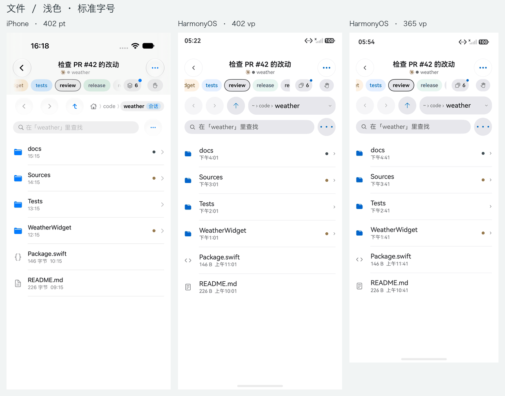
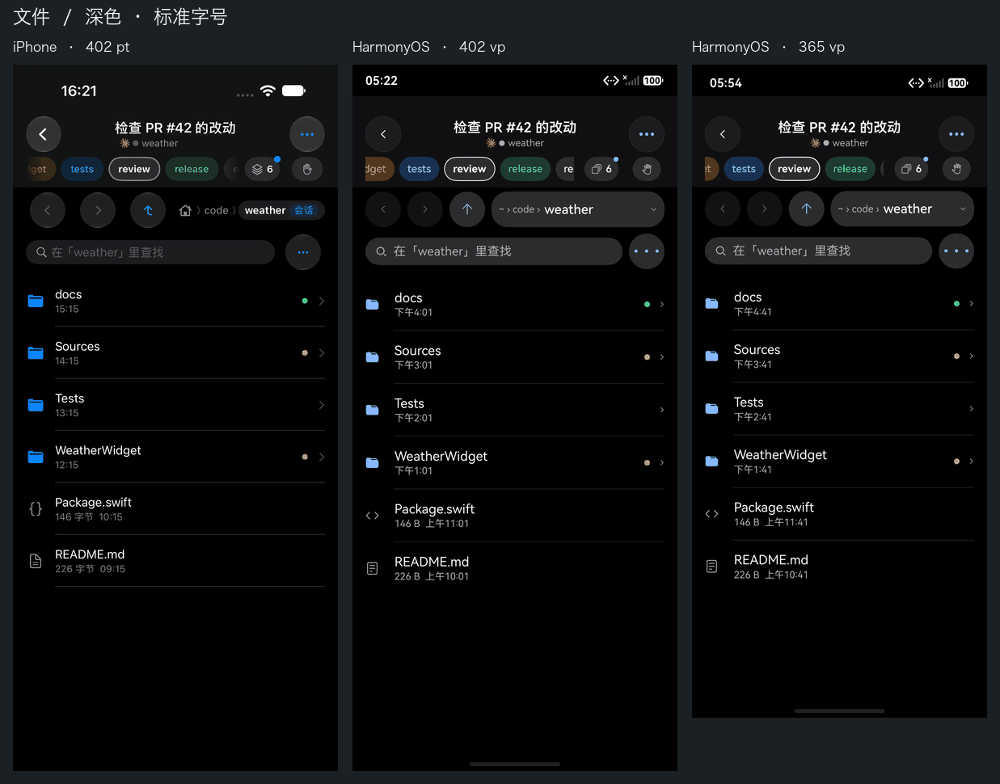
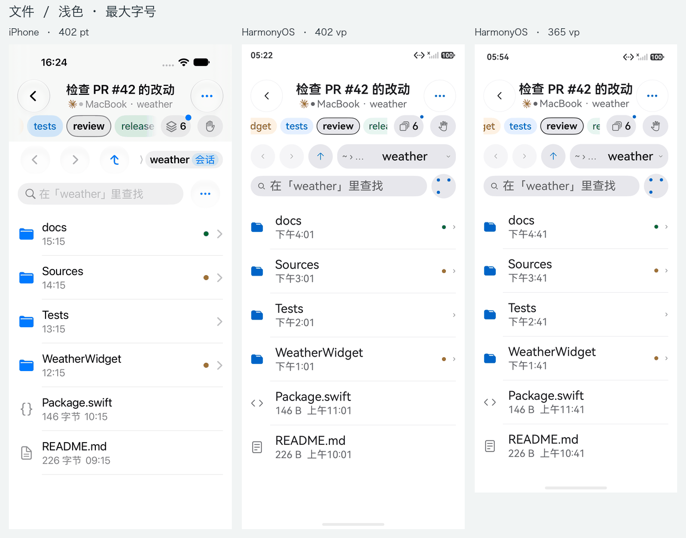

# 文件 · Workspace files

[返回全部页面 · All pages](../README.md)

浏览 weather 目录的文件与文件夹。
Open Files from the More menu of the PR #42 conversation. Its title, space and sibling tabs stay visible.

Three independent native captures, left to right: iPhone 402 pt, HarmonyOS 402 vp, HarmonyOS 365 vp. The complete screen, including system bars, is visible.

[Download all original screenshots and accessibility trees for this page](../originals/files.zip?raw=1) · [Source and capture method](../SOURCES.md)

Original archive SHA-256: 48c54dcb79da094923945c626628eef3de65d608ccdb4337a2e91dfd946dcf33

## 浅色 · 标准字号

| Device | Pixels | Captured at | PNG digest | Hierarchy digest |
| --- | --- | --- | --- | --- |
| iPhone 402 pt | 1206 × 2622 | 2026-11-23T08:18:44.114+00:00 | f6d2bfb26781d9bd | 0541c992d34519d5 |
| HarmonyOS 402 vp | 1206 × 2622 | 2026-11-23T17:22:35+08:00 | 0cf943a0e018956b | 978a7ddc0a05f596 |
| HarmonyOS 365 vp | 1280 × 2832 | 2026-11-23T17:54:30+08:00 | 52efdc592e5c5381 | dc806efc54562b58 |

## 深色 · 标准字号

| Device | Pixels | Captured at | PNG digest | Hierarchy digest |
| --- | --- | --- | --- | --- |
| iPhone 402 pt | 1206 × 2622 | 2026-11-23T08:21:47.202+00:00 | 6076f27a9f0cd98f | 8d9cff9bef517030 |
| HarmonyOS 402 vp | 1206 × 2622 | 2026-11-23T17:22:39+08:00 | bb836c964e11eeb7 | dd2dd61f019f17df |
| HarmonyOS 365 vp | 1280 × 2832 | 2026-11-23T17:54:34+08:00 | 562b08b5af25ae26 | c0aebbe9a81a8bcc |

## 浅色 · 最大字号

| Device | Pixels | Captured at | PNG digest | Hierarchy digest |
| --- | --- | --- | --- | --- |
| iPhone 402 pt | 1206 × 2622 | 2026-11-23T08:24:31.666+00:00 | 8f18af26a2d8166e | b338cd346ec1803e |
| HarmonyOS 402 vp | 1206 × 2622 | 2026-11-23T17:22:51+08:00 | 2a53a13c5d1357af | 08b49ceb80fdf94b |
| HarmonyOS 365 vp | 1280 × 2832 | 2026-11-23T17:54:38+08:00 | cbfe738a850e5e46 | 3f9baa9063f1bb43 |

Full 64-character digests and ZIP entry paths are under this page in the [manifest](../manifest.json).

[← 回看会话记录](reading-history.md)
[工作区文件搜索 →](file-search.md)
