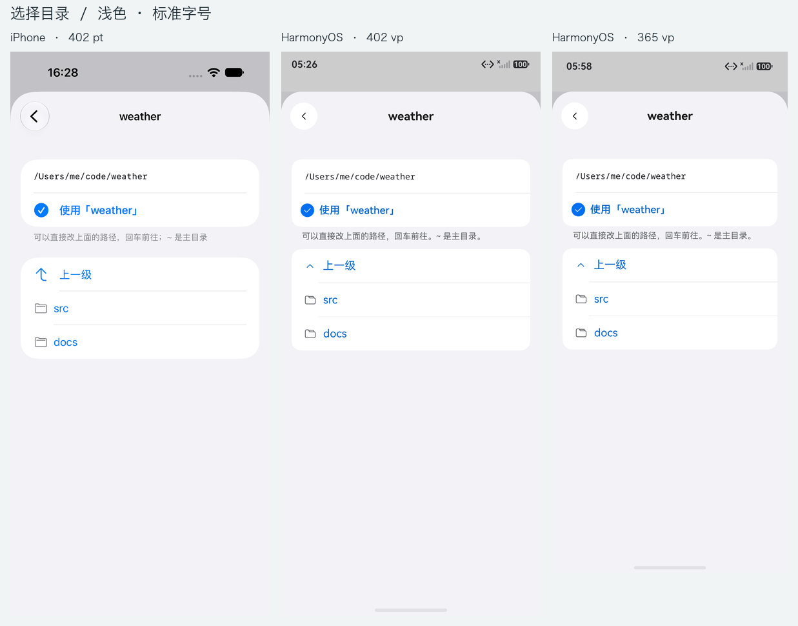
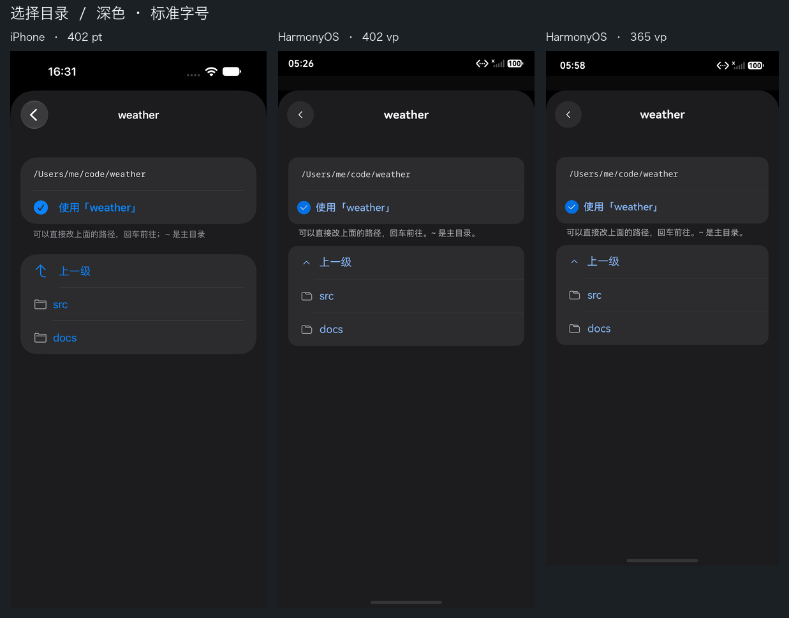
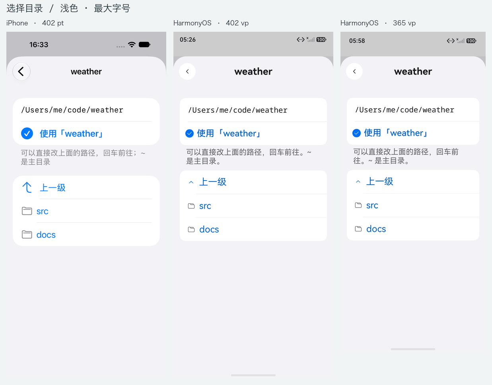

# 选择目录 · Choose a working directory

[返回全部页面 · All pages](../README.md)

浏览目录，并将所选目录交给新会话。
Open the weather directory picker and compare the parent, children and the action to use that directory.

Three independent native captures, left to right: iPhone 402 pt, HarmonyOS 402 vp, HarmonyOS 365 vp. The complete screen, including system bars, is visible.

[Download all original screenshots and accessibility trees for this page](../originals/folder-browser.zip?raw=1) · [Source and capture method](../SOURCES.md)

Original archive SHA-256: 5dba3d67ca0e196e23d3b7d3bbb34de157f61402c2fa1d67ad73a91a1c9c29b7

## 浅色 · 标准字号

| Device | Pixels | Captured at | PNG digest | Hierarchy digest |
| --- | --- | --- | --- | --- |
| iPhone 402 pt | 1206 × 2622 | 2026-11-23T08:28:49.373+00:00 | 9ee9d94b65a8c922 | 6f7515bd12a78438 |
| HarmonyOS 402 vp | 1206 × 2622 | 2026-11-23T17:26:30+08:00 | 4942110359d33dbd | d93263ddbaddf57e |
| HarmonyOS 365 vp | 1280 × 2832 | 2026-11-23T17:58:26+08:00 | 7553f012b6646e2e | 70064c1cfa1cceeb |

## 深色 · 标准字号

| Device | Pixels | Captured at | PNG digest | Hierarchy digest |
| --- | --- | --- | --- | --- |
| iPhone 402 pt | 1206 × 2622 | 2026-11-23T08:31:17.792+00:00 | 21789bd832cefdd3 | 4e16ceafce57421f |
| HarmonyOS 402 vp | 1206 × 2622 | 2026-11-23T17:26:34+08:00 | af6182dc798069cf | 2c372f26a30daea3 |
| HarmonyOS 365 vp | 1280 × 2832 | 2026-11-23T17:58:30+08:00 | 55648b4b62fd2798 | 6c80b1c572dea4ed |

## 浅色 · 最大字号

| Device | Pixels | Captured at | PNG digest | Hierarchy digest |
| --- | --- | --- | --- | --- |
| iPhone 402 pt | 1206 × 2622 | 2026-11-23T08:33:53.781+00:00 | 5aebe0933363104e | 58f01d47158566f7 |
| HarmonyOS 402 vp | 1206 × 2622 | 2026-11-23T17:26:40+08:00 | 7b558475c083e766 | 447d69167103b113 |
| HarmonyOS 365 vp | 1280 × 2832 | 2026-11-23T17:58:34+08:00 | 0989061aa18a81d3 | dcca0c805e0a6270 |

Full 64-character digests and ZIP entry paths are under this page in the [manifest](../manifest.json).

[← 新建 Agent](new-agent.md)
[选择模型 →](models.md)
