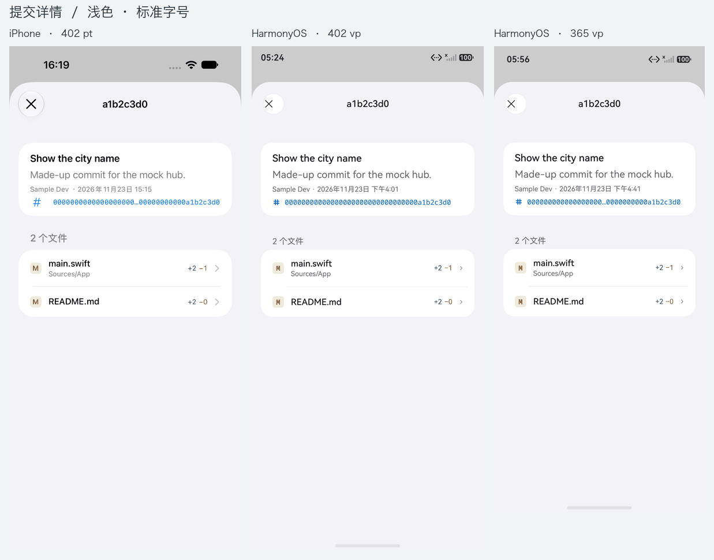
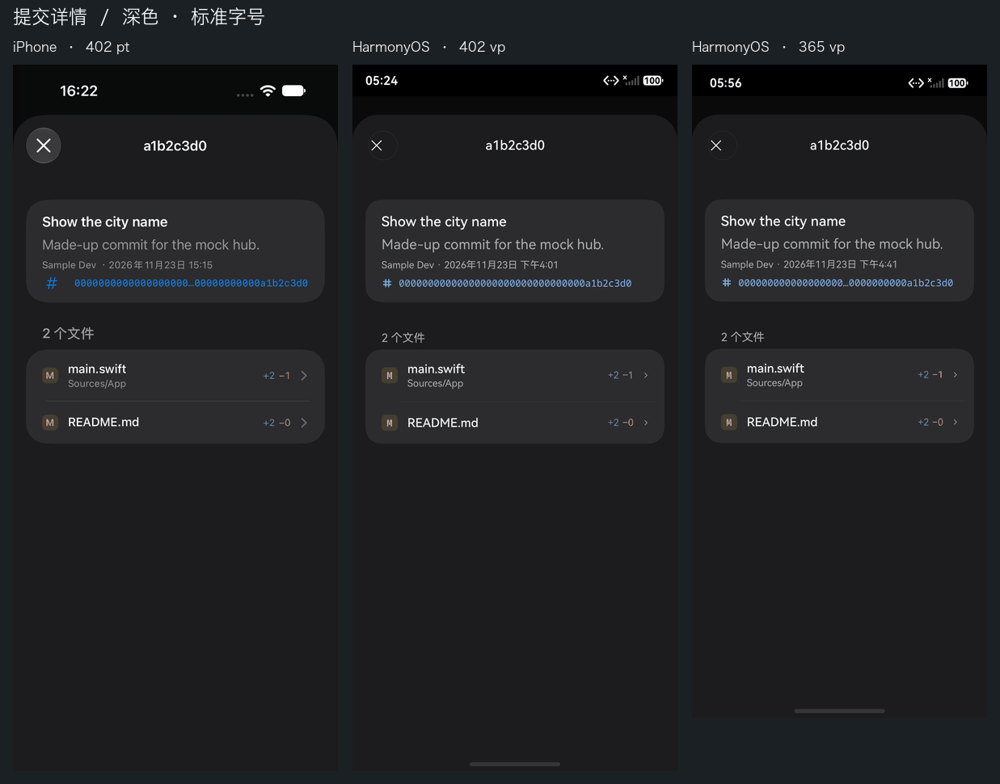
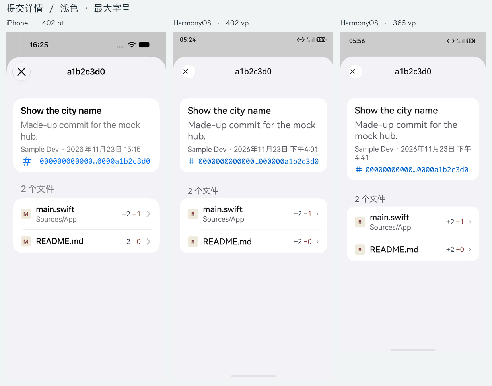

# 提交详情 · Commit details

[返回全部页面 · All pages](../README.md)

查看 Show the city name 提交、作者、短哈希和改动文件。

Three independent native captures, left to right: iPhone 402 pt, HarmonyOS 402 vp, HarmonyOS 365 vp. The complete screen, including system bars, is visible.

[Download all original screenshots and accessibility trees for this page](../originals/git-commit.zip?raw=1) · [Source and capture method](../SOURCES.md)

Original archive SHA-256: 0949433101d443207d76133b8e46fa8e9d6a6c42f59b3f6b572ac14b6c4a0cba

## 浅色 · 标准字号

| Device | Pixels | Captured at | PNG digest | Hierarchy digest |
| --- | --- | --- | --- | --- |
| iPhone 402 pt | 1206 × 2622 | 2026-11-23T08:19:24.506+00:00 | 130262b8d3e1a1be | 1dff280559b217c3 |
| HarmonyOS 402 vp | 1206 × 2622 | 2026-11-23T17:24:30+08:00 | 99bd08741b9b94c4 | ca377d07677965f1 |
| HarmonyOS 365 vp | 1280 × 2832 | 2026-11-23T17:56:00+08:00 | dab9f34b7da6e8a8 | b44557bf7b135b61 |

## 深色 · 标准字号

| Device | Pixels | Captured at | PNG digest | Hierarchy digest |
| --- | --- | --- | --- | --- |
| iPhone 402 pt | 1206 × 2622 | 2026-11-23T08:22:26.408+00:00 | 5f576521f784f020 | 28ab81521ec9eaad |
| HarmonyOS 402 vp | 1206 × 2622 | 2026-11-23T17:24:35+08:00 | 2b94f5e90b5404e2 | 47563e880e53ba7f |
| HarmonyOS 365 vp | 1280 × 2832 | 2026-11-23T17:56:04+08:00 | 99533619106b4c87 | 2b2698f442eed6c9 |

## 浅色 · 最大字号

| Device | Pixels | Captured at | PNG digest | Hierarchy digest |
| --- | --- | --- | --- | --- |
| iPhone 402 pt | 1206 × 2622 | 2026-11-23T08:25:09.712+00:00 | ac43b780d2fde266 | b73454ccf1f78af7 |
| HarmonyOS 402 vp | 1206 × 2622 | 2026-11-23T17:24:40+08:00 | f32a2a7ce82a8553 | 2f50e2ed3e040ae1 |
| HarmonyOS 365 vp | 1280 × 2832 | 2026-11-23T17:56:08+08:00 | e3e273990c46f07f | a502cb6e2b61851d |

Full 64-character digests and ZIP entry paths are under this page in the [manifest](../manifest.json).

[← Git 工作区](git.md)
[Git 差异 →](git-diff.md)
