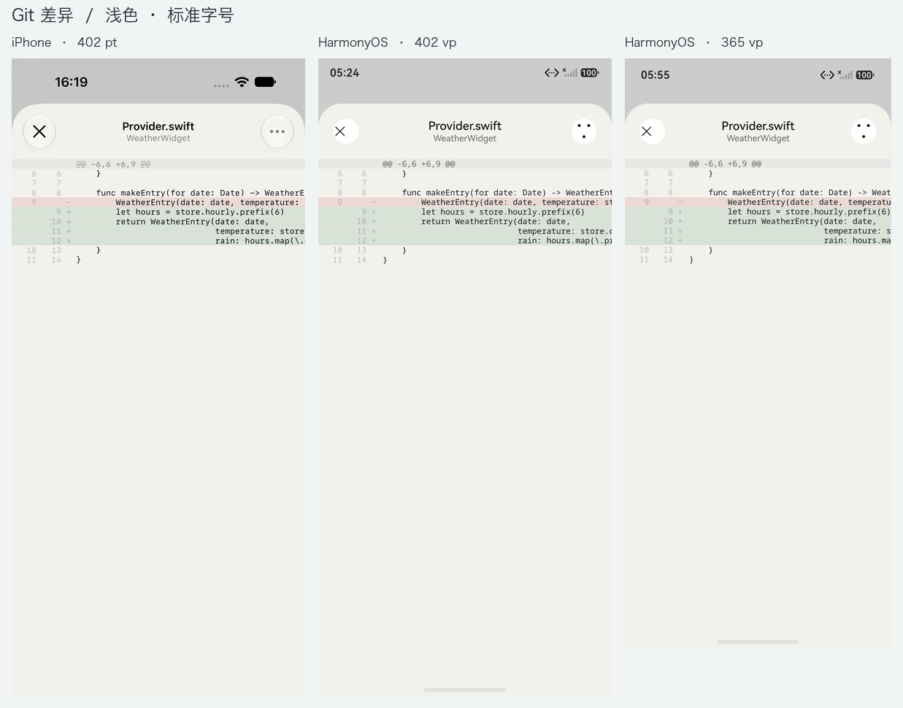
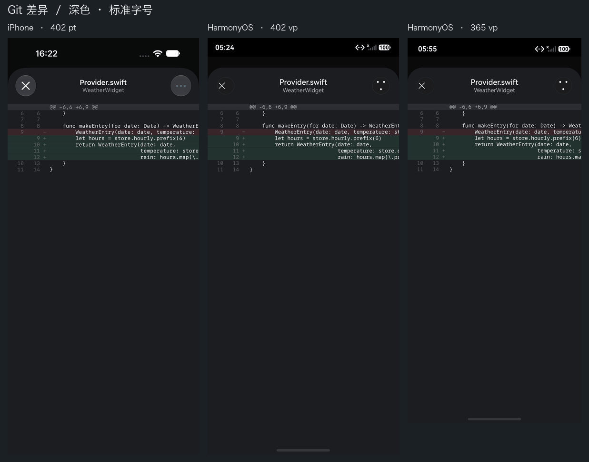

# Git 差异 · File diff

[返回全部页面 · All pages](../README.md)

读取 Provider.swift 的逐行差异。

Three independent native captures, left to right: iPhone 402 pt, HarmonyOS 402 vp, HarmonyOS 365 vp. The complete screen, including system bars, is visible.

[Download all original screenshots and accessibility trees for this page](../originals/git-diff.zip?raw=1) · [Source and capture method](../SOURCES.md)

Original archive SHA-256: c5efdc5e15e437576d8d88ddb08d29e458e4337f639b92c11ee52645f84f47f7

## 浅色 · 标准字号

| Device | Pixels | Captured at | PNG digest | Hierarchy digest |
| --- | --- | --- | --- | --- |
| iPhone 402 pt | 1206 × 2622 | 2026-11-23T08:19:40.070+00:00 | bf544ddf7547f29a | 62c16aa149a3c15c |
| HarmonyOS 402 vp | 1206 × 2622 | 2026-11-23T17:24:03+08:00 | cae4f0feafbb33d4 | 43d54205d40fc61a |
| HarmonyOS 365 vp | 1280 × 2832 | 2026-11-23T17:55:37+08:00 | cb794c9f72e3b35b | 2312423947aefbb2 |

## 深色 · 标准字号

| Device | Pixels | Captured at | PNG digest | Hierarchy digest |
| --- | --- | --- | --- | --- |
| iPhone 402 pt | 1206 × 2622 | 2026-11-23T08:22:41.327+00:00 | 73b58538e23e54c1 | 5a7fc6b90bdc34f4 |
| HarmonyOS 402 vp | 1206 × 2622 | 2026-11-23T17:24:07+08:00 | d90baff62b40c0f9 | be39de3f827617d5 |
| HarmonyOS 365 vp | 1280 × 2832 | 2026-11-23T17:55:41+08:00 | 62cb61f6749f0612 | 96e8fc76db50c41d |

## 浅色 · 最大字号

| Device | Pixels | Captured at | PNG digest | Hierarchy digest |
| --- | --- | --- | --- | --- |
| iPhone 402 pt | 1206 × 2622 | 2026-11-23T08:25:24.958+00:00 | 35e711057fc70a5d | 1ddd7ed7705280fc |
| HarmonyOS 402 vp | 1206 × 2622 | 2026-11-23T17:24:11+08:00 | f160b1edcf3d9dfd | 5ec724588fa71f56 |
| HarmonyOS 365 vp | 1280 × 2832 | 2026-11-23T17:55:45+08:00 | 2d2fc50c3714c990 | 556bf69afc262596 |

Full 64-character digests and ZIP entry paths are under this page in the [manifest](../manifest.json).

[← 提交详情](git-commit.md)
[机器总览 →](machines.md)
