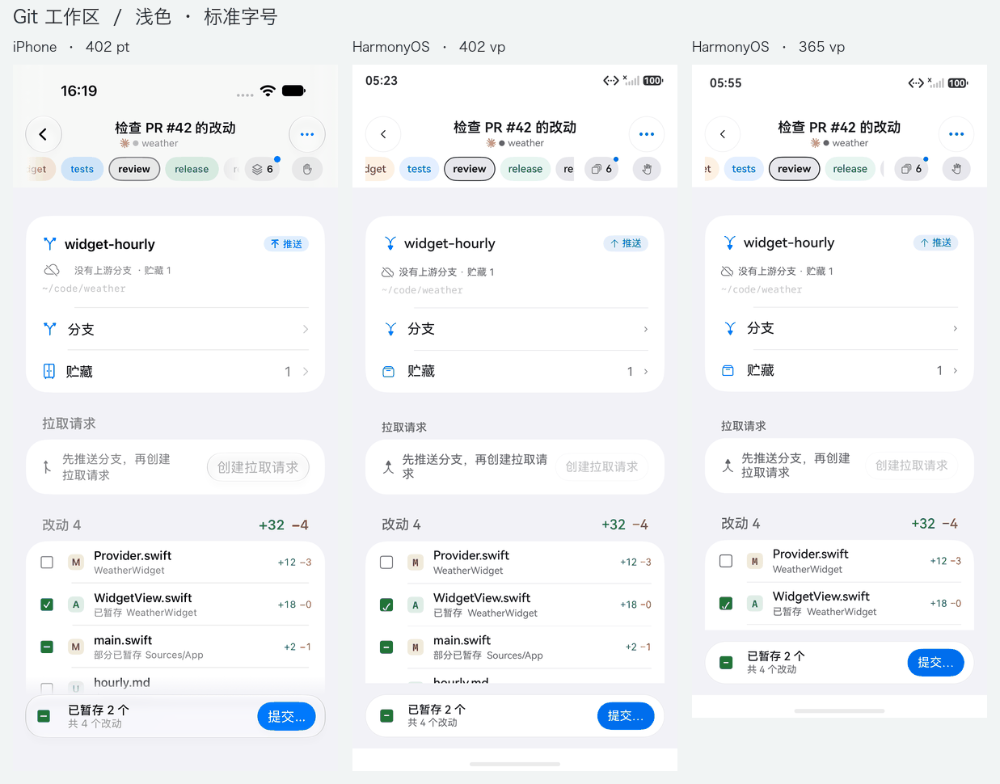
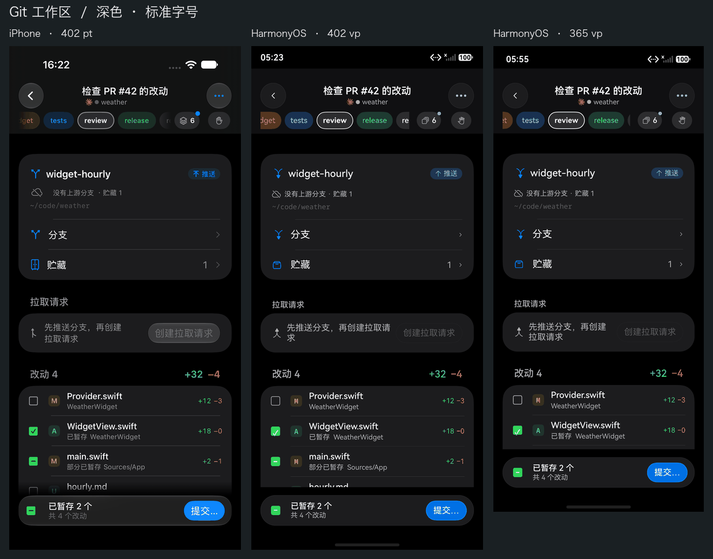

# Git 工作区 · Git workspace

[返回全部页面 · All pages](../README.md)

查看分支、改动文件及暂存状态。
Open Git from the PR #42 conversation menu and inspect its branch, stash, pull request and changes.

Three independent native captures, left to right: iPhone 402 pt, HarmonyOS 402 vp, HarmonyOS 365 vp. The complete screen, including system bars, is visible.

[Download all original screenshots and accessibility trees for this page](../originals/git.zip?raw=1) · [Source and capture method](../SOURCES.md)

Original archive SHA-256: eb9c6c442c8a85bb27fbc00fb27857968b2942b6751fc93ad3355b78d2cb6a6d

## 浅色 · 标准字号

| Device | Pixels | Captured at | PNG digest | Hierarchy digest |
| --- | --- | --- | --- | --- |
| iPhone 402 pt | 1206 × 2622 | 2026-11-23T08:19:03.988+00:00 | ffb9092ae60e5afd | f265e8dfc01e76f7 |
| HarmonyOS 402 vp | 1206 × 2622 | 2026-11-23T17:23:35+08:00 | 09d0bff30f94dbb7 | 32ecc4f34a858fa7 |
| HarmonyOS 365 vp | 1280 × 2832 | 2026-11-23T17:55:12+08:00 | 9a553e6309d8d1ef | c357219eee9992a6 |

## 深色 · 标准字号

| Device | Pixels | Captured at | PNG digest | Hierarchy digest |
| --- | --- | --- | --- | --- |
| iPhone 402 pt | 1206 × 2622 | 2026-11-23T08:22:06.369+00:00 | 0b70c127cf1219a6 | d9f2ceb13476b5fd |
| HarmonyOS 402 vp | 1206 × 2622 | 2026-11-23T17:23:39+08:00 | 563041f18013ca7e | 7931443ee2b27b3c |
| HarmonyOS 365 vp | 1280 × 2832 | 2026-11-23T17:55:16+08:00 | bd37f89491e3d4f8 | b34e85a02dc6842a |

## 浅色 · 最大字号

| Device | Pixels | Captured at | PNG digest | Hierarchy digest |
| --- | --- | --- | --- | --- |
| iPhone 402 pt | 1206 × 2622 | 2026-11-23T08:24:50.504+00:00 | c7c8bceb2b247b9c | fded88db004c055a |
| HarmonyOS 402 vp | 1206 × 2622 | 2026-11-23T17:23:43+08:00 | af8991b3a248a2cc | 054f168b4ad0da77 |
| HarmonyOS 365 vp | 1280 × 2832 | 2026-11-23T17:55:20+08:00 | 10bb56233715d47c | 8082332d97983c32 |

Full 64-character digests and ZIP entry paths are under this page in the [manifest](../manifest.json).

[← 工作区文件搜索](file-search.md)
[提交详情 →](git-commit.md)
