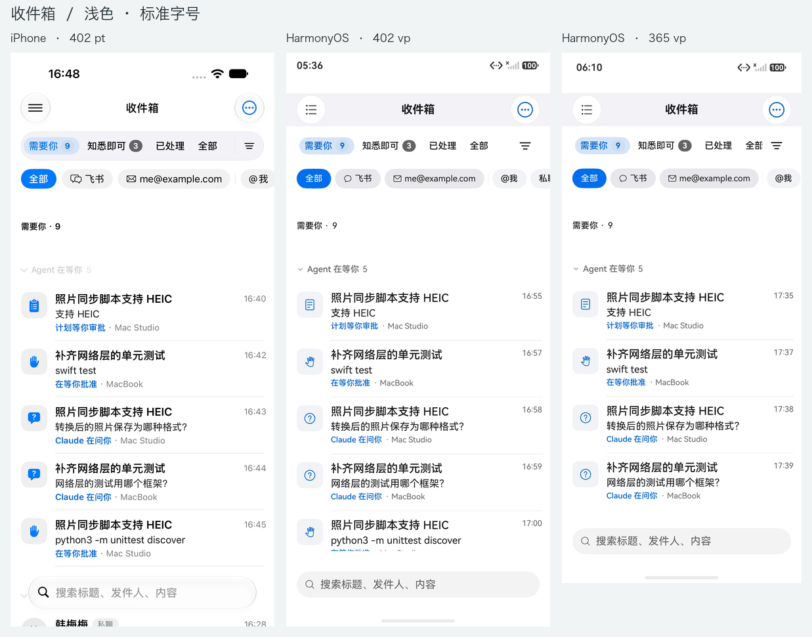
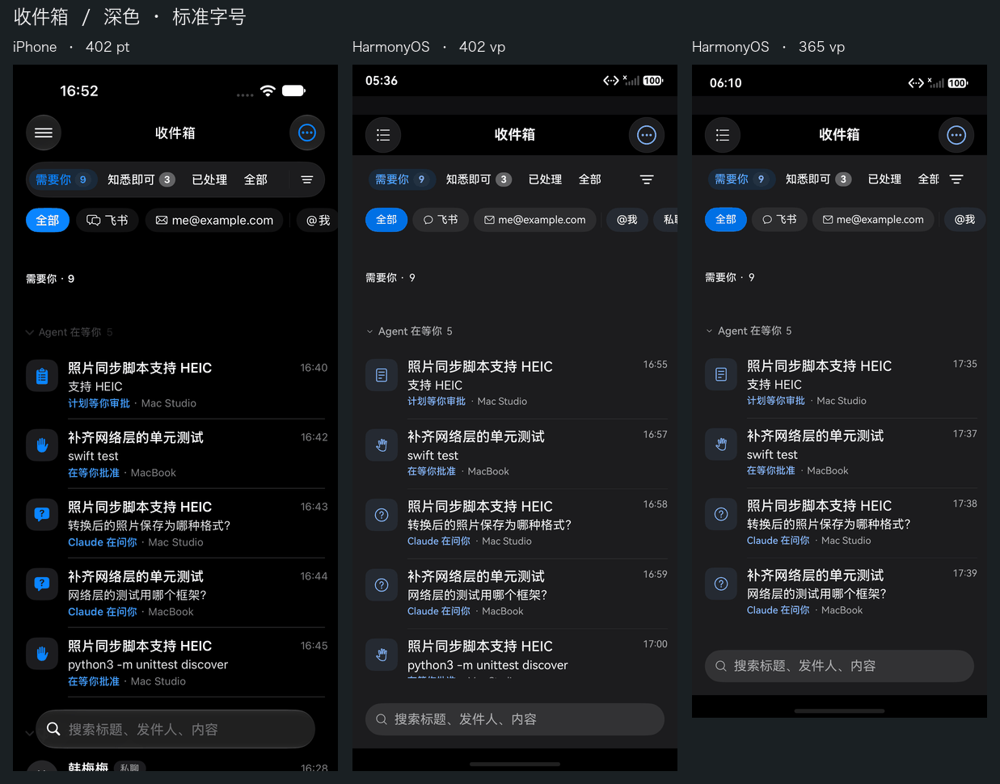
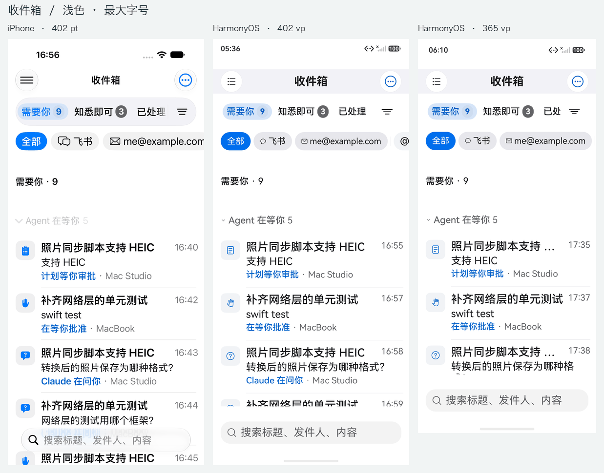

# 收件箱 · Inbox

[返回全部页面 · All pages](../README.md)

查看收件箱的分类、筛选和待处理事项。

Three independent native captures, left to right: iPhone 402 pt, HarmonyOS 402 vp, HarmonyOS 365 vp. The complete screen, including system bars, is visible.

[Download all original screenshots and accessibility trees for this page](../originals/inbox.zip?raw=1) · [Source and capture method](../SOURCES.md)

Original archive SHA-256: 56b60792f9a89bc2f443c4e51d4679a8d455af36a9ff4d29201c773f6aac9fc6

## 浅色 · 标准字号

| Device | Pixels | Captured at | PNG digest | Hierarchy digest |
| --- | --- | --- | --- | --- |
| iPhone 402 pt | 1206 × 2622 | 2026-11-23T08:48:46.185+00:00 | 1631dd8e0ed2abe1 | 8e9ab18dbdba6db9 |
| HarmonyOS 402 vp | 1206 × 2622 | 2026-11-23T17:36:20+08:00 | 497948b2f08eacf2 | 71f4d64fe47079b2 |
| HarmonyOS 365 vp | 1280 × 2832 | 2026-11-23T18:10:09+08:00 | a74d4c8844b61b58 | a5ee815143857fda |

## 深色 · 标准字号

| Device | Pixels | Captured at | PNG digest | Hierarchy digest |
| --- | --- | --- | --- | --- |
| iPhone 402 pt | 1206 × 2622 | 2026-11-23T08:52:33.647+00:00 | a8a8c89de96c61c1 | 7e440ccd6004e32b |
| HarmonyOS 402 vp | 1206 × 2622 | 2026-11-23T17:36:24+08:00 | c23dd43a926f5b8e | dc22174dcdbfad77 |
| HarmonyOS 365 vp | 1280 × 2832 | 2026-11-23T18:10:13+08:00 | ad8ef594298015df | b6415999f316d5eb |

## 浅色 · 最大字号

| Device | Pixels | Captured at | PNG digest | Hierarchy digest |
| --- | --- | --- | --- | --- |
| iPhone 402 pt | 1206 × 2622 | 2026-11-23T08:56:21.154+00:00 | b7e108c74865a32e | 5d14ef51f3f6faf0 |
| HarmonyOS 402 vp | 1206 × 2622 | 2026-11-23T17:36:29+08:00 | 27d28d394852a081 | a72e32bd2fd62fb7 |
| HarmonyOS 365 vp | 1280 × 2832 | 2026-11-23T18:10:17+08:00 | 68352fcd2fc1e865 | c909942296843b4f |

Full 64-character digests and ZIP entry paths are under this page in the [manifest](../manifest.json).

[← 搜索会话内容](search.md)
[待办 →](todo.md)
