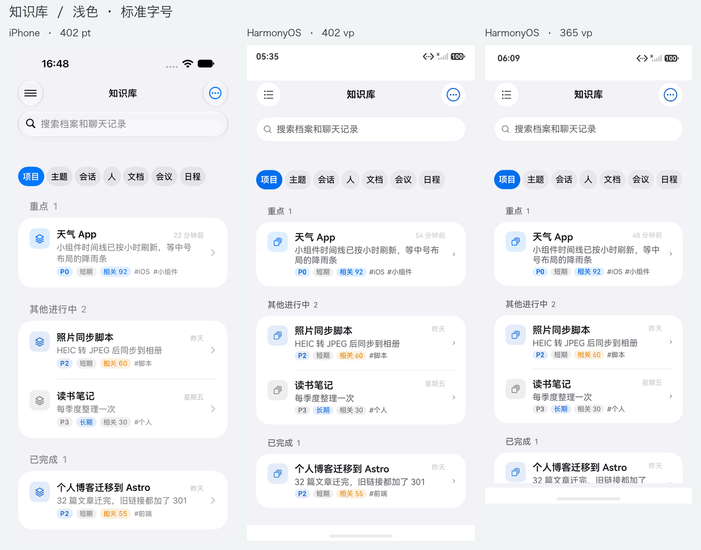
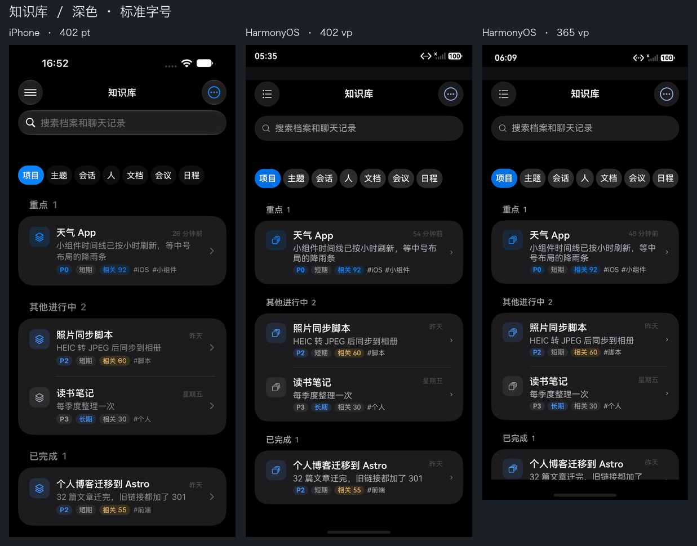
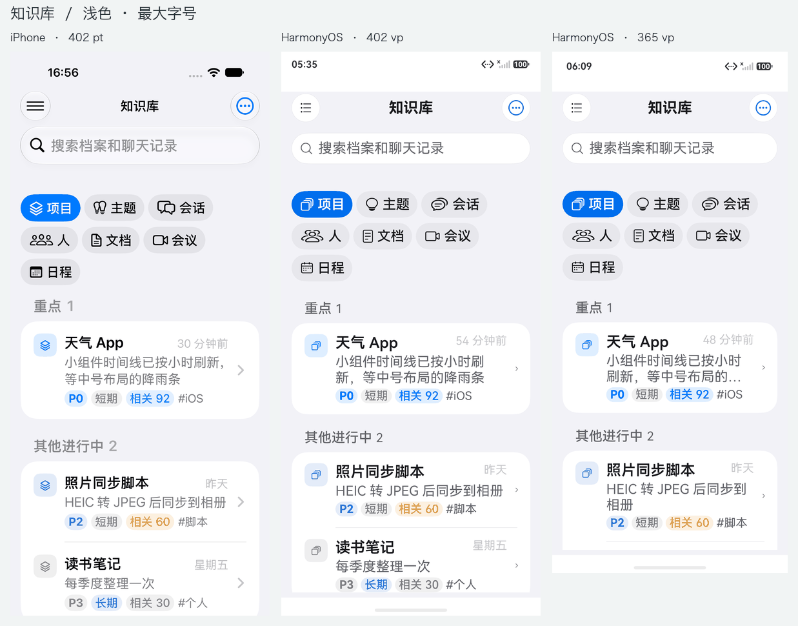

# 知识库 · Knowledge

[返回全部页面 · All pages](../README.md)

浏览知识库的分类和条目。
Compare the same projects across Focus, Other Active and Completed, including priority and state.

Three independent native captures, left to right: iPhone 402 pt, HarmonyOS 402 vp, HarmonyOS 365 vp. The complete screen, including system bars, is visible.

[Download all original screenshots and accessibility trees for this page](../originals/knowledge.zip?raw=1) · [Source and capture method](../SOURCES.md)

Original archive SHA-256: 8c1431ff2c6f5b312899b8bea4d7bfb8bae40873d265887dea91f33367ebe420

## 浅色 · 标准字号

| Device | Pixels | Captured at | PNG digest | Hierarchy digest |
| --- | --- | --- | --- | --- |
| iPhone 402 pt | 1206 × 2622 | 2026-11-23T08:48:57.660+00:00 | 2c4fb21bea1560ff | 5335072615986497 |
| HarmonyOS 402 vp | 1206 × 2622 | 2026-11-23T17:35:47+08:00 | 658567333c66e1d4 | ed9323e19328cd3c |
| HarmonyOS 365 vp | 1280 × 2832 | 2026-11-23T18:09:37+08:00 | 65cb5b70544ebf09 | 18ebce2cca18e5ab |

## 深色 · 标准字号

| Device | Pixels | Captured at | PNG digest | Hierarchy digest |
| --- | --- | --- | --- | --- |
| iPhone 402 pt | 1206 × 2622 | 2026-11-23T08:52:44.881+00:00 | 4c5c9727d5225e53 | 5cbaff37ff82d58e |
| HarmonyOS 402 vp | 1206 × 2622 | 2026-11-23T17:35:51+08:00 | 93f692963f9223d6 | f423025bf0d78dd5 |
| HarmonyOS 365 vp | 1280 × 2832 | 2026-11-23T18:09:40+08:00 | 5e316809f1d407a5 | 730a0cbe769ba383 |

## 浅色 · 最大字号

| Device | Pixels | Captured at | PNG digest | Hierarchy digest |
| --- | --- | --- | --- | --- |
| iPhone 402 pt | 1206 × 2622 | 2026-11-23T08:56:32.294+00:00 | 742cf562d37a9fa2 | a6b9b8c8795683ed |
| HarmonyOS 402 vp | 1206 × 2622 | 2026-11-23T17:35:55+08:00 | 4be9c5d9552a526c | bddf1c97439e8fd8 |
| HarmonyOS 365 vp | 1280 × 2832 | 2026-11-23T18:09:45+08:00 | 90a72c447e05ba4e | 386947122cacb64d |

Full 64-character digests and ZIP entry paths are under this page in the [manifest](../manifest.json).

[← 今日待办与排序](todo-due.md)
[会议 →](meetings.md)
