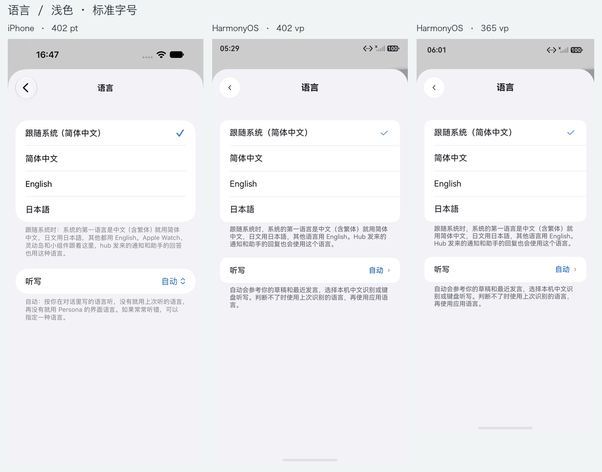
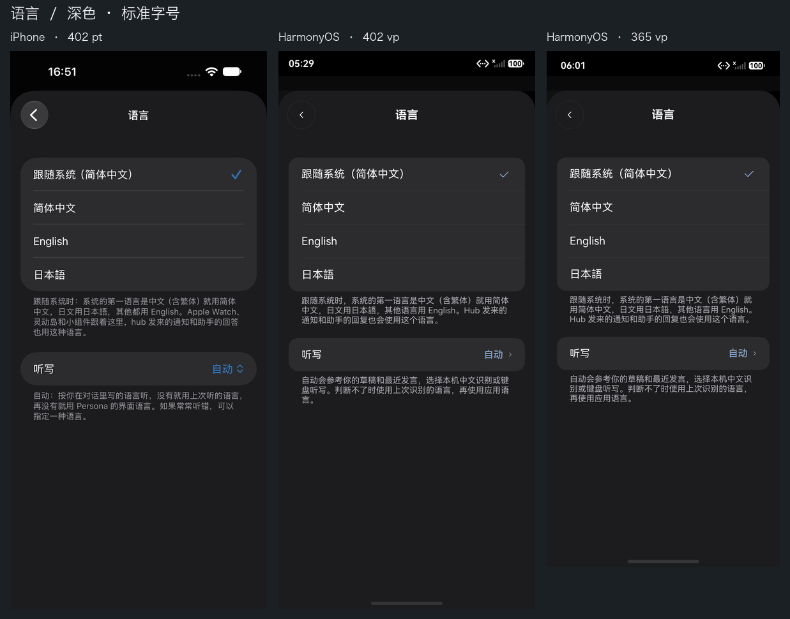
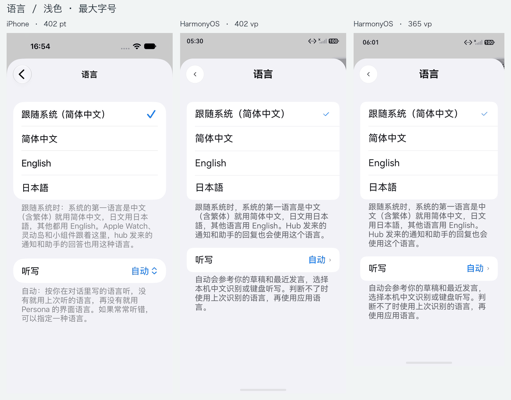

# 语言 · Language settings

[返回全部页面 · All pages](../README.md)

查看可选应用语言和当前语言设置。
Open Language in Settings. Automatic dictation follows the conversation language and the device’s available input methods.

Three independent native captures, left to right: iPhone 402 pt, HarmonyOS 402 vp, HarmonyOS 365 vp. The complete screen, including system bars, is visible.

[Download all original screenshots and accessibility trees for this page](../originals/language.zip?raw=1) · [Source and capture method](../SOURCES.md)

Original archive SHA-256: 2ea4766d61e96dec733bb7f7ebe0f36dcf0128659ba989b7209362bfc49e920d

## 浅色 · 标准字号

| Device | Pixels | Captured at | PNG digest | Hierarchy digest |
| --- | --- | --- | --- | --- |
| iPhone 402 pt | 1206 × 2622 | 2026-11-23T08:47:29.065+00:00 | 56df40f94a5a0c5f | f85cfd221e65535b |
| HarmonyOS 402 vp | 1206 × 2622 | 2026-11-23T17:29:53+08:00 | cdb19cfca5f8330c | 2553d08e08f47a6e |
| HarmonyOS 365 vp | 1280 × 2832 | 2026-11-23T18:01:45+08:00 | acadd55c25ba3fff | 01df2def3ef2123d |

## 深色 · 标准字号

| Device | Pixels | Captured at | PNG digest | Hierarchy digest |
| --- | --- | --- | --- | --- |
| iPhone 402 pt | 1206 × 2622 | 2026-11-23T08:51:16.001+00:00 | e45f6d71329cee3c | 6f1fddc84d9cde17 |
| HarmonyOS 402 vp | 1206 × 2622 | 2026-11-23T17:29:57+08:00 | 00dd451051a0e140 | 25fef2b26de082e4 |
| HarmonyOS 365 vp | 1280 × 2832 | 2026-11-23T18:01:49+08:00 | df3042597241366d | 5e4acaee7553d875 |

## 浅色 · 最大字号

| Device | Pixels | Captured at | PNG digest | Hierarchy digest |
| --- | --- | --- | --- | --- |
| iPhone 402 pt | 1206 × 2622 | 2026-11-23T08:54:59.540+00:00 | 0ead91d807d69986 | c72204006c9e33c3 |
| HarmonyOS 402 vp | 1206 × 2622 | 2026-11-23T17:30:01+08:00 | 5ced0519347aca25 | c776aae40615549b |
| HarmonyOS 365 vp | 1280 × 2832 | 2026-11-23T18:01:53+08:00 | e2546d2d5cc471a7 | 4dbf3dfc0ac85f87 |

Full 64-character digests and ZIP entry paths are under this page in the [manifest](../manifest.json).

[← 返回设置搜索结果](settings-search-restored.md)
[Agent 偏好 →](agent-preferences.md)
