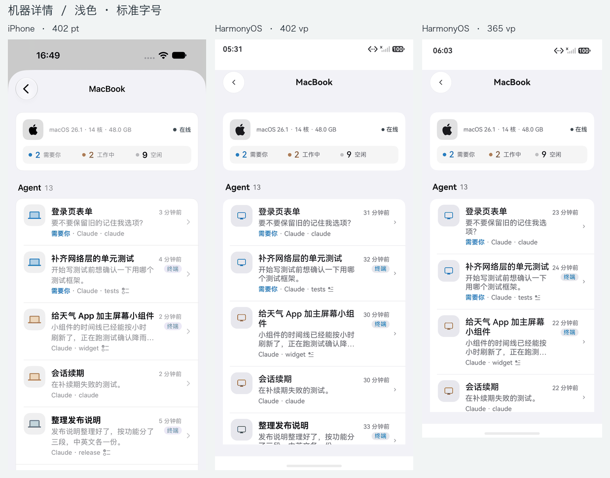
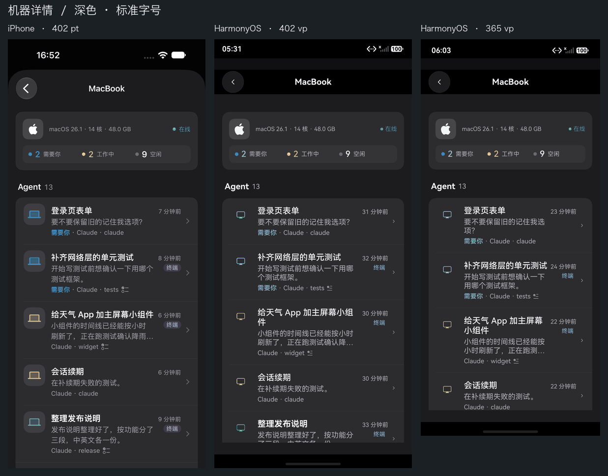
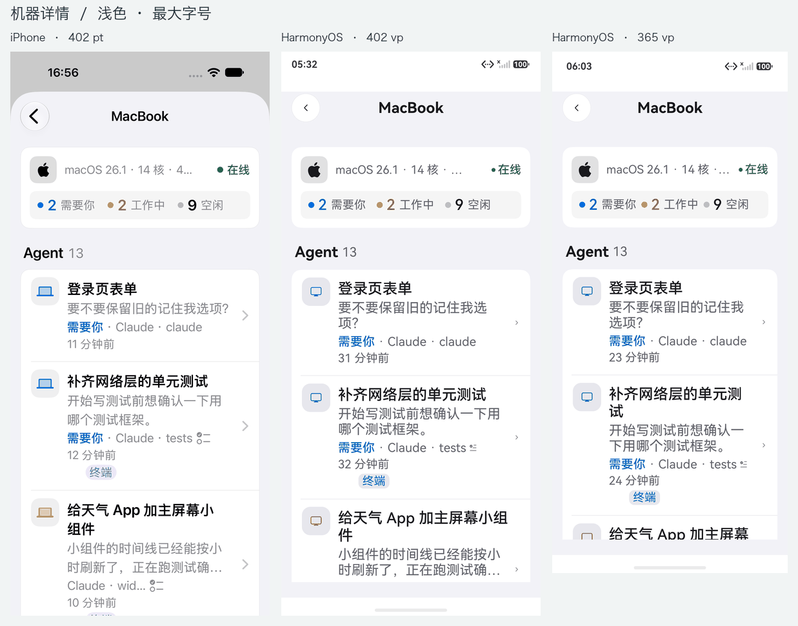

# 机器详情 · Machine details

[返回全部页面 · All pages](../README.md)

进入同一台测试 MacBook 的详情。
Open the fixture MacBook from the machine directory and inspect its agents.

Three independent native captures, left to right: iPhone 402 pt, HarmonyOS 402 vp, HarmonyOS 365 vp. The complete screen, including system bars, is visible.

[Download all original screenshots and accessibility trees for this page](../originals/machine-detail.zip?raw=1) · [Source and capture method](../SOURCES.md)

Original archive SHA-256: 440f2a2354a3e9e4ba0fd54fbd09aa8af55fd5ce864a4698a5b0febdf721526a

## 浅色 · 标准字号

| Device | Pixels | Captured at | PNG digest | Hierarchy digest |
| --- | --- | --- | --- | --- |
| iPhone 402 pt | 1206 × 2622 | 2026-11-23T08:49:10.384+00:00 | 64f0fd56196ccd19 | a0085b12849474f5 |
| HarmonyOS 402 vp | 1206 × 2622 | 2026-11-23T17:31:51+08:00 | a807fc5ac2bf0c19 | 00a5b6a429018d63 |
| HarmonyOS 365 vp | 1280 × 2832 | 2026-11-23T18:03:49+08:00 | 67ef3b45e010cecb | 51a0785fad922658 |

## 深色 · 标准字号

| Device | Pixels | Captured at | PNG digest | Hierarchy digest |
| --- | --- | --- | --- | --- |
| iPhone 402 pt | 1206 × 2622 | 2026-11-23T08:52:57.008+00:00 | 9a329dd99dae27b5 | ab11323105bc023a |
| HarmonyOS 402 vp | 1206 × 2622 | 2026-11-23T17:31:55+08:00 | e66880019ecfde68 | 6071db64fcf4662d |
| HarmonyOS 365 vp | 1280 × 2832 | 2026-11-23T18:03:53+08:00 | b5a939811b111150 | ae6f260568f1cbcb |

## 浅色 · 最大字号

| Device | Pixels | Captured at | PNG digest | Hierarchy digest |
| --- | --- | --- | --- | --- |
| iPhone 402 pt | 1206 × 2622 | 2026-11-23T08:56:44.434+00:00 | d04a29ea3f950e12 | 31251048f2ad4543 |
| HarmonyOS 402 vp | 1206 × 2622 | 2026-11-23T17:32:00+08:00 | de818a00215e1a4c | c4d39da542c41e78 |
| HarmonyOS 365 vp | 1280 × 2832 | 2026-11-23T18:03:57+08:00 | 9179f4c6fd4916bb | 3d77e875ca8b247f |

Full 64-character digests and ZIP entry paths are under this page in the [manifest](../manifest.json).

[← 机器总览](machines.md)
[机器监控读数 →](machine-monitor.md)
