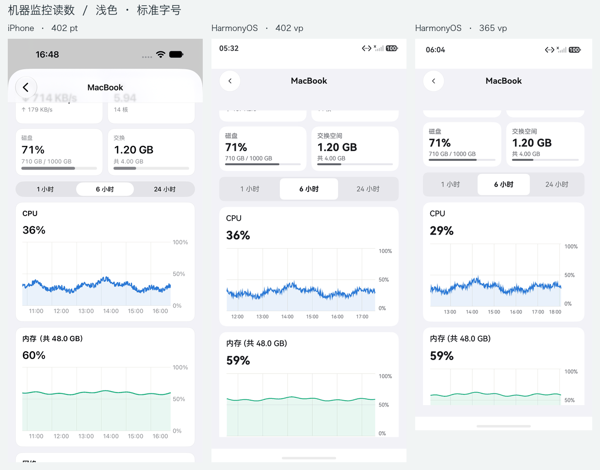
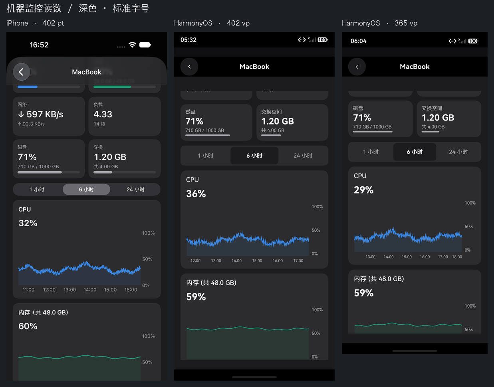
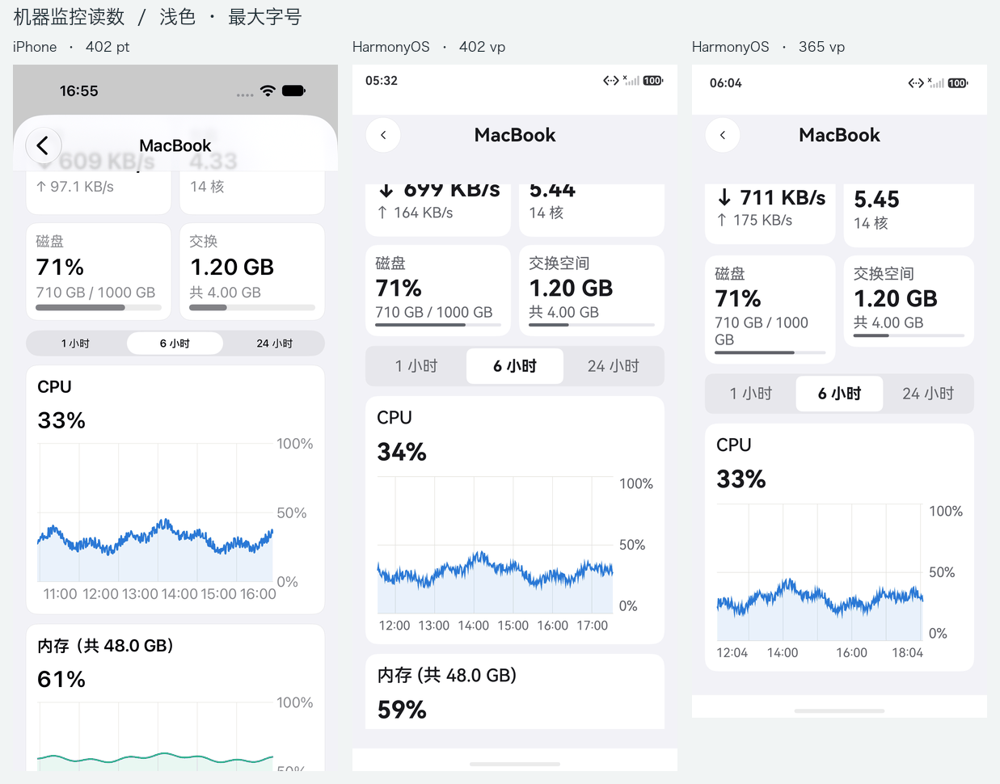

# 机器监控读数 · Machine metrics

[返回全部页面 · All pages](../README.md)

查看 MacBook 的 CPU 历史曲线及所选时间范围。
Inspect six hours of CPU history on the fixture MacBook. Each local Hub has its own sampling time and values.

Three independent native captures, left to right: iPhone 402 pt, HarmonyOS 402 vp, HarmonyOS 365 vp. The complete screen, including system bars, is visible.

[Download all original screenshots and accessibility trees for this page](../originals/machine-monitor.zip?raw=1) · [Source and capture method](../SOURCES.md)

Original archive SHA-256: 039cb81763939d120f7c50b68e8268e68619f44012c8bb270c0694c162570b7e

## 浅色 · 标准字号

| Device | Pixels | Captured at | PNG digest | Hierarchy digest |
| --- | --- | --- | --- | --- |
| iPhone 402 pt | 1206 × 2622 | 2026-11-23T08:48:19.389+00:00 | 090dfd018836cdfd | c999308785ee2745 |
| HarmonyOS 402 vp | 1206 × 2622 | 2026-11-23T17:32:35+08:00 | f8ffcba0018d77fa | b0501f1dd6ab7e84 |
| HarmonyOS 365 vp | 1280 × 2832 | 2026-11-23T18:04:22+08:00 | abb024132e0d36fb | 57e7f5408e6b3761 |

## 深色 · 标准字号

| Device | Pixels | Captured at | PNG digest | Hierarchy digest |
| --- | --- | --- | --- | --- |
| iPhone 402 pt | 1206 × 2622 | 2026-11-23T08:52:08.332+00:00 | 964cd5e4f7cd03e9 | 17b34284dc46b023 |
| HarmonyOS 402 vp | 1206 × 2622 | 2026-11-23T17:32:41+08:00 | 98957a50a1276a8b | 8ca596cb7dbe1dff |
| HarmonyOS 365 vp | 1280 × 2832 | 2026-11-23T18:04:27+08:00 | f7e0db0d149d7025 | c6407ecf91cddabe |

## 浅色 · 最大字号

| Device | Pixels | Captured at | PNG digest | Hierarchy digest |
| --- | --- | --- | --- | --- |
| iPhone 402 pt | 1206 × 2622 | 2026-11-23T08:55:55.172+00:00 | 5ee8153d9819d7a0 | 3756d08abea99040 |
| HarmonyOS 402 vp | 1206 × 2622 | 2026-11-23T17:32:55+08:00 | 09a2ae3c07baf093 | 84035a30648b64fe |
| HarmonyOS 365 vp | 1280 × 2832 | 2026-11-23T18:04:40+08:00 | 352ee5228f487d05 | 7e940f6d281b367d |

Full 64-character digests and ZIP entry paths are under this page in the [manifest](../manifest.json).

[← 机器详情](machine-detail.md)
[侧栏 →](drawer.md)
