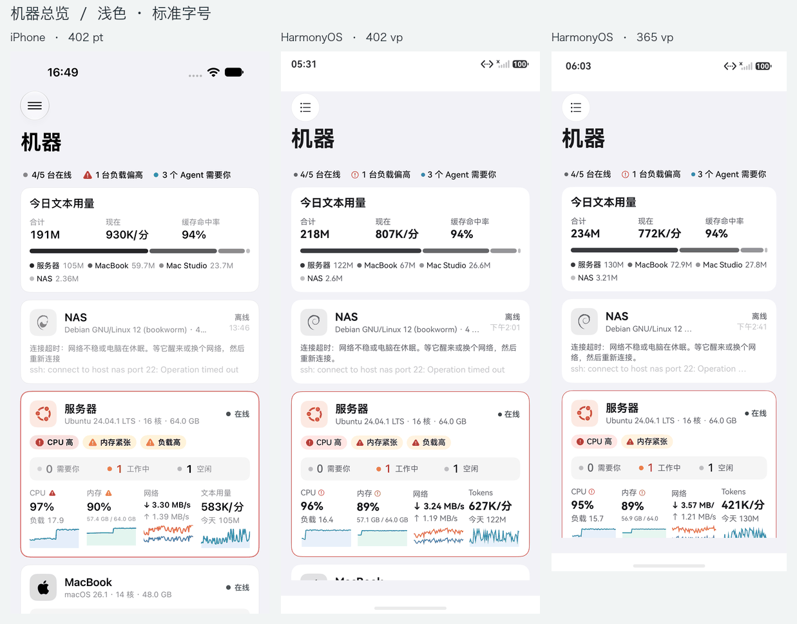
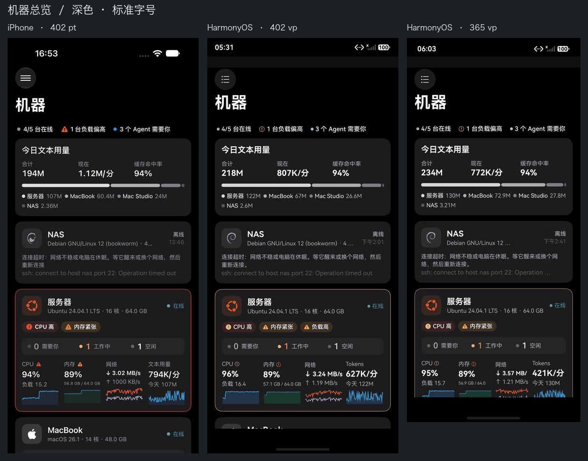
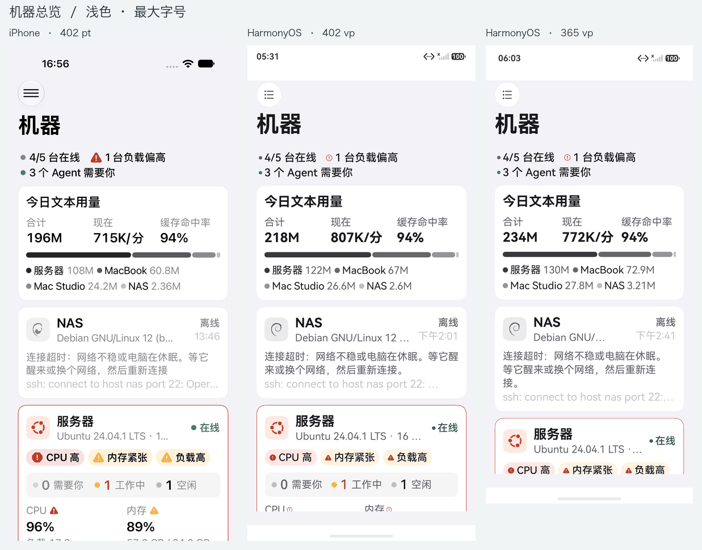

# 机器总览 · Machines

[返回全部页面 · All pages](../README.md)

比较机器的在线状态、负载与使用量。

Three independent native captures, left to right: iPhone 402 pt, HarmonyOS 402 vp, HarmonyOS 365 vp. The complete screen, including system bars, is visible.

[Download all original screenshots and accessibility trees for this page](../originals/machines.zip?raw=1) · [Source and capture method](../SOURCES.md)

Original archive SHA-256: 7c3831dc79baab3676d20decdc8f78f29e175887da59f50ec961e775c946a00e

## 浅色 · 标准字号

| Device | Pixels | Captured at | PNG digest | Hierarchy digest |
| --- | --- | --- | --- | --- |
| iPhone 402 pt | 1206 × 2622 | 2026-11-23T08:49:22.173+00:00 | e91b3da9d56b8583 | 7a47767d34d167af |
| HarmonyOS 402 vp | 1206 × 2622 | 2026-11-23T17:31:38+08:00 | c122249a9d6e7d5b | f89e89890b86a7fc |
| HarmonyOS 365 vp | 1280 × 2832 | 2026-11-23T18:03:31+08:00 | d86abf4b67ca7c4a | 2cd36900cd16d2b7 |

## 深色 · 标准字号

| Device | Pixels | Captured at | PNG digest | Hierarchy digest |
| --- | --- | --- | --- | --- |
| iPhone 402 pt | 1206 × 2622 | 2026-11-23T08:53:08.357+00:00 | 11e86184adb70e17 | a828559bd324e0bc |
| HarmonyOS 402 vp | 1206 × 2622 | 2026-11-23T17:31:42+08:00 | bd3c672cad685ec2 | 525bb292cbf2761b |
| HarmonyOS 365 vp | 1280 × 2832 | 2026-11-23T18:03:35+08:00 | fd2647f183ed680f | af8314d2d7020a1e |

## 浅色 · 最大字号

| Device | Pixels | Captured at | PNG digest | Hierarchy digest |
| --- | --- | --- | --- | --- |
| iPhone 402 pt | 1206 × 2622 | 2026-11-23T08:56:55.831+00:00 | f88fa90cff5dc431 | e104818f63773c83 |
| HarmonyOS 402 vp | 1206 × 2622 | 2026-11-23T17:31:46+08:00 | 8d194443b957ac79 | bbbbbd0b55ef23eb |
| HarmonyOS 365 vp | 1280 × 2832 | 2026-11-23T18:03:39+08:00 | bdde6b6a7c142565 | 0a2c8b5b65ec91b6 |

Full 64-character digests and ZIP entry paths are under this page in the [manifest](../manifest.json).

[← Git 差异](git-diff.md)
[机器详情 →](machine-detail.md)
