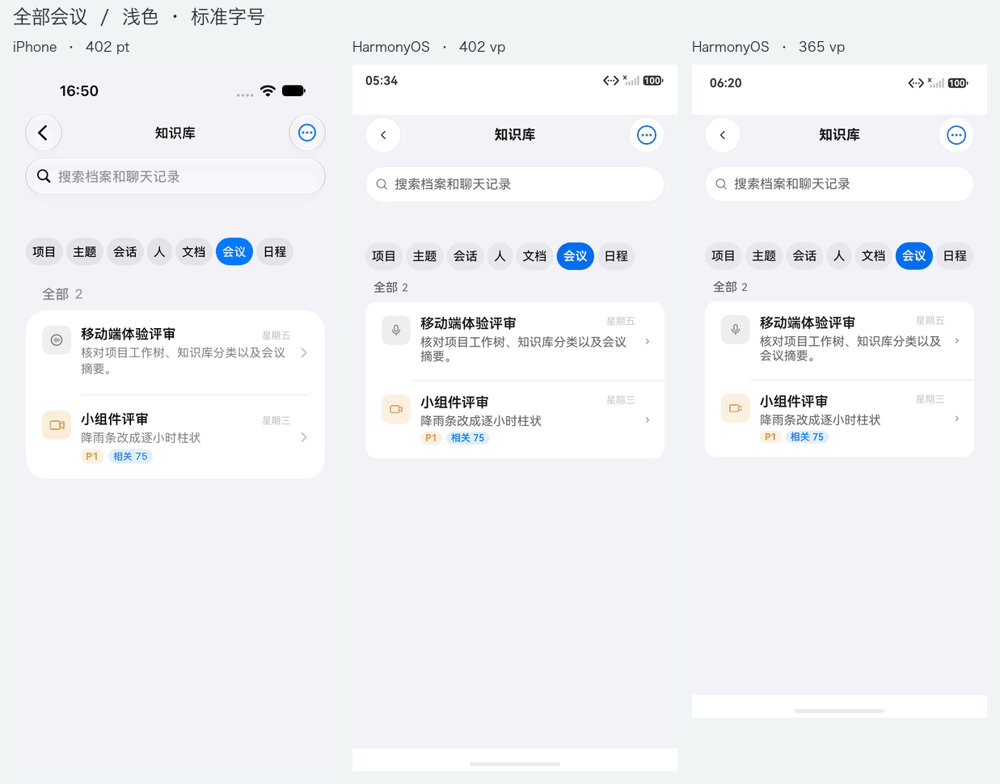
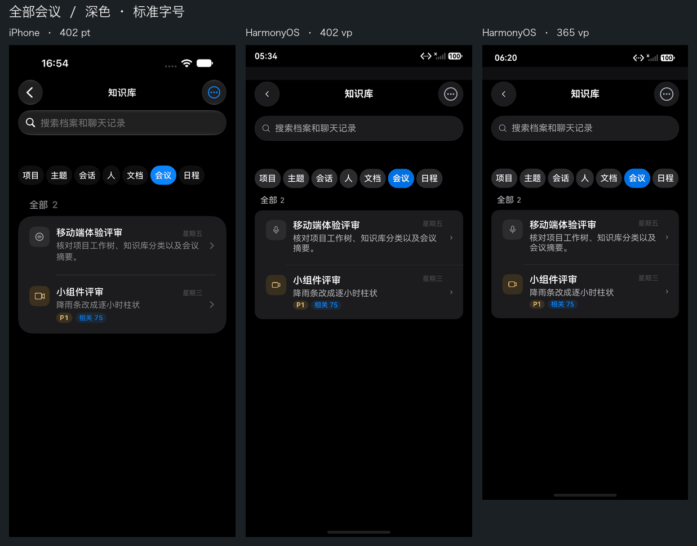
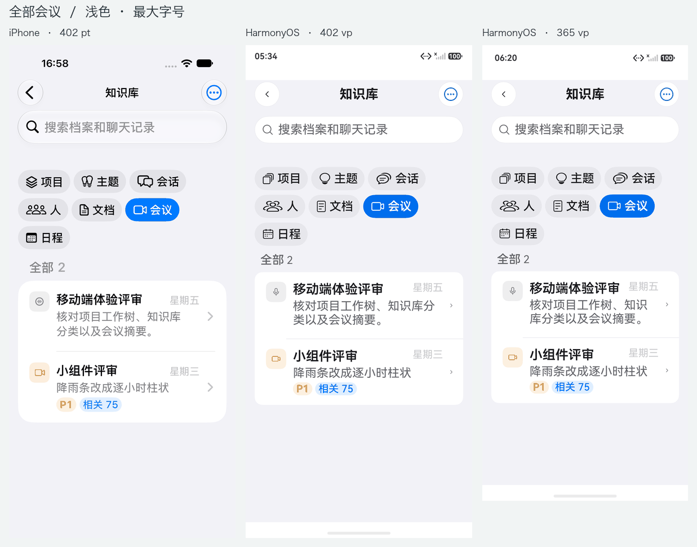

# 全部会议 · All meetings

[返回全部页面 · All pages](../README.md)

打开会议记录列表，找到移动端体验评审。

Three independent native captures, left to right: iPhone 402 pt, HarmonyOS 402 vp, HarmonyOS 365 vp. The complete screen, including system bars, is visible.

[Download all original screenshots and accessibility trees for this page](../originals/meeting-list.zip?raw=1) · [Source and capture method](../SOURCES.md)

Original archive SHA-256: d3a1e89b05e6a3f265ce82e0f2cc9d8f400e16d55548de39dfe88430e8450090

## 浅色 · 标准字号

| Device | Pixels | Captured at | PNG digest | Hierarchy digest |
| --- | --- | --- | --- | --- |
| iPhone 402 pt | 1206 × 2622 | 2026-11-23T08:50:28.909+00:00 | daf9419ac16253c9 | 1097dccc0589ddfd |
| HarmonyOS 402 vp | 1206 × 2622 | 2026-11-23T17:34:50+08:00 | e12b2488f6ec966d | 1f50cb3386896774 |
| HarmonyOS 365 vp | 1280 × 2832 | 2026-11-23T18:20:00+08:00 | dbe908e7aa7d3d91 | ae5c4c6b543a02c7 |

## 深色 · 标准字号

| Device | Pixels | Captured at | PNG digest | Hierarchy digest |
| --- | --- | --- | --- | --- |
| iPhone 402 pt | 1206 × 2622 | 2026-11-23T08:54:13.362+00:00 | 1b7a7daa08bd6bdc | 3958123ab18d6ba6 |
| HarmonyOS 402 vp | 1206 × 2622 | 2026-11-23T17:34:54+08:00 | 18e6c5afebb1c105 | 494f7fa6de52cc96 |
| HarmonyOS 365 vp | 1280 × 2832 | 2026-11-23T18:20:04+08:00 | 9318c178e9db6103 | 7f3689310e4f6c8e |

## 浅色 · 最大字号

| Device | Pixels | Captured at | PNG digest | Hierarchy digest |
| --- | --- | --- | --- | --- |
| iPhone 402 pt | 1206 × 2622 | 2026-11-23T08:58:01.470+00:00 | 17bf95d1616c5a21 | 2ccf7bea3d0e736d |
| HarmonyOS 402 vp | 1206 × 2622 | 2026-11-23T17:34:58+08:00 | f22695c42a4aaf54 | ac616d6b32be552b |
| HarmonyOS 365 vp | 1280 × 2832 | 2026-11-23T18:20:08+08:00 | 5629508c393ba2a5 | 6044518060755fba |

Full 64-character digests and ZIP entry paths are under this page in the [manifest](../manifest.json).

[← 会议](meetings.md)
[会议详情 →](meeting-detail.md)
