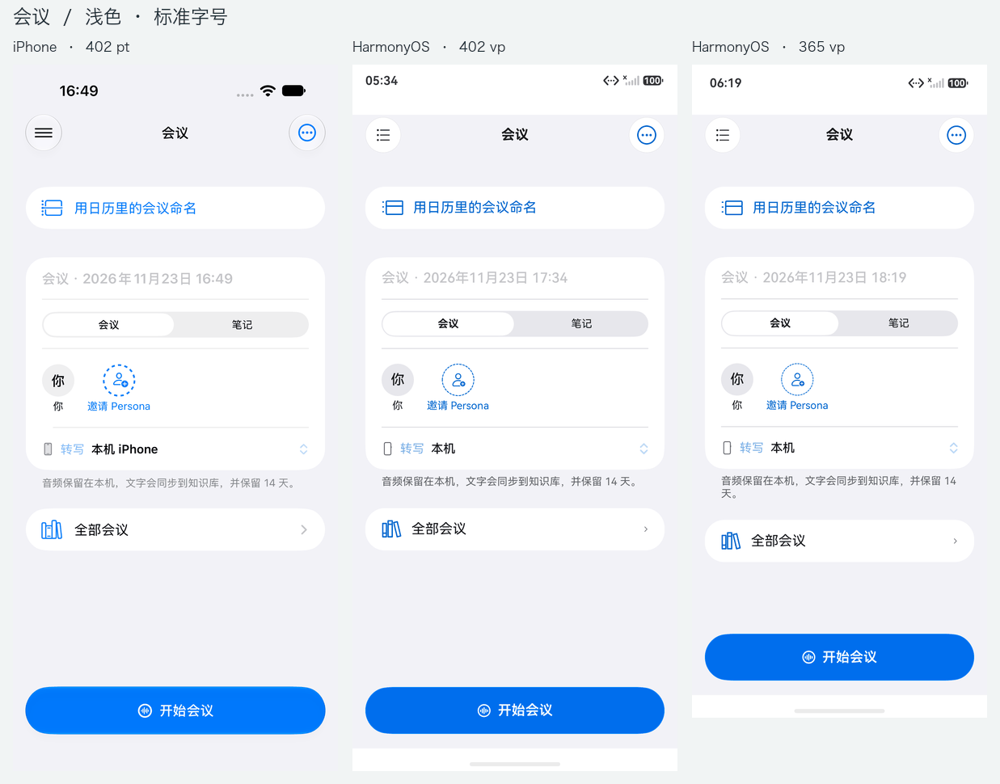
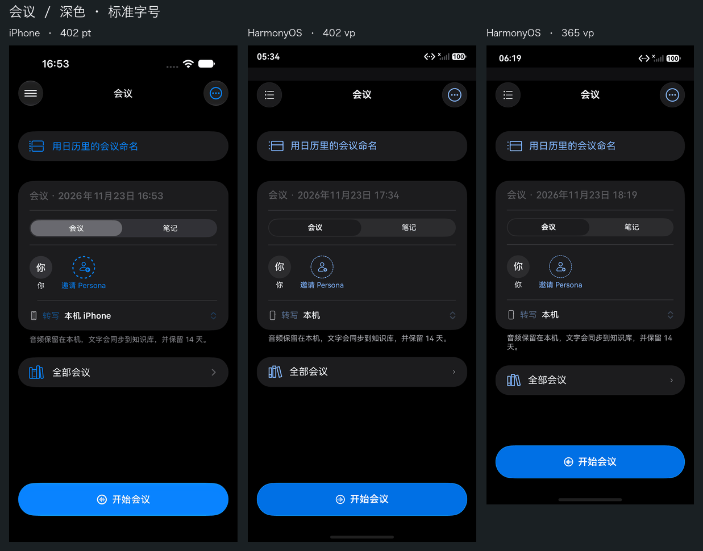
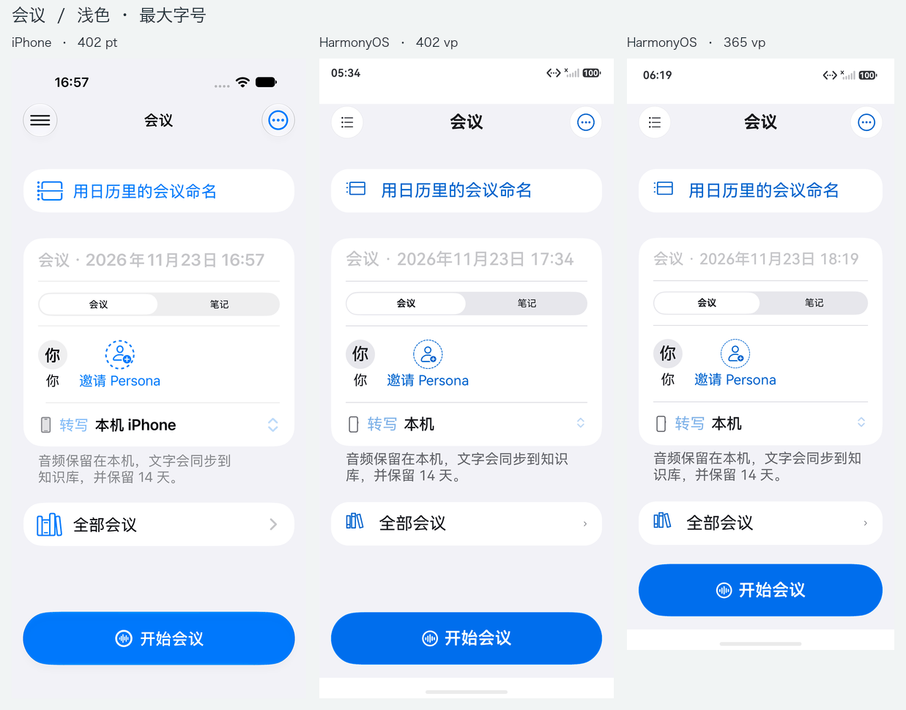

# 会议 · Meetings

[返回全部页面 · All pages](../README.md)

查看会议首页、录制入口及全部会议入口。
Compare the meeting and note setup, calendar naming, assistant invitation and start action.

Three independent native captures, left to right: iPhone 402 pt, HarmonyOS 402 vp, HarmonyOS 365 vp. The complete screen, including system bars, is visible.

[Download all original screenshots and accessibility trees for this page](../originals/meetings.zip?raw=1) · [Source and capture method](../SOURCES.md)

Original archive SHA-256: f475918a4915cdbd804a86f3bbb841a4a26f4bd857f5e891d77c784ae370926d

## 浅色 · 标准字号

| Device | Pixels | Captured at | PNG digest | Hierarchy digest |
| --- | --- | --- | --- | --- |
| iPhone 402 pt | 1206 × 2622 | 2026-11-23T08:49:33.720+00:00 | 3e49f7d7a701b818 | a867653399dbb670 |
| HarmonyOS 402 vp | 1206 × 2622 | 2026-11-23T17:34:37+08:00 | 16f833ec901a16df | bbbd74c6b1350209 |
| HarmonyOS 365 vp | 1280 × 2832 | 2026-11-23T18:19:47+08:00 | 3a949e045c1291c3 | cacbbe0742f7a05d |

## 深色 · 标准字号

| Device | Pixels | Captured at | PNG digest | Hierarchy digest |
| --- | --- | --- | --- | --- |
| iPhone 402 pt | 1206 × 2622 | 2026-11-23T08:53:19.318+00:00 | cfff87f04847c742 | 5f3953e48f0242ac |
| HarmonyOS 402 vp | 1206 × 2622 | 2026-11-23T17:34:40+08:00 | f58229c670b143be | 7d349ae86d6fe06b |
| HarmonyOS 365 vp | 1280 × 2832 | 2026-11-23T18:19:51+08:00 | 85e8769e94fbf32e | 755296fda85d3768 |

## 浅色 · 最大字号

| Device | Pixels | Captured at | PNG digest | Hierarchy digest |
| --- | --- | --- | --- | --- |
| iPhone 402 pt | 1206 × 2622 | 2026-11-23T08:57:07.301+00:00 | 4f1051ff0e8b7f2c | 816ec59ead3194de |
| HarmonyOS 402 vp | 1206 × 2622 | 2026-11-23T17:34:45+08:00 | 798b7c6ff72b725d | 6a12c425a75746c1 |
| HarmonyOS 365 vp | 1280 × 2832 | 2026-11-23T18:19:55+08:00 | 0143f1e3ae72f432 | 4f9bed2dc89f87f0 |

Full 64-character digests and ZIP entry paths are under this page in the [manifest](../manifest.json).

[← 知识库](knowledge.md)
[全部会议 →](meeting-list.md)
