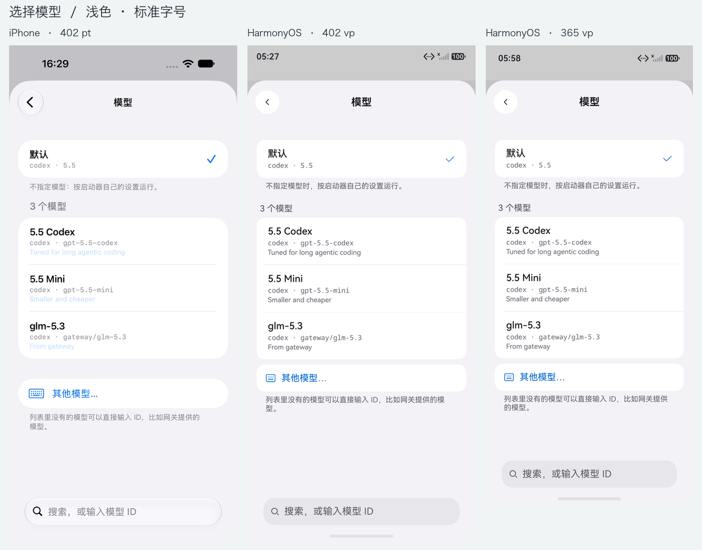
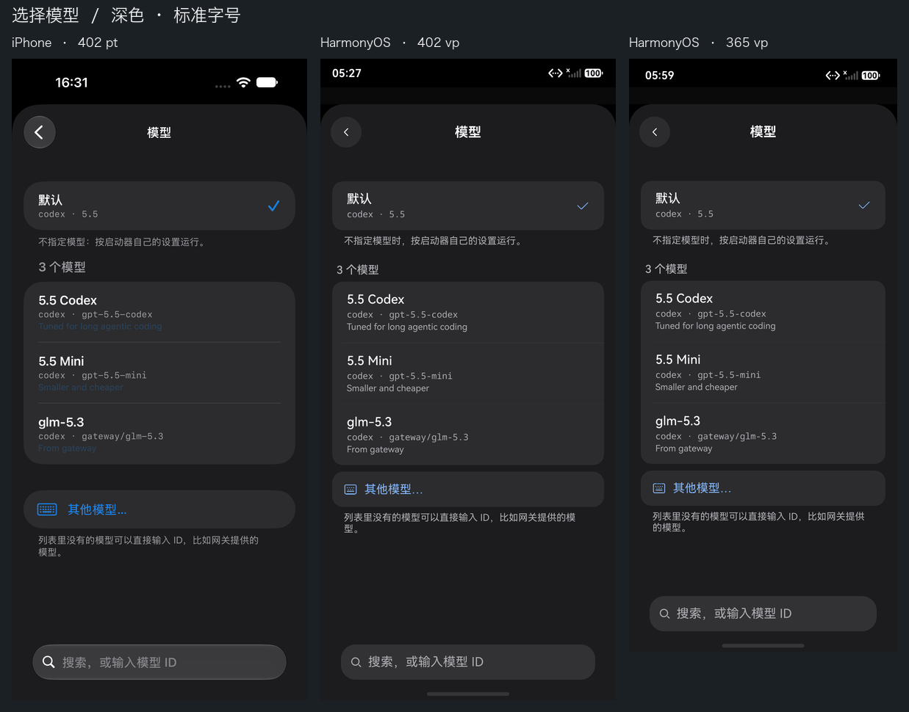
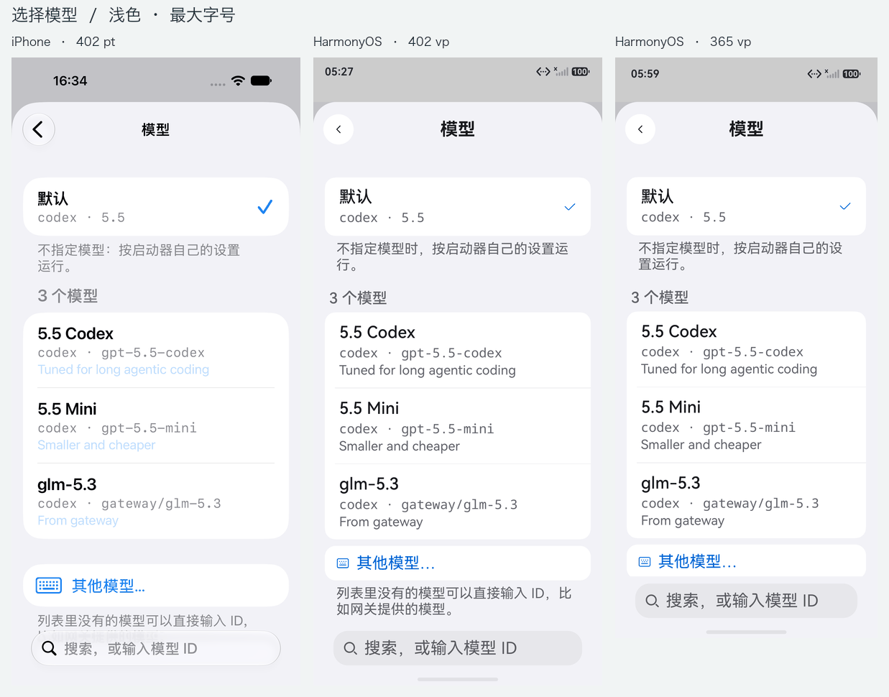

# 选择模型 · Choose a model

[返回全部页面 · All pages](../README.md)

打开所选启动器提供的模型列表。

Three independent native captures, left to right: iPhone 402 pt, HarmonyOS 402 vp, HarmonyOS 365 vp. The complete screen, including system bars, is visible.

[Download all original screenshots and accessibility trees for this page](../originals/models.zip?raw=1) · [Source and capture method](../SOURCES.md)

Original archive SHA-256: 7bbd0317d878855f8435979469383cac82de18757ce477b2b6dda3a7362b6427

## 浅色 · 标准字号

| Device | Pixels | Captured at | PNG digest | Hierarchy digest |
| --- | --- | --- | --- | --- |
| iPhone 402 pt | 1206 × 2622 | 2026-11-23T08:29:09.770+00:00 | 9370daf1b88b69d6 | 8980519c9fdcd3a9 |
| HarmonyOS 402 vp | 1206 × 2622 | 2026-11-23T17:27:00+08:00 | 4fbb245bfc75f609 | 7fb92c4b320584a7 |
| HarmonyOS 365 vp | 1280 × 2832 | 2026-11-23T17:58:56+08:00 | f739b2481e2d9f4f | 38ce124c23e996cb |

## 深色 · 标准字号

| Device | Pixels | Captured at | PNG digest | Hierarchy digest |
| --- | --- | --- | --- | --- |
| iPhone 402 pt | 1206 × 2622 | 2026-11-23T08:31:38.744+00:00 | fb1d19261e72a526 | e9af5d72b8b5f048 |
| HarmonyOS 402 vp | 1206 × 2622 | 2026-11-23T17:27:04+08:00 | 0250974327642f78 | 517b64288e45ea6f |
| HarmonyOS 365 vp | 1280 × 2832 | 2026-11-23T17:59:00+08:00 | a9c24dd03b1de7d1 | 3212ff93f32e2605 |

## 浅色 · 最大字号

| Device | Pixels | Captured at | PNG digest | Hierarchy digest |
| --- | --- | --- | --- | --- |
| iPhone 402 pt | 1206 × 2622 | 2026-11-23T08:34:16.110+00:00 | 82624ba3983e7159 | aafd37ae69f4fa0d |
| HarmonyOS 402 vp | 1206 × 2622 | 2026-11-23T17:27:08+08:00 | ef0be0fd96c327eb | f1e8fef635b3a004 |
| HarmonyOS 365 vp | 1280 × 2832 | 2026-11-23T17:59:04+08:00 | 3c330330ba209358 | c25157181952635e |

Full 64-character digests and ZIP entry paths are under this page in the [manifest](../manifest.json).

[← 选择目录](folder-browser.md)
[提交 Agent 配置 →](start-ready.md)
