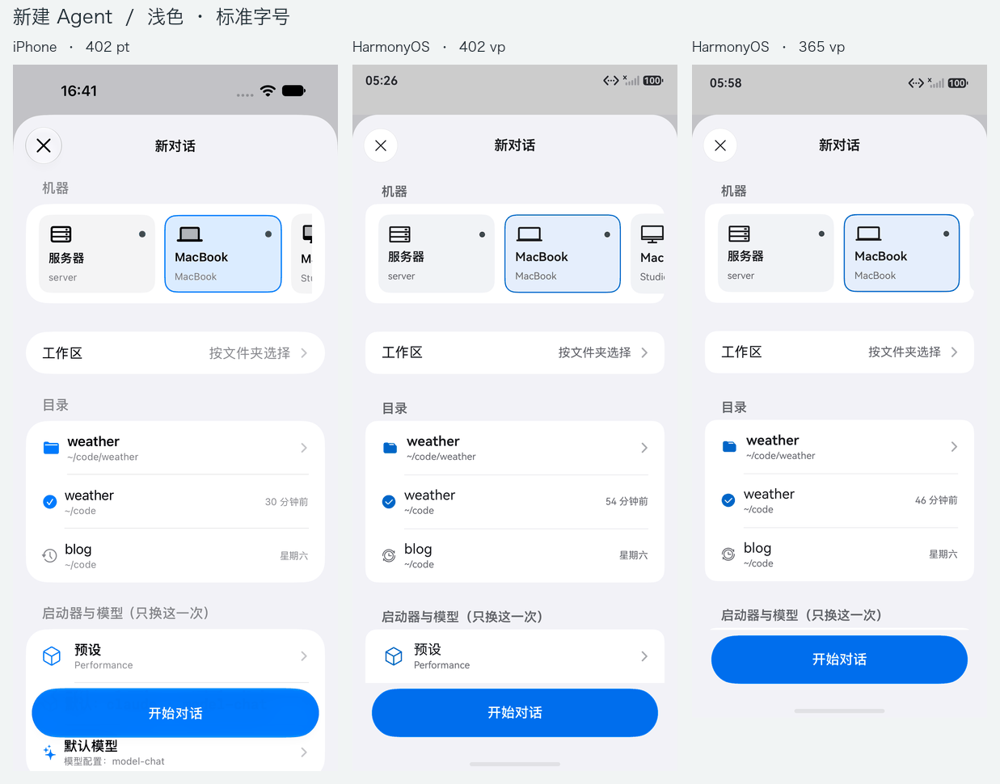
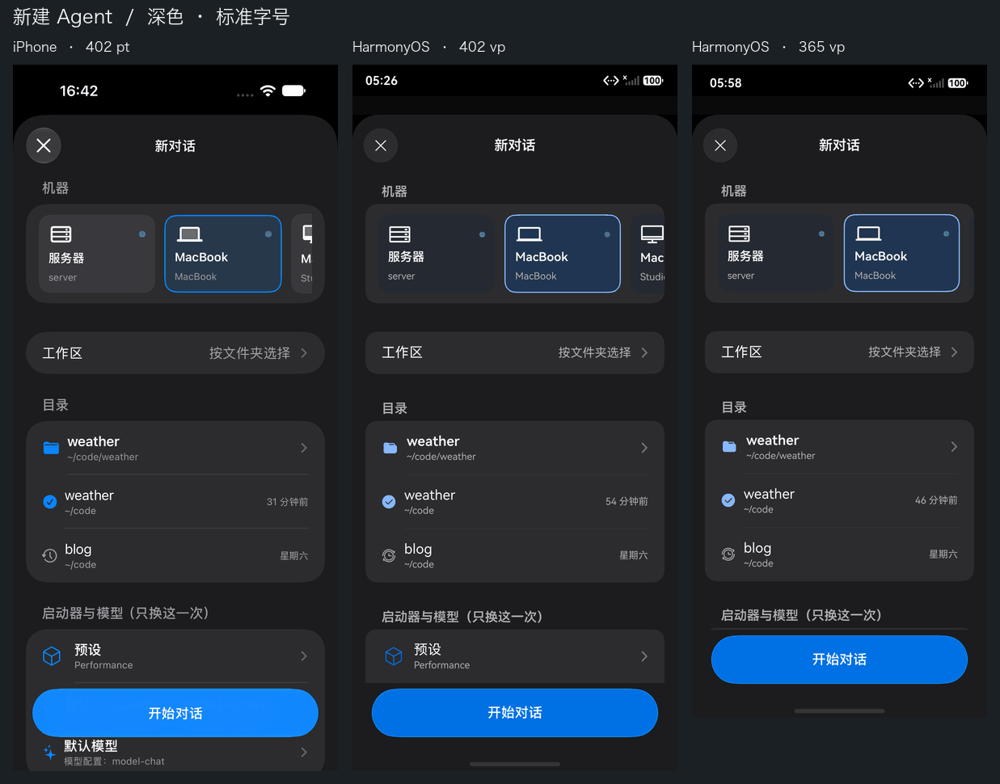
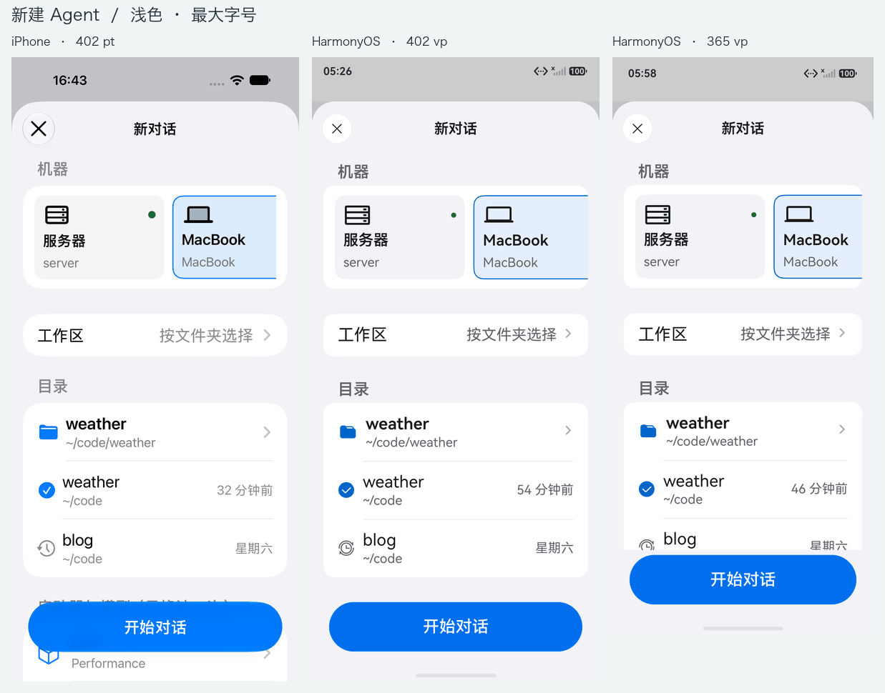

# 新建 Agent · New agent

[返回全部页面 · All pages](../README.md)

在启动表单选择机器、工作目录和启动器。
Compare the machine, directory, launcher and default model in the start form.

Three independent native captures, left to right: iPhone 402 pt, HarmonyOS 402 vp, HarmonyOS 365 vp. The complete screen, including system bars, is visible.

[Download all original screenshots and accessibility trees for this page](../originals/new-agent.zip?raw=1) · [Source and capture method](../SOURCES.md)

Original archive SHA-256: b22b3945f4288ceb76382b5589ec48908ac07480dcdad96bd84fdaff32c3a7db

## 浅色 · 标准字号

| Device | Pixels | Captured at | PNG digest | Hierarchy digest |
| --- | --- | --- | --- | --- |
| iPhone 402 pt | 1206 × 2622 | 2026-11-23T08:41:32.971+00:00 | 7e303f91820dedbd | 67c6ad0753f28187 |
| HarmonyOS 402 vp | 1206 × 2622 | 2026-11-23T17:26:17+08:00 | 1ee53db358a9c8ce | 0362a0da81d0a541 |
| HarmonyOS 365 vp | 1280 × 2832 | 2026-11-23T17:58:10+08:00 | 2a84503878919764 | e6ea84fe72713f79 |

## 深色 · 标准字号

| Device | Pixels | Captured at | PNG digest | Hierarchy digest |
| --- | --- | --- | --- | --- |
| iPhone 402 pt | 1206 × 2622 | 2026-11-23T08:42:23.190+00:00 | ea0dbd7a1abdc59e | 4329ca97a375deb7 |
| HarmonyOS 402 vp | 1206 × 2622 | 2026-11-23T17:26:21+08:00 | 8d0ef163d8d29fd1 | 1433159b246197a9 |
| HarmonyOS 365 vp | 1280 × 2832 | 2026-11-23T17:58:15+08:00 | 0935ad3a314aec15 | 1b1784e4c7934082 |

## 浅色 · 最大字号

| Device | Pixels | Captured at | PNG digest | Hierarchy digest |
| --- | --- | --- | --- | --- |
| iPhone 402 pt | 1206 × 2622 | 2026-11-23T08:43:09.600+00:00 | ea55fb8c83e7c085 | f9b331f4441ef0d5 |
| HarmonyOS 402 vp | 1206 × 2622 | 2026-11-23T17:26:25+08:00 | 6949b086d6a6769c | 0da8ffda751636cc |
| HarmonyOS 365 vp | 1280 × 2832 | 2026-11-23T17:58:20+08:00 | 2357612a6544031c | 787d85d6fc384e42 |

Full 64-character digests and ZIP entry paths are under this page in the [manifest](../manifest.json).

[← 工作树详情](worktree.md)
[选择目录 →](folder-browser.md)
