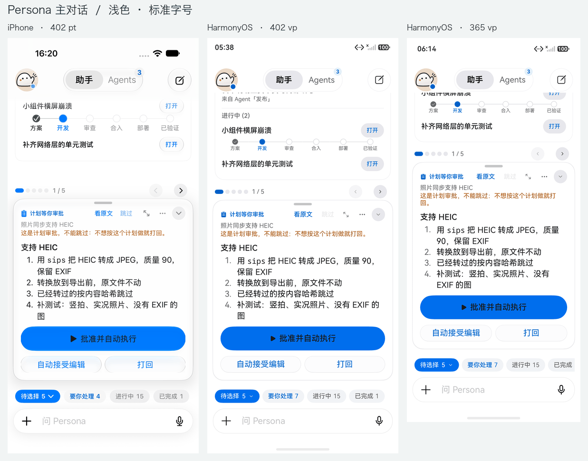
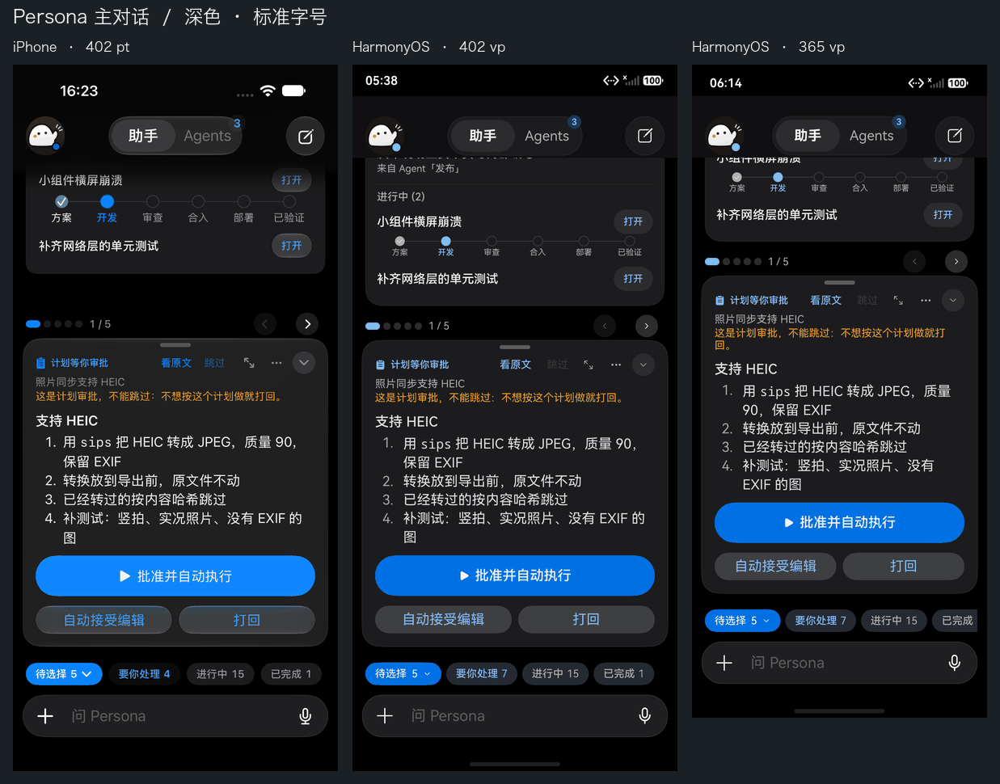
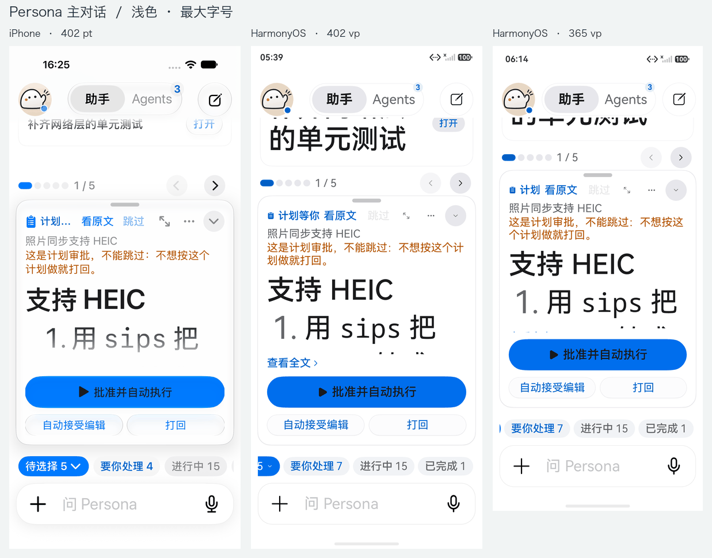

# Persona 主对话 · Main assistant conversation

[返回全部页面 · All pages](../README.md)

查看主助手的消息、任务卡和输入区。
Compare the assistant briefing, its progress links, the pending Agent plan and the composer.

Three independent native captures, left to right: iPhone 402 pt, HarmonyOS 402 vp, HarmonyOS 365 vp. The complete screen, including system bars, is visible.

[Download all original screenshots and accessibility trees for this page](../originals/persona.zip?raw=1) · [Source and capture method](../SOURCES.md)

Original archive SHA-256: 0988d5b976406a3b82e1eaa21f6fecde3de0363c2359daa55678529b4f082439

## 浅色 · 标准字号

| Device | Pixels | Captured at | PNG digest | Hierarchy digest |
| --- | --- | --- | --- | --- |
| iPhone 402 pt | 1206 × 2622 | 2026-11-23T08:20:06.281+00:00 | 5f07976f6eed6336 | be128a2e18c882d3 |
| HarmonyOS 402 vp | 1206 × 2622 | 2026-11-23T17:38:50+08:00 | 87b871bc730d6bae | d69b09dbea6b183e |
| HarmonyOS 365 vp | 1280 × 2832 | 2026-11-23T18:14:19+08:00 | 3c622228a803172a | 5a15e5d98905df00 |

## 深色 · 标准字号

| Device | Pixels | Captured at | PNG digest | Hierarchy digest |
| --- | --- | --- | --- | --- |
| iPhone 402 pt | 1206 × 2622 | 2026-11-23T08:23:06.295+00:00 | 6c52f1463376691c | 735052b48f98b329 |
| HarmonyOS 402 vp | 1206 × 2622 | 2026-11-23T17:38:54+08:00 | 1fb3662c1fba2a9e | cb76b38002f6fadd |
| HarmonyOS 365 vp | 1280 × 2832 | 2026-11-23T18:14:23+08:00 | f67cf4ba85f00e69 | 590fffa35c55f3bb |

## 浅色 · 最大字号

| Device | Pixels | Captured at | PNG digest | Hierarchy digest |
| --- | --- | --- | --- | --- |
| iPhone 402 pt | 1206 × 2622 | 2026-11-23T08:25:49.291+00:00 | e316384d665280e9 | 4ac62b4cd12b618f |
| HarmonyOS 402 vp | 1206 × 2622 | 2026-11-23T17:39:20+08:00 | 1a8f21cc8202d65f | 04d67af0e5fbcc8c |
| HarmonyOS 365 vp | 1280 × 2832 | 2026-11-23T18:14:51+08:00 | e4ff32f601010e91 | bb2c5ab5a1d76c23 |

Full 64-character digests and ZIP entry paths are under this page in the [manifest](../manifest.json).

[← 会话小结详情](recap-detail.md)
[展开会话输入框 →](composer.md)
