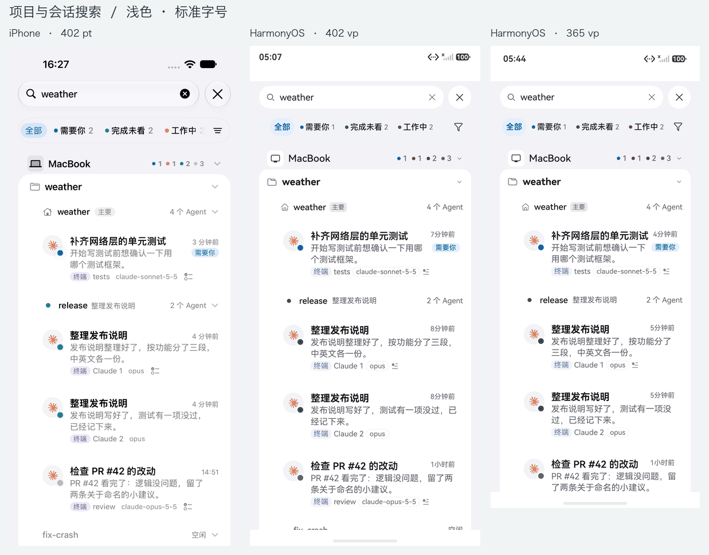
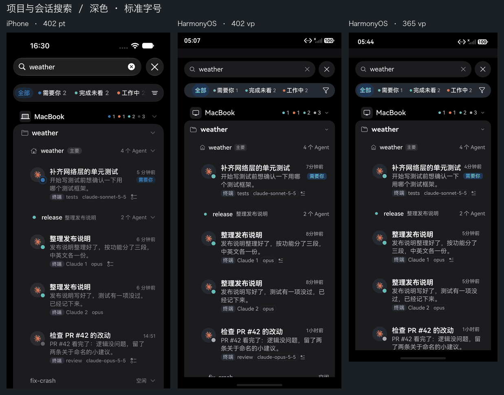
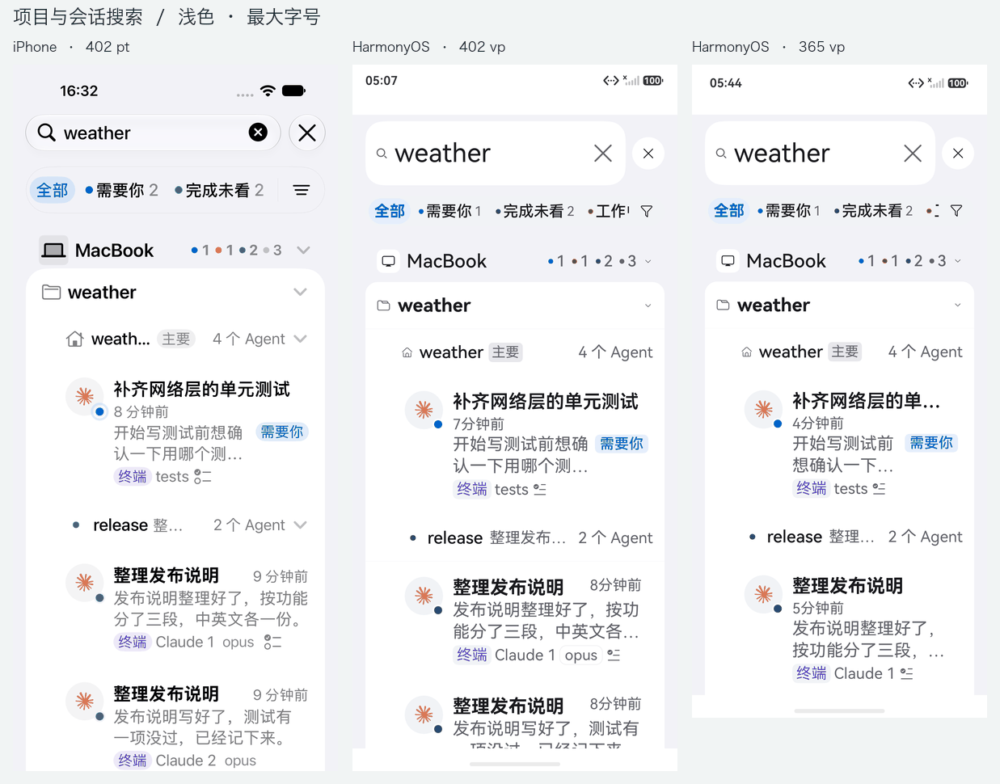

# 项目与会话搜索 · Search projects and sessions

[返回全部页面 · All pages](../README.md)

按仓库或会话关键词筛选项目，再读取匹配项。
Search for weather in the repository outline and compare its activity filters and matching rows.

Three independent native captures, left to right: iPhone 402 pt, HarmonyOS 402 vp, HarmonyOS 365 vp. The complete screen, including system bars, is visible.

[Download all original screenshots and accessibility trees for this page](../originals/project-search.zip?raw=1) · [Source and capture method](../SOURCES.md)

Original archive SHA-256: 9b63f93110bb8a13eed6d59aa72ea0c0d8de19ada216c966aa0fb4a70cd7d269

## 浅色 · 标准字号

| Device | Pixels | Captured at | PNG digest | Hierarchy digest |
| --- | --- | --- | --- | --- |
| iPhone 402 pt | 1206 × 2622 | 2026-11-23T08:27:54.772+00:00 | b9f1ea22b2bec616 | 6a6d4c693899713a |
| HarmonyOS 402 vp | 1206 × 2622 | 2026-11-23T17:07:07+08:00 | 22385aefbf41515f | 85b892e43972f3ec |
| HarmonyOS 365 vp | 1280 × 2832 | 2026-11-23T17:44:10+08:00 | cdd364e87cfff265 | 454f9c4de19bdfe8 |

## 深色 · 标准字号

| Device | Pixels | Captured at | PNG digest | Hierarchy digest |
| --- | --- | --- | --- | --- |
| iPhone 402 pt | 1206 × 2622 | 2026-11-23T08:30:22.521+00:00 | 15ae932be6268014 | e509d79fadcebec1 |
| HarmonyOS 402 vp | 1206 × 2622 | 2026-11-23T17:07:11+08:00 | 9e00613e0bfd1582 | 5d56188930211e4d |
| HarmonyOS 365 vp | 1280 × 2832 | 2026-11-23T17:44:13+08:00 | e5bd9e174090db66 | fd63f4fd3079632c |

## 浅色 · 最大字号

| Device | Pixels | Captured at | PNG digest | Hierarchy digest |
| --- | --- | --- | --- | --- |
| iPhone 402 pt | 1206 × 2622 | 2026-11-23T08:32:54.582+00:00 | 6e08056e6f176892 | 7fa23809e90dfe8a |
| HarmonyOS 402 vp | 1206 × 2622 | 2026-11-23T17:07:15+08:00 | 4214feb24dde5d76 | f56a54cb2dc2b222 |
| HarmonyOS 365 vp | 1280 × 2832 | 2026-11-23T17:44:18+08:00 | 63a886487f46dd19 | 5f7d76afa3adacc6 |

Full 64-character digests and ZIP entry paths are under this page in the [manifest](../manifest.json).

[← 折叠 release 标签](release-collapsed.md)
[仓库详情 →](project.md)
