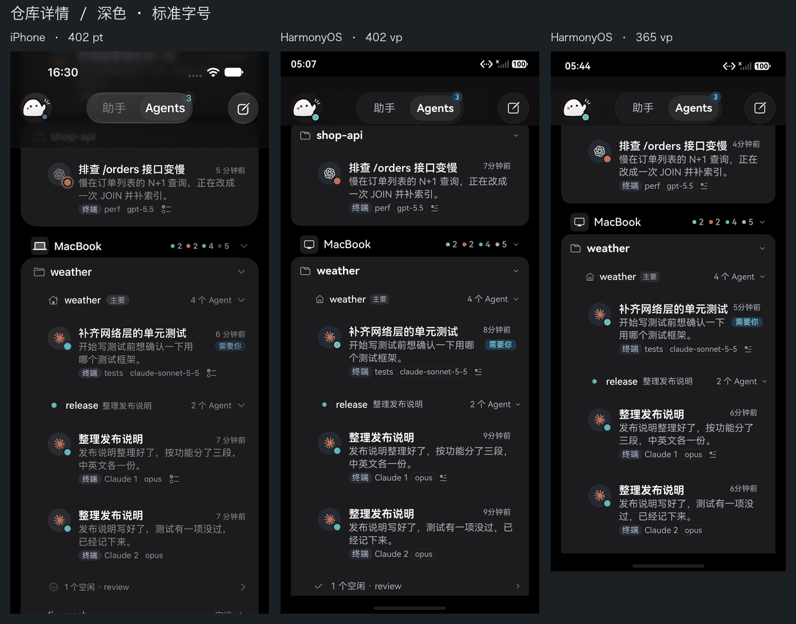

# 仓库详情 · Repository details

[返回全部页面 · All pages](../README.md)

查看 weather 仓库包含的工作树和会话。
Expand weather in place and inspect the worktrees and sessions inside this repository.

Three independent native captures, left to right: iPhone 402 pt, HarmonyOS 402 vp, HarmonyOS 365 vp. The complete screen, including system bars, is visible.

[Download all original screenshots and accessibility trees for this page](../originals/project.zip?raw=1) · [Source and capture method](../SOURCES.md)

Original archive SHA-256: 1fa2e4e73724b14bd0d429c7f1f11696037f4bc012582bf667962328a9313634

## 浅色 · 标准字号

| Device | Pixels | Captured at | PNG digest | Hierarchy digest |
| --- | --- | --- | --- | --- |
| iPhone 402 pt | 1206 × 2622 | 2026-11-23T08:28:10.252+00:00 | 1c982019c69e2ddd | 15c6c348aabaec1b |
| HarmonyOS 402 vp | 1206 × 2622 | 2026-11-23T17:07:38+08:00 | 5c28063779db82d0 | 5cfc0917475bb460 |
| HarmonyOS 365 vp | 1280 × 2832 | 2026-11-23T17:44:40+08:00 | 10251e51f7bc957f | 5416bb79afc5eba6 |

## 深色 · 标准字号

| Device | Pixels | Captured at | PNG digest | Hierarchy digest |
| --- | --- | --- | --- | --- |
| iPhone 402 pt | 1206 × 2622 | 2026-11-23T08:30:38.100+00:00 | e04b28cb3248604b | 0bf0d82e8ababf23 |
| HarmonyOS 402 vp | 1206 × 2622 | 2026-11-23T17:07:44+08:00 | b3fc93759aa56f74 | f51484677310ad6a |
| HarmonyOS 365 vp | 1280 × 2832 | 2026-11-23T17:44:46+08:00 | 2ad9ec6b3b4b73fd | fe2f10be4e3e0011 |

## 浅色 · 最大字号

| Device | Pixels | Captured at | PNG digest | Hierarchy digest |
| --- | --- | --- | --- | --- |
| iPhone 402 pt | 1206 × 2622 | 2026-11-23T08:33:13.732+00:00 | cc82d518b8436828 | ccd530c3c51c52ad |
| HarmonyOS 402 vp | 1206 × 2622 | 2026-11-23T17:07:55+08:00 | 6913be02f3ff9e1a | af862af3445a6b96 |
| HarmonyOS 365 vp | 1280 × 2832 | 2026-11-23T17:44:56+08:00 | 0131d679ab24f5e5 | ee570f2ce2f5d021 |

Full 64-character digests and ZIP entry paths are under this page in the [manifest](../manifest.json).

[← 项目与会话搜索](project-search.md)
[工作树详情 →](worktree.md)
