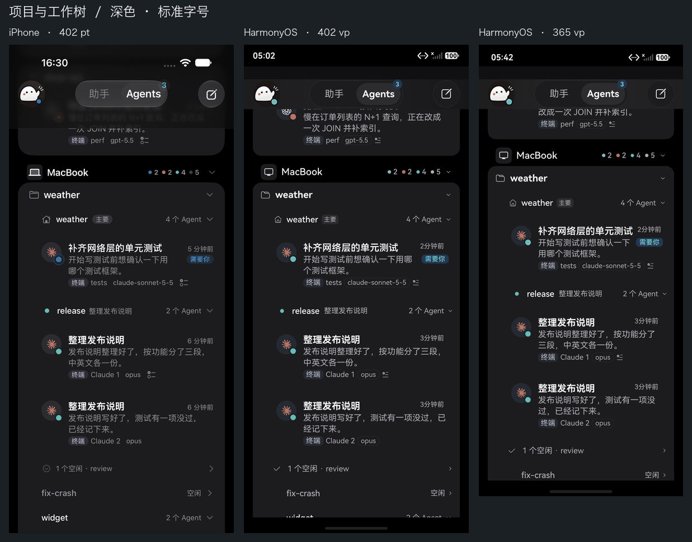

# 项目与工作树 · Project tree

[返回全部页面 · All pages](../README.md)

查看 weather 仓库、工作树和各自的 Agent。
Open the repository grouping in Agents and expand the same machine.

Three independent native captures, left to right: iPhone 402 pt, HarmonyOS 402 vp, HarmonyOS 365 vp. The complete screen, including system bars, is visible.

[Download all original screenshots and accessibility trees for this page](../originals/projects.zip?raw=1) · [Source and capture method](../SOURCES.md)

Original archive SHA-256: 32bc3ba02d9748a941ef9c0a81394f680c1c916ae540660a28f768ddf7068dd8

## 浅色 · 标准字号

| Device | Pixels | Captured at | PNG digest | Hierarchy digest |
| --- | --- | --- | --- | --- |
| iPhone 402 pt | 1206 × 2622 | 2026-11-23T08:27:37.158+00:00 | 09e15599f0d5a711 | 3cef99bf39cdb5e8 |
| HarmonyOS 402 vp | 1206 × 2622 | 2026-11-23T17:02:04+08:00 | 3ac5f31602c12c10 | 78a9ceef629476b9 |
| HarmonyOS 365 vp | 1280 × 2832 | 2026-11-23T17:42:08+08:00 | 1389e0d738277967 | b8ff49cfb30ef5ad |

## 深色 · 标准字号

| Device | Pixels | Captured at | PNG digest | Hierarchy digest |
| --- | --- | --- | --- | --- |
| iPhone 402 pt | 1206 × 2622 | 2026-11-23T08:30:04.526+00:00 | c5fd46ae19121f6e | cb867fd24825b390 |
| HarmonyOS 402 vp | 1206 × 2622 | 2026-11-23T17:02:09+08:00 | e63442ac502733c9 | e041052d82c14be1 |
| HarmonyOS 365 vp | 1280 × 2832 | 2026-11-23T17:42:14+08:00 | 2793b3a764e1ada9 | 72b1eafa998fb35b |

## 浅色 · 最大字号

| Device | Pixels | Captured at | PNG digest | Hierarchy digest |
| --- | --- | --- | --- | --- |
| iPhone 402 pt | 1206 × 2622 | 2026-11-23T08:32:38.423+00:00 | a48d12dfb58ed6d8 | 86fe79dcad0bf3dd |
| HarmonyOS 402 vp | 1206 × 2622 | 2026-11-23T17:02:23+08:00 | 8936edbbb053a76c | 66358701d099253b |
| HarmonyOS 365 vp | 1280 × 2832 | 2026-11-23T17:42:23+08:00 | 468577ef4f9d1c02 | 6adf22036e9318a2 |

Full 64-character digests and ZIP entry paths are under this page in the [manifest](../manifest.json).

[折叠 release 标签 →](release-collapsed.md)
