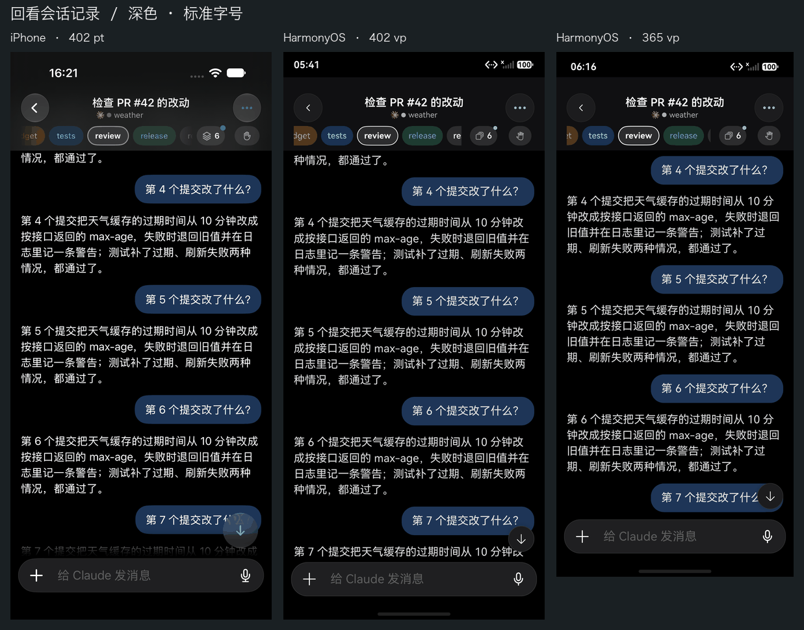

# 回看会话记录 · Read earlier messages

[返回全部页面 · All pages](../README.md)

回到较早的消息，再通过向下箭头跳至最新内容。

Three independent native captures, left to right: iPhone 402 pt, HarmonyOS 402 vp, HarmonyOS 365 vp. The complete screen, including system bars, is visible.

[Download all original screenshots and accessibility trees for this page](../originals/reading-history.zip?raw=1) · [Source and capture method](../SOURCES.md)

Original archive SHA-256: a2c0bcf8b74330c264a2fb348f69d6981fad2b988fb32f6e6b9223728bac90d2

## 浅色 · 标准字号

| Device | Pixels | Captured at | PNG digest | Hierarchy digest |
| --- | --- | --- | --- | --- |
| iPhone 402 pt | 1206 × 2622 | 2026-11-23T08:18:32.593+00:00 | 78224b66874f701e | 40cd6ecbe2b6dc5b |
| HarmonyOS 402 vp | 1206 × 2622 | 2026-11-23T17:41:03+08:00 | 4007c1feaa6fa127 | b001ed6b06c21105 |
| HarmonyOS 365 vp | 1280 × 2832 | 2026-11-23T18:16:35+08:00 | fb4d2b18fcfe1781 | b87ff1e918409d94 |

## 深色 · 标准字号

| Device | Pixels | Captured at | PNG digest | Hierarchy digest |
| --- | --- | --- | --- | --- |
| iPhone 402 pt | 1206 × 2622 | 2026-11-23T08:21:34.995+00:00 | 189c7411c782da7b | aa2cacfc668494f8 |
| HarmonyOS 402 vp | 1206 × 2622 | 2026-11-23T17:41:11+08:00 | dcb1fa08cc4de1c0 | 9f2a20ca5dc56a58 |
| HarmonyOS 365 vp | 1280 × 2832 | 2026-11-23T18:16:42+08:00 | 5b1b6ed3ee209e75 | 7d12d9ad759cbaa0 |

## 浅色 · 最大字号

| Device | Pixels | Captured at | PNG digest | Hierarchy digest |
| --- | --- | --- | --- | --- |
| iPhone 402 pt | 1206 × 2622 | 2026-11-23T08:24:19.833+00:00 | e5a75fbe1b8b4221 | 9d9e9a2aa3f0c678 |
| HarmonyOS 402 vp | 1206 × 2622 | 2026-11-23T17:42:51+08:00 | 63a6c26b4208a16f | d829c7b934f7282e |
| HarmonyOS 365 vp | 1280 × 2832 | 2026-11-23T18:18:54+08:00 | b52ca9a00442f564 | a2ceed9d9fc5b852 |

Full 64-character digests and ZIP entry paths are under this page in the [manifest](../manifest.json).

[← 展开会话输入框](composer.md)
[文件 →](files.md)
