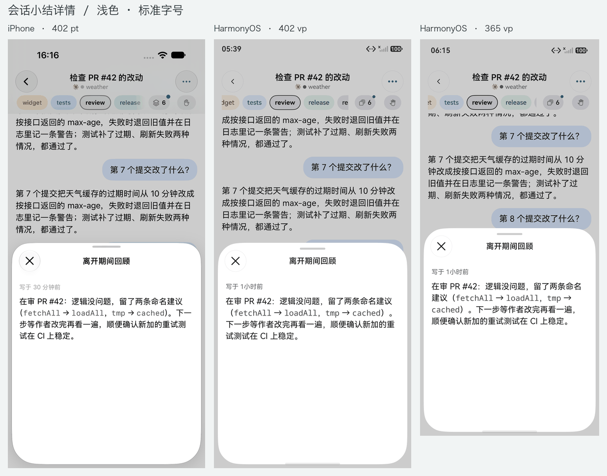
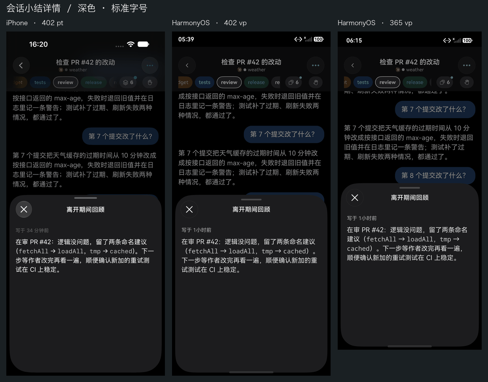
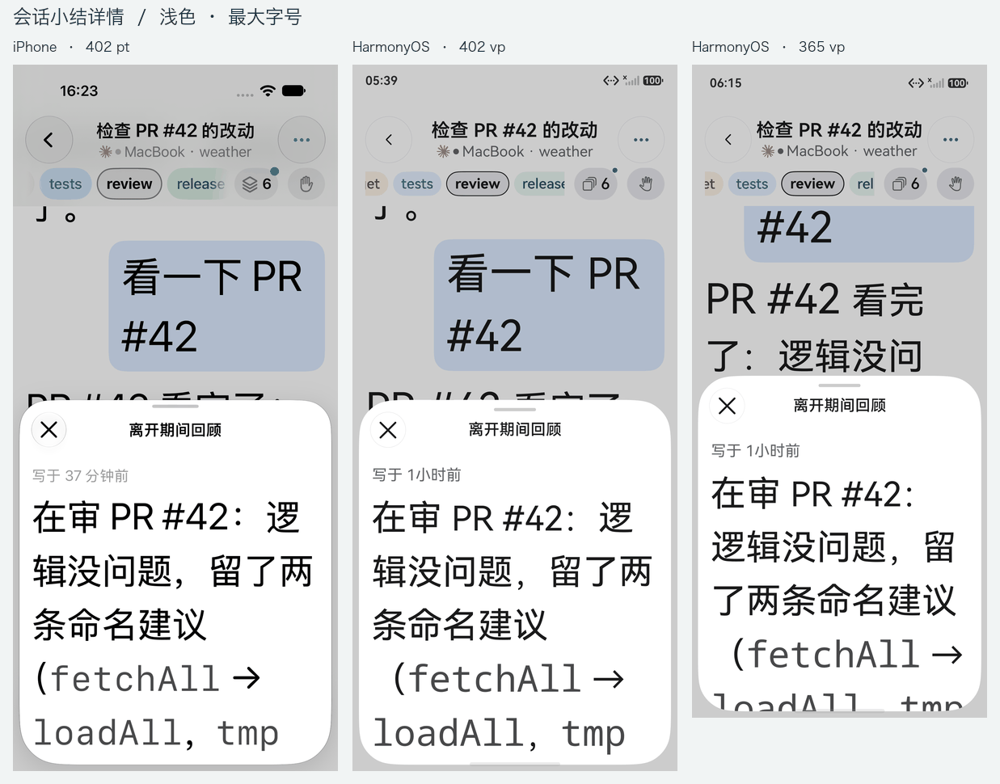

# 会话小结详情 · Conversation recap

[返回全部页面 · All pages](../README.md)

从「离开期间回顾」标记打开完整回顾。

Three independent native captures, left to right: iPhone 402 pt, HarmonyOS 402 vp, HarmonyOS 365 vp. The complete screen, including system bars, is visible.

[Download all original screenshots and accessibility trees for this page](../originals/recap-detail.zip?raw=1) · [Source and capture method](../SOURCES.md)

Original archive SHA-256: d662e50346928ac6661531589af43b31a8dff84fc0aaf60e33922c210d18d18e

## 浅色 · 标准字号

| Device | Pixels | Captured at | PNG digest | Hierarchy digest |
| --- | --- | --- | --- | --- |
| iPhone 402 pt | 1206 × 2622 | 2026-11-23T08:16:46.143+00:00 | 4c416297e43a430f | 66a3ceca14112f4b |
| HarmonyOS 402 vp | 1206 × 2622 | 2026-11-23T17:39:48+08:00 | 59529fdf101d3ad7 | 417424371c763bba |
| HarmonyOS 365 vp | 1280 × 2832 | 2026-11-23T18:15:19+08:00 | 5e41e0e80e9513b2 | 764f0c0e7ccc5276 |

## 深色 · 标准字号

| Device | Pixels | Captured at | PNG digest | Hierarchy digest |
| --- | --- | --- | --- | --- |
| iPhone 402 pt | 1206 × 2622 | 2026-11-23T08:20:29.223+00:00 | 0f243b438a3d558f | 59286e500e080796 |
| HarmonyOS 402 vp | 1206 × 2622 | 2026-11-23T17:39:52+08:00 | 26e7cd192b8d8c88 | 0922be60900f1f71 |
| HarmonyOS 365 vp | 1280 × 2832 | 2026-11-23T18:15:23+08:00 | e2e6223ea1ff30f1 | 90955db0edd10ea6 |

## 浅色 · 最大字号

| Device | Pixels | Captured at | PNG digest | Hierarchy digest |
| --- | --- | --- | --- | --- |
| iPhone 402 pt | 1206 × 2622 | 2026-11-23T08:23:28.421+00:00 | 91f102d9d9d38477 | bbca930ee21ee6e1 |
| HarmonyOS 402 vp | 1206 × 2622 | 2026-11-23T17:39:56+08:00 | 71e6a2ea6a055ec0 | 41e99e43610226f4 |
| HarmonyOS 365 vp | 1280 × 2832 | 2026-11-23T18:15:27+08:00 | 20e4d398a171adb7 | b7c6667529d2d5d3 |

Full 64-character digests and ZIP entry paths are under this page in the [manifest](../manifest.json).

[← Agent 会话](agent-chat.md)
[Persona 主对话 →](persona.md)
