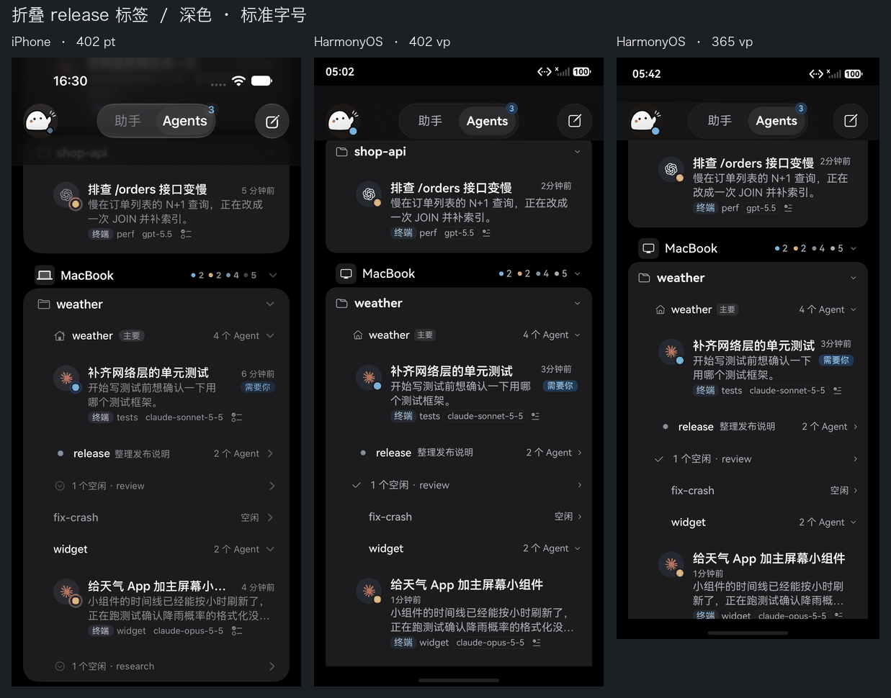

# 折叠 release 标签 · Collapse a terminal tab

[返回全部页面 · All pages](../README.md)

折叠 weather 下的 release 标签，查看分组和折叠状态。
Collapse the release terminal group in the weather project tree.

Three independent native captures, left to right: iPhone 402 pt, HarmonyOS 402 vp, HarmonyOS 365 vp. The complete screen, including system bars, is visible.

[Download all original screenshots and accessibility trees for this page](../originals/release-collapsed.zip?raw=1) · [Source and capture method](../SOURCES.md)

Original archive SHA-256: b8b09bc27c28b8c2a0158a04be9aff43a7d82d1f40883775fe86dc5502bc99d9

## 浅色 · 标准字号

| Device | Pixels | Captured at | PNG digest | Hierarchy digest |
| --- | --- | --- | --- | --- |
| iPhone 402 pt | 1206 × 2622 | 2026-11-23T08:28:14.370+00:00 | 152e3cbe74c9a068 | 377dc2f7b57eb543 |
| HarmonyOS 402 vp | 1206 × 2622 | 2026-11-23T17:02:36+08:00 | 8738bb33cc1d8141 | 9ad4309b821ec5e4 |
| HarmonyOS 365 vp | 1280 × 2832 | 2026-11-23T17:42:38+08:00 | ac6b65322b9cb311 | 52a3cf28cc3ee02b |

## 深色 · 标准字号

| Device | Pixels | Captured at | PNG digest | Hierarchy digest |
| --- | --- | --- | --- | --- |
| iPhone 402 pt | 1206 × 2622 | 2026-11-23T08:30:42.312+00:00 | f5b36d2378859df2 | b3c8ef5dfd2da38f |
| HarmonyOS 402 vp | 1206 × 2622 | 2026-11-23T17:02:41+08:00 | 165fc12385173666 | 0eda9e4851f946b6 |
| HarmonyOS 365 vp | 1280 × 2832 | 2026-11-23T17:42:44+08:00 | df7151f1be04b301 | c58586eac08308b2 |

## 浅色 · 最大字号

| Device | Pixels | Captured at | PNG digest | Hierarchy digest |
| --- | --- | --- | --- | --- |
| iPhone 402 pt | 1206 × 2622 | 2026-11-23T08:33:17.767+00:00 | 839e44b19666bbdb | db558fa8f757364d |
| HarmonyOS 402 vp | 1206 × 2622 | 2026-11-23T17:02:49+08:00 | 9cdabc386eb34d97 | 3285f12291ba2e8c |
| HarmonyOS 365 vp | 1280 × 2832 | 2026-11-23T17:42:53+08:00 | 6cb2bcc17910b0a7 | 9ee0182600c21000 |

Full 64-character digests and ZIP entry paths are under this page in the [manifest](../manifest.json).

[← 项目与工作树](projects.md)
[项目与会话搜索 →](project-search.md)
