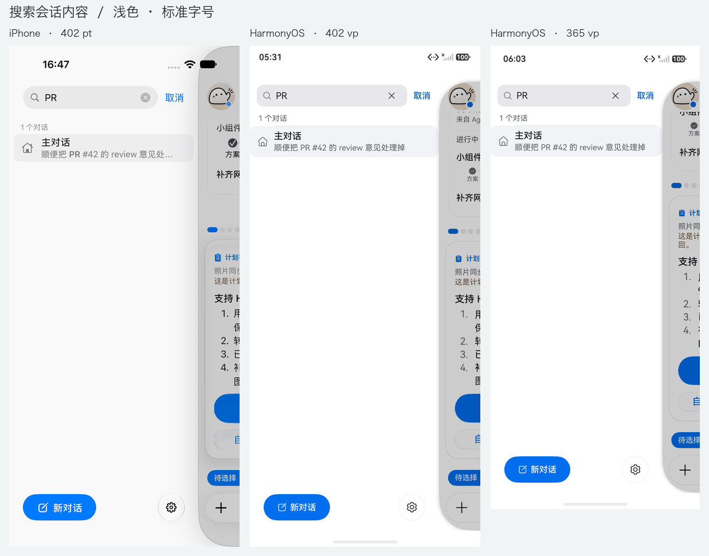
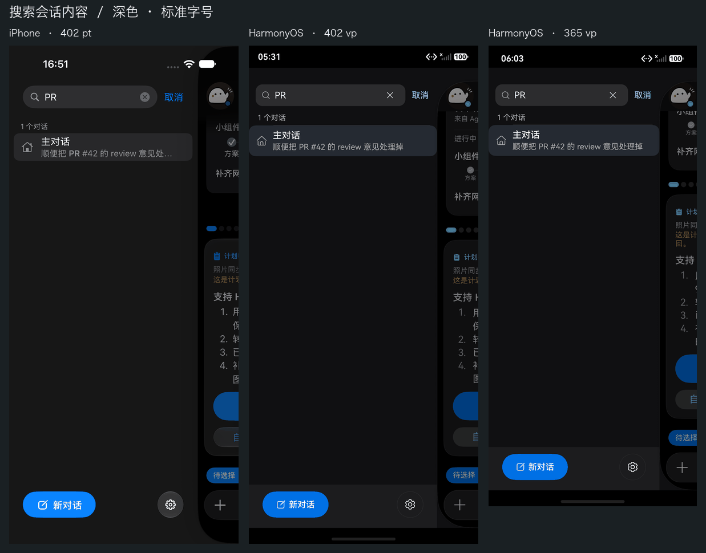
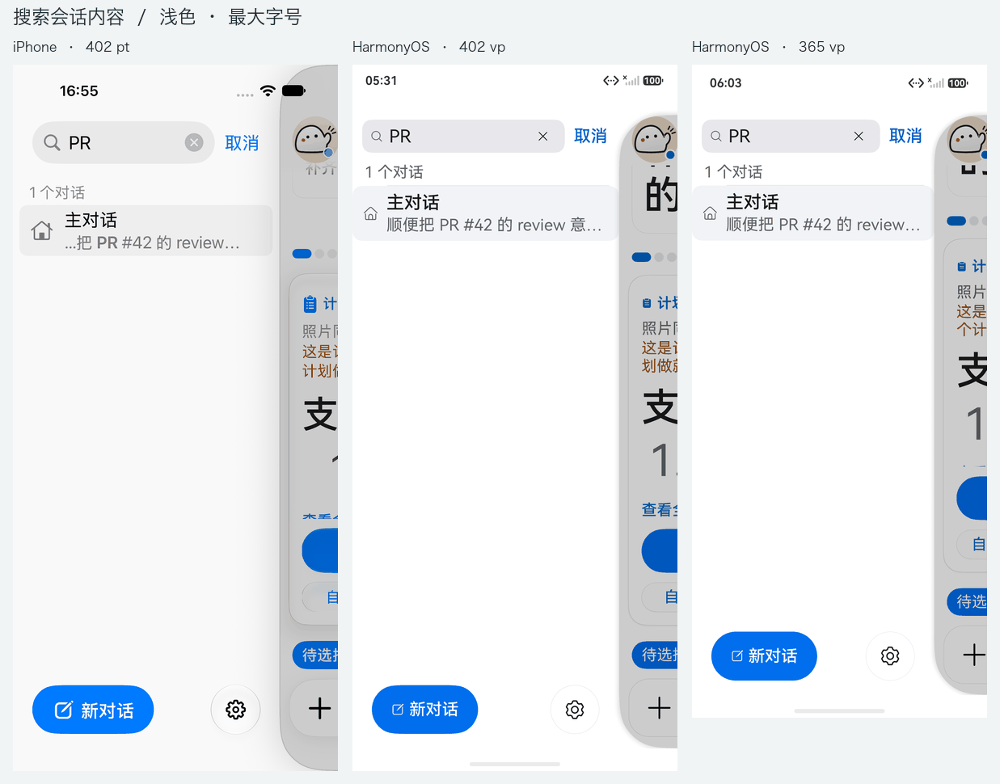

# 搜索会话内容 · Search conversations

[返回全部页面 · All pages](../README.md)

用 PR 搜索会话内容并查看匹配结果。

Three independent native captures, left to right: iPhone 402 pt, HarmonyOS 402 vp, HarmonyOS 365 vp. The complete screen, including system bars, is visible.

[Download all original screenshots and accessibility trees for this page](../originals/search.zip?raw=1) · [Source and capture method](../SOURCES.md)

Original archive SHA-256: 5e606ba0614384411591d0de4d26f0862d0afc39dd7c83d1049bc06e4c7f627c

## 浅色 · 标准字号

| Device | Pixels | Captured at | PNG digest | Hierarchy digest |
| --- | --- | --- | --- | --- |
| iPhone 402 pt | 1206 × 2622 | 2026-11-23T08:47:55.763+00:00 | a0ddfaa848b8f876 | 013077bf90761dd4 |
| HarmonyOS 402 vp | 1206 × 2622 | 2026-11-23T17:31:16+08:00 | bf3e99088cff3fed | bf3036902b8cc86e |
| HarmonyOS 365 vp | 1280 × 2832 | 2026-11-23T18:03:09+08:00 | 603978e02f57a44b | 9a9d2dab6f8fe85a |

## 深色 · 标准字号

| Device | Pixels | Captured at | PNG digest | Hierarchy digest |
| --- | --- | --- | --- | --- |
| iPhone 402 pt | 1206 × 2622 | 2026-11-23T08:51:44.637+00:00 | 1629d198ed622b85 | 88c204cddf60b5a7 |
| HarmonyOS 402 vp | 1206 × 2622 | 2026-11-23T17:31:20+08:00 | 110d6f9aa0d07046 | b040490f7b40e860 |
| HarmonyOS 365 vp | 1280 × 2832 | 2026-11-23T18:03:13+08:00 | 6c4fdd1b0be406e4 | cfe823b0e7eebe6a |

## 浅色 · 最大字号

| Device | Pixels | Captured at | PNG digest | Hierarchy digest |
| --- | --- | --- | --- | --- |
| iPhone 402 pt | 1206 × 2622 | 2026-11-23T08:55:28.996+00:00 | a8bdb15f361d41ef | bb8f2a69838f78c4 |
| HarmonyOS 402 vp | 1206 × 2622 | 2026-11-23T17:31:24+08:00 | b27f62bed1401bd3 | c47658ad4456c7f3 |
| HarmonyOS 365 vp | 1280 × 2832 | 2026-11-23T18:03:18+08:00 | a96a594c827f9623 | 2a4047c3d05cf5a3 |

Full 64-character digests and ZIP entry paths are under this page in the [manifest](../manifest.json).

[← Agent 偏好](agent-preferences.md)
[收件箱 →](inbox.md)
