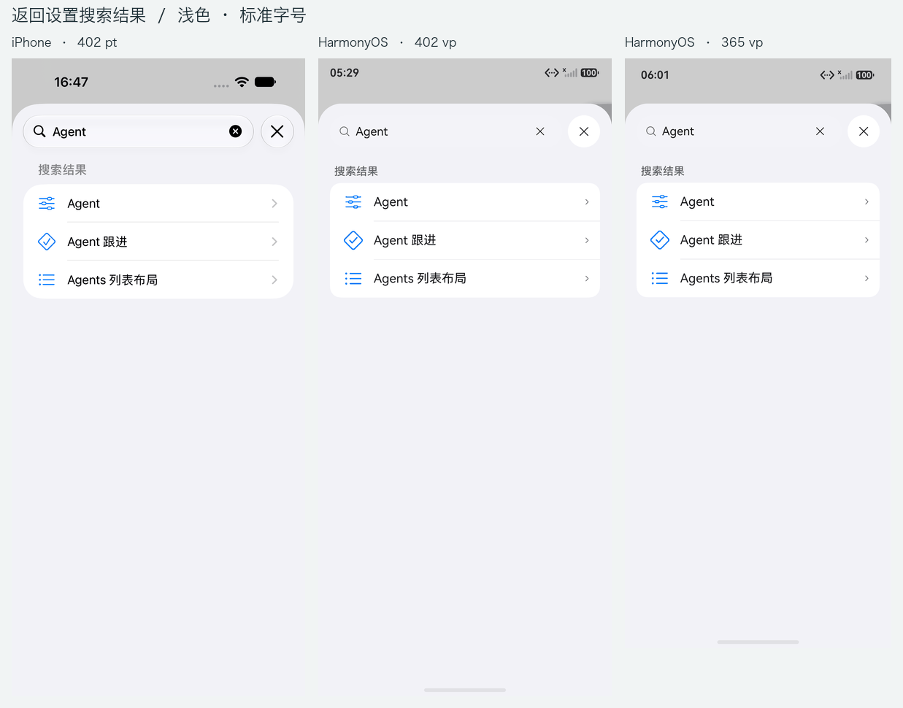
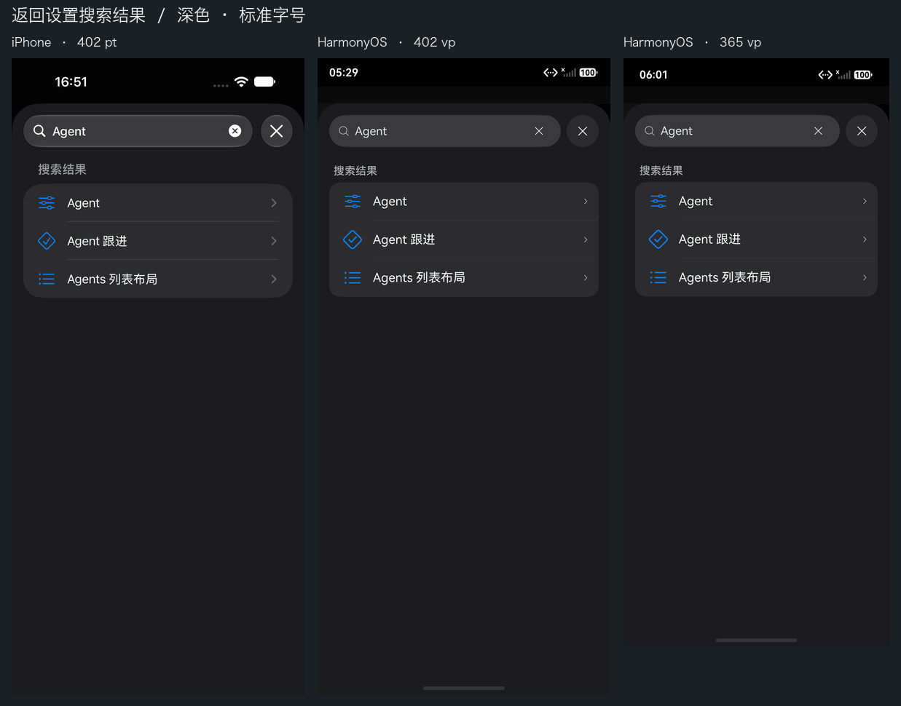
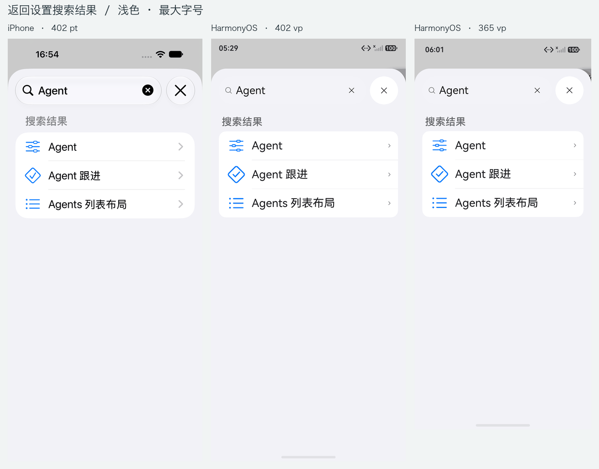

# 返回设置搜索结果 · Restore settings search

[返回全部页面 · All pages](../README.md)

搜索 Agent，打开偏好项，再返回已保留的搜索结果。

Three independent native captures, left to right: iPhone 402 pt, HarmonyOS 402 vp, HarmonyOS 365 vp. The complete screen, including system bars, is visible.

[Download all original screenshots and accessibility trees for this page](../originals/settings-search-restored.zip?raw=1) · [Source and capture method](../SOURCES.md)

Original archive SHA-256: 1b066bd9b8cf87f5f5888f9cab48ba2f3161a86d97a50f713b5ec7657c9d2b67

## 浅色 · 标准字号

| Device | Pixels | Captured at | PNG digest | Hierarchy digest |
| --- | --- | --- | --- | --- |
| iPhone 402 pt | 1206 × 2622 | 2026-11-23T08:47:13.623+00:00 | 007f1f0dc0e38d0f | 9b52df0dff687c03 |
| HarmonyOS 402 vp | 1206 × 2622 | 2026-11-23T17:29:24+08:00 | 3f1873a0f87671b3 | c743f31b1460c26b |
| HarmonyOS 365 vp | 1280 × 2832 | 2026-11-23T18:01:12+08:00 | c224bf56ed883a9d | 9fe57f1a2a65be3f |

## 深色 · 标准字号

| Device | Pixels | Captured at | PNG digest | Hierarchy digest |
| --- | --- | --- | --- | --- |
| iPhone 402 pt | 1206 × 2622 | 2026-11-23T08:51:00.604+00:00 | 60fa18908d55b6ca | ea115d42c6560fc4 |
| HarmonyOS 402 vp | 1206 × 2622 | 2026-11-23T17:29:28+08:00 | 5e61abf9b194cb95 | af87456e140a13da |
| HarmonyOS 365 vp | 1280 × 2832 | 2026-11-23T18:01:16+08:00 | ad7ee7063d40c86c | 348590d8dfb1e61f |

## 浅色 · 最大字号

| Device | Pixels | Captured at | PNG digest | Hierarchy digest |
| --- | --- | --- | --- | --- |
| iPhone 402 pt | 1206 × 2622 | 2026-11-23T08:54:44.339+00:00 | 329719413cf28b2c | 0e40cd98c6f9dc52 |
| HarmonyOS 402 vp | 1206 × 2622 | 2026-11-23T17:29:32+08:00 | 48ba59b7a9f71ecb | 873306b0219d23a4 |
| HarmonyOS 365 vp | 1280 × 2832 | 2026-11-23T18:01:20+08:00 | 01db20d70e08c442 | 97cca692b6b3a8b8 |

Full 64-character digests and ZIP entry paths are under this page in the [manifest](../manifest.json).

[← 设置](settings.md)
[语言 →](language.md)
