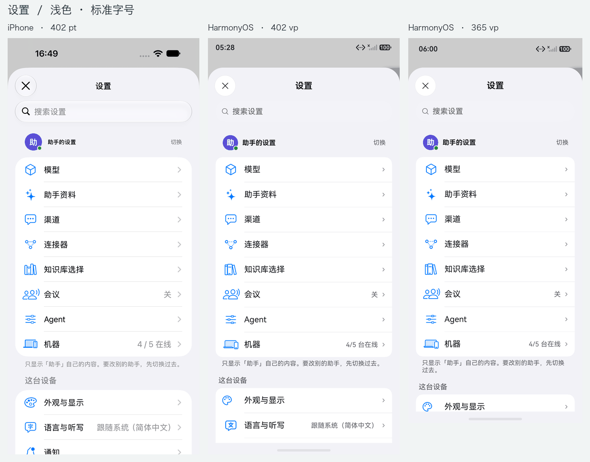
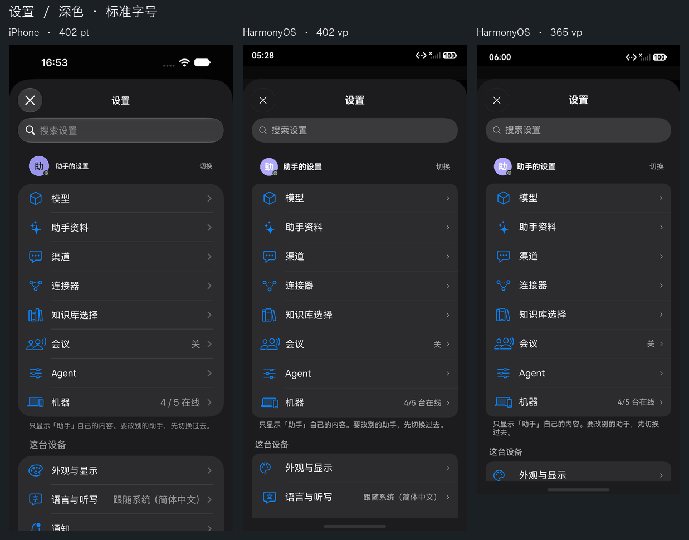
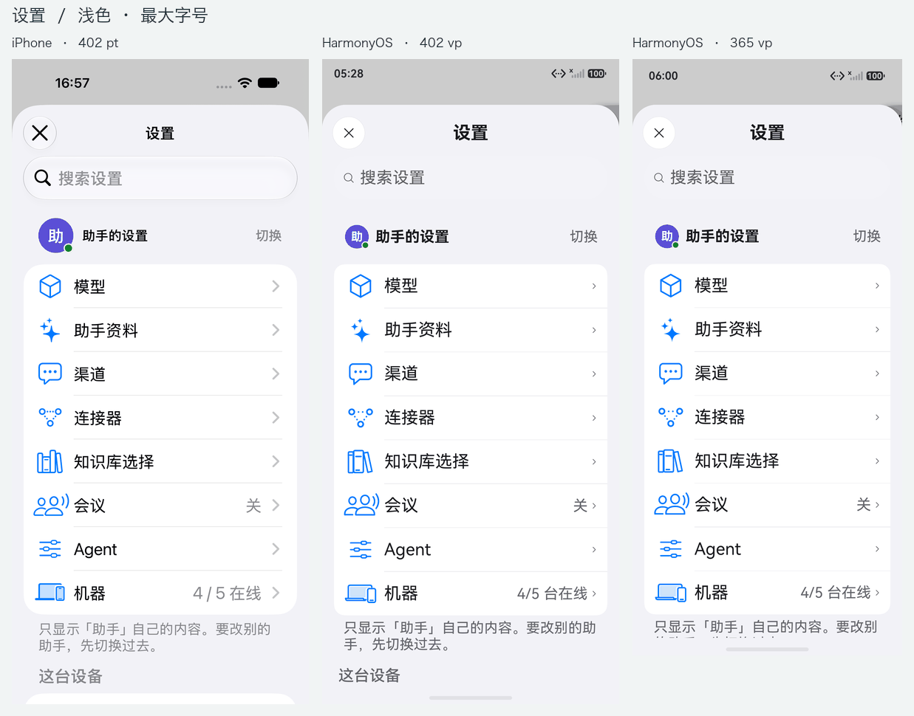

# 设置 · Settings

[返回全部页面 · All pages](../README.md)

查看设置分组和搜索入口。

Three independent native captures, left to right: iPhone 402 pt, HarmonyOS 402 vp, HarmonyOS 365 vp. The complete screen, including system bars, is visible.

[Download all original screenshots and accessibility trees for this page](../originals/settings.zip?raw=1) · [Source and capture method](../SOURCES.md)

Original archive SHA-256: cb6339da6537073da7c28f9c54beb4e8f69c72369597f83cb0e893118009f6d9

## 浅色 · 标准字号

| Device | Pixels | Captured at | PNG digest | Hierarchy digest |
| --- | --- | --- | --- | --- |
| iPhone 402 pt | 1206 × 2622 | 2026-11-23T08:49:45.112+00:00 | e0186113e4bb019f | 504f4af7ffa8f18f |
| HarmonyOS 402 vp | 1206 × 2622 | 2026-11-23T17:28:24+08:00 | ac3ddcbaee8184ee | 9136d23cc162f2ba |
| HarmonyOS 365 vp | 1280 × 2832 | 2026-11-23T18:00:14+08:00 | 2705e6afb4b1afb9 | 967f35ebbe019a5f |

## 深色 · 标准字号

| Device | Pixels | Captured at | PNG digest | Hierarchy digest |
| --- | --- | --- | --- | --- |
| iPhone 402 pt | 1206 × 2622 | 2026-11-23T08:53:30.513+00:00 | 2132b252ab2c3789 | 7ebede71e111d8e1 |
| HarmonyOS 402 vp | 1206 × 2622 | 2026-11-23T17:28:27+08:00 | b40281b216e3258b | b5b9a057b65e185f |
| HarmonyOS 365 vp | 1280 × 2832 | 2026-11-23T18:00:18+08:00 | 6366f7ae74a60b15 | e65a3423e8db487d |

## 浅色 · 最大字号

| Device | Pixels | Captured at | PNG digest | Hierarchy digest |
| --- | --- | --- | --- | --- |
| iPhone 402 pt | 1206 × 2622 | 2026-11-23T08:57:18.528+00:00 | f40948d36281e4bc | 5509afb24162bfcd |
| HarmonyOS 402 vp | 1206 × 2622 | 2026-11-23T17:28:32+08:00 | 079d5b38de762524 | cc63155207e9a7f5 |
| HarmonyOS 365 vp | 1280 × 2832 | 2026-11-23T18:00:22+08:00 | 1dd78ff01855b556 | 1d99e8fb9a288776 |

Full 64-character digests and ZIP entry paths are under this page in the [manifest](../manifest.json).

[← 切换助手](assistant-menu.md)
[返回设置搜索结果 →](settings-search-restored.md)
